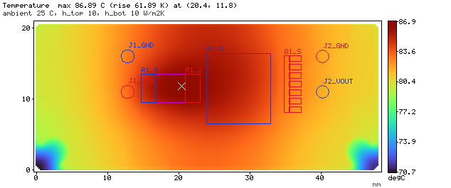

# 2026-10-24 PCB V0.1 草稿检查记录

> 后续变更：
>
> - 2026-10-31 投板前复查又修改了工程（网络命名、L3 禁止覆铜区、U1 阻焊，随后加 C4、改 J2 孔径），见 [2026-10-31 投板前复查](../2026-10-31-fab-check/README.md)。
> - 同日改为焊线版 V0.2，见[焊线版记录](../2026-10-31-wire-v0.2/README.md)。
>
> 本记录的结论、Gerber 与仿真对应 2026-10-24 版本。文中的 PCB 预览链接指向 2026-10-31 另存的 V0.1 渲染图，图上已含 10-31 的修改。

| 项目 | 内容 |
| --- | --- |
| 日期 | 2026-10-24 |
| 软件 | 嘉立创 EDA 专业版 `4.1.71.7a7261be`，命令行 `lceda-pro` 无界面会话；Gerber 检查、渲染与仿真用 Node 24 脚本（零依赖） |
| 工程版本 | PCB V0.1 草稿（四层，卧式 XT30PW 紧凑版，48 × 20.5 mm），原理图 V0.1 草稿；分支 `codex/chassis-softstart`，基于 `main` 的 `1cb5f2c`，记录时未提交 |
| 范围 | `pcb/缓启动PCB.epcb2` 的布局、布线、覆铜、丝印和制造输出检查；原理图中 R1、D1、D2、U1 的实例封装，以及 J1/J2 改为卧式 XT30PW；电流与温升仿真 |
| 输出 | 检查用 Gerber 在被 Git 忽略的 `outputs/v0.1-pcb-compact-2026-10-24/`（紧凑版，从仓库工程导出）；仿真用的是工程副本的导出，与该目录逐层几何一致。同日较早版本的输出（卧式非紧凑版 `outputs/v0.1-pcb-xt30pw-2026-10-24/`、竖装版 `outputs/v0.1-pcb-45deg-2026-10-24/` 等）只作历史参考 |

当天的 PCB 经过三版：竖装 XT30（45.5 × 25 mm）→ 卧式 XT30PW（48 × 27.5 mm）→ 紧凑布局（48 × 20.5 mm）。下文结果都针对最后一版，前两版只在说明改动原因时提到。

## 做法

1. **定方案**：先由三个子任务分别核对嘉立创四层工艺和叠层、器件封装与数据手册，并对标开源热插拔板和 TI 等厂家的布局说明。
2. **写计划**：布局和走线写成逐网计划文件，坐标单位 mm，原点在板左下角。计划先用离线脚本检查焊盘世界坐标、异网间距、板边距离、器件外形重叠、同网连通和悬空端点，再经编辑器 API 落图：
   - 器件按计划设置坐标与角度。
   - 走线逐段创建，过孔逐个创建，覆铜按多边形创建。
   - 没有调用 `autoRouting`、`autoLayout` 或任何寻路功能，也没有导出或导入自动布线文件。
3. **重开验证**：落图后保存，关闭会话再从磁盘重开，按优先级重铺全部覆铜，然后运行严格模式 DRC。
   - 第一版重开后焊盘网络丢失，原因是落图脚本里 `pcb_PrimitivePad.getAll()` 连器件焊盘也返回了，“删除自建焊盘”一步误删了它们；当时用“从原理图导入变更”恢复（器件位置不变），脚本已改为只删安装孔焊盘。
4. **导出复核**：导出 Gerber，用脚本核对以下几项并渲染各层：
   - 丝印到焊盘的间距；
   - 实测字高；
   - 铜到板边的距离；
   - 参考平面是否连续。
5. **改卧式 XT30**（用户要求“xt30 换成卧插”）：先确认没有打开的客户端窗口，把 `hardware/` 整个复制到临时目录，在副本上改：原理图原位换 J1/J2 → PCB 从原理图导入变更 → 按新计划落图 → 保存、重开、重铺、复核。副本核对无误后整体拷回仓库（拷回前确认仓库里的文件与改前备份逐字节相同），再从仓库工程重开复核，导出 Gerber、渲染图和原理图预览。
6. **压缩布局**（用户意见“layout 太不紧凑”）：先离线改计划、出新旧对比图，用户确认并关掉客户端窗口后，按第 5 步的方式在副本上落图、复核，再拷回仓库复核。

## 卧式 XT30 改版

### 选型

| 位号 | 型号 | 立创编号 | 库封装 | 说明（2026-10-24 查询） |
| --- | --- | --- | --- | --- |
| J1 | AMASS XT30PW-M30.G.Y 卧式公头 | C431092 | `CONN-TH_XT30PW-M` | 现货 1.5 万只以上，约 ¥2.35；库符号 1 脚“−”、2 脚“+”，3、4 脚为固定脚 |
| J2 | AMASS XT30PW-F30.G.Y 卧式母座 | C30170176 | `CONN-TH_XT30PW-F30.G.Y` | 现货约 5769 只，约 ¥2.02；库符号引脚无名。同系列 XT30PW-F20.G.Y（C2913282，现货 2.2 万只以上）的库封装孔位相同，可作替代 |

额定（厂家资料）：15 A、瞬时 30 A（公头规格书）、接触电阻 0.80 mΩ、−20～120 °C；母座按产品目录参数表为 15 A、0.80 mΩ。另一型号 XT30PW(2+2) 的规格书给出“15 A 通电 4 h 温升 < 60 °C”，只作参考。

### 尺寸核对

- **公头**：AMASS 规格书 XT30PW-M V1.2 给出本体长 9.00、含插针总长 13.95、宽 9.90（含固定耳 13.30）；安装孔 2-Φ1.7（插针，间距 5.00）+ 2-Φ1.0（固定脚，间距 11.00），两排相距 10.00。立创封装孔位一致，端面在固定脚前 3.05 mm（图纸没有标这个尺寸，按比例量得约 3.0）；孔径为 Φ1.8 / Φ1.1，比图纸大 0.1 mm。
- **母座**：AMASS 产品目录第 15 页两张 XT30PW 图纸的标题与 V1.2 规格书对调：
  - 目录把“总长 13.95、两排孔相距 10.00”的图标成 XT30PW-F，把“总长 14.90、带 6.00 插芯”的图标成 XT30PW-M。
  - 同一目录里 XT30U-F 带 6.00 的插芯、XT30U-M 没有；按这个规律，带插芯的是母头。
  - 立创 F30 封装的外形与带插芯的那张图一致：插芯 6.0、台肩到插针排 8.1、总长 14.85（图 14.90）、宽 9.9 / 13.5（图 9.90 / 13.30）。
  - 因此按 V1.2 规格书和立创封装采用，目录标题视为错误。母座孔 Φ1.7 / Φ1.0、两排相距 5.00（目录图上孔距数字看不清，取库封装）。

### 极性

- **库标注**：M30 符号标 1 脚“−”、2 脚“+”；同系列 M20 符号标 1 脚“+”、2 脚“−”，但 M20 封装与 M30 封装互为 180° 旋转，换算到同一个物理触点后两者一致。F30、F20 的符号引脚无名。
- **实拍图**：立创 C431092 的正面图是倒置拍摄（插针朝上）；按装板方向换算后，外壳倒角端对应 1 脚。
- **约定**：用户确认 XT30 外壳“方角端为 +”。超电功率板上已在车上使用的 XT30U-M/XT30UPB-F，按其网络名与封装丝印推断，也是方角端焊盘接正极。
- **结论**：J1 公头 2 脚为 +、1 脚为 −；J2 母座与公头插合时方角端相对，1 脚为 +。放到板上后两只连接器的 + 脚都在下排。**这是按图片、库封装和插合关系推定的，到货后要对照实物确认**：丝印 `IN+`、`OUT+` 一侧应是外壳方角端。
- 最初用一个描述有歧义的问题向用户确认，得到的“左边是正极”与上面的证据相反；改问“方角端还是倒角端为 +”后按上述结论执行。

### 连接器位置

- 卧式公头的插针离端面约 13 mm，母座插针离台肩约 8 mm；两只连接器的固定耳上下各伸出约 6.7 mm。板宽由此和功率链决定，板高至少要容下 13.5 mm 的固定耳。
- J1 端面伸出左板边 0.25 mm，J2 台肩伸出右板边 0.3 mm，母座 6 mm 插芯悬在板外。XT30 线端插头外壳高 5.2 mm，连接器中心高按图纸估算约 2.5 mm（待实物确认），外壳下沿会略低于板面，板边不能伸到插头下面；伸出量大于外形公差 ±0.2 mm。
- 固定脚（3、4 脚）为金属化孔，不接网络，只焊接固定；周围覆铜自动避让。连接器外形（含插针弯折段）下方不放器件，离线检查确认 0.2 mm 内没有其它焊盘。

### 原理图

- 原位删除旧件、放新件：依次试 4 个角度和是否镜像，取“+”“−”两脚正好落在原导线端点上、且两脚朝向电路一侧的一种（J1 需要镜像，J2 不需要），导线不动。
- 3、4 脚标为不连接。客户端 4.1.71 的 `sch_PrimitivePin.modify(..., { noConnected: true })` 会把引脚 Y 坐标取反，把引脚移到图纸外。试运行时在导出图上发现了这个问题（不连接标记出现在图纸左下方外侧），当时未保存。改为标记后立即把原坐标写回，重开后核对坐标和标记都正确。
- J1 的位号和型号放在符号上方，避开向下的地线；J2 的放在符号右侧。

## 紧凑布局

卧式版最初做成 48 × 27.5 mm：控制部分在功率链下方占了约 27 × 11 mm 且很稀疏，最下面约 4 mm 只有两个安装孔，Q1 上方的顶部空带也空着。用户看后认为不够紧凑，于是压成 48 × 20.5 mm（面积小 25%）：

- **功率链不动**：两只连接器、R1、Q1、C1、TP1/TP2 及其铜皮整体下移 7 mm，相对位置不变；D1、D2 仍在各自连接器 + 脚正下方。
- **控制带**：功率链下方约 6 mm 高的一条：
  - U1 紧贴 R1 下方，开尔文线竖直段由 3.5 mm 缩短到 2.8 mm；R2 放在 R1-1 与 U1 之间，UVLO 线从 U1-4/U1-5 上方绕到 U1-3。
  - GATE 与 OUT 以 0.6 mm 中心距成对贴着 Q1 下沿走到 R4（R4 在 Q1 栅极正下方）。
  - D3、C3、Q2、R5 排成一行，TP3 挂在 GATE 线下方。
- **测试点与指示灯**：TP4 移到顶部空带并直接在 VOUT 铜皮里；LED1/R6 竖排在 R4 与 D2 之间；TP6 在其下方，与 D2 阳极同在右下地铜；TP5 放在左下安装孔右侧。
- **PGD**：U1-8 经过孔走 L3，到 LED2 阴极下的过孔和 TP5 上方的过孔（共 3 个过孔）。
- **两处为参考地做的调整**（L2 上过孔避让孔半径实测约 0.56 mm）：
  - Q1 漏极下沿的 4 个 SENSE 过孔上移 0.15 mm，避让孔不再压到 OUT 线下方；
  - U1-8 旁的 PGD 过孔右下移，避开 PWR 线。

## 板框、叠层与规则

| 项目 | 内容 |
| --- | --- |
| 板框 | 48.0 × 20.5 mm，四角 R1.0；两个 Φ2.2 mm 非金属化安装孔在 (2.6, 2.6)、(45.4, 2.6)，孔周 Φ4.4 mm 内禁铜、禁线、禁铺铜。**外形、孔位和插拔空间是草稿，未与机械组确认** |
| 目标叠层 | 嘉立创 JLC04161H-7628（下单默认）：L1/L4 外层 1 oz（成品约 35 µm），L2/L3 内层 0.5 oz（约 15.2 µm）；L1–L2 PP 0.2104 mm，芯板 1.065 mm，L3–L4 PP 0.2104 mm。工程里没有设置物理叠层；本板没有阻抗受控网络，叠层只影响载流和散热，下单时按此选择 |
| 层分配（方案 X） | L1：全部器件、功率铜、控制信号；L2：整层 GND；L3：VIN/SENSE/VOUT 功率铜 + 其余 GND 填充 + PGD 跨线；L4：整层 GND |
| 规则 | 嘉立创多层板工艺预设，只把焊盘与覆铜的连接方式改为直连（贴片与通孔焊盘都是）；当前配置名为“自定义配置3”。没有关闭检查项或放宽间距 |
| 过孔 | 全部 0.3 / 0.6 mm 通孔，共 30 个：VIN 2、SENSE 12、VOUT 6、GND 7、PGD 3；嘉立创四层板默认塞孔，过孔都不在焊盘开窗内 |

## 布局与走线

- **功率链（参照 TI 手册图 45）**：从左到右排成一条线，J1 + 脚 → R1 → Q1 漏极 tab → Q1 源极 → J2 + 脚；D1、D2 在两端 + 脚正下方，C1 在 R1 输入端上方。
  - VIN、SENSE、VOUT 在 L1、L3 上各有一块铜皮，用过孔并联。
  - 回流走 L2、L4 两个整层地，以及 L3 的地填充。
- **开尔文取样**：从 R1 两个焊盘内缘向内 0.2 mm 处引出 0.2 mm 线，成对走到 U1-2（VIN）、U1-1（SENSE）；TP1、TP2 另从焊盘内缘单独引线到顶部。取样线不在铜皮多边形范围内，铜皮只在焊盘处与它相连。
  - 取样线约有 2 mm 在 R1 本体下方，处于阻焊下。
  - R1 规格书的结构图表明，这颗电阻是塑封包覆的合金本体，底面没有裸露金属。
  - 规格书示意的引线位置是焊盘内缘下角，与本板的引法等效。
- **U1 地岛（TI 手册图 47）**：C2（TIMER）、R3（PWR）的地在顶层用 0.4 mm 竖线汇到 U1-5/U1-4，只在 U1-5 旁用两个并排过孔接到地平面。C3 与 Q2 集电极紧挨着，合用一个地孔。
- **GATE 与 OUT 成对**：OUT 从 U1-9 焊盘内端引出，在器件体下转向，与 GATE 并行到 Q1 一侧，OUT 接在 Q1 源极铜皮上；10 Ω 的 R4 放在 Q1 栅极正下方。
- **dv/dt 单元**：D3 阴极经 45° 短线接 Q2 发射极，C3 的 DVDT 端接 D3 阴极，C3 地端贴 Q2 集电极；R5 紧接 Q2 基极，另一端挂在 GATE 通道上。
- **线宽**：取样线 0.2 mm；一般信号 0.25 mm；GATE 0.3 mm；R4 到 Q1 栅极 0.4 mm；地岛竖线 0.4 mm。
- **转角**：全部为 45°。在最终 Gerber 上只按走线线宽（0.2/0.25/0.3/0.4 mm）统计，覆铜轮廓线不计：
  - 顶层 51 段走线，0 个直角拐点、22 个 45° 转弯、3 个 T 形分支接点（R5、TP3 挂在 GATE 通道上，C2 接地岛竖线）；
  - L3 的 PGD 跨线 6 段，0 个直角、3 个 45° 转弯、1 个分支接点。
- **离线计划检查**：
  - 异网最小间距 0.2 mm，只出现在 U1 自身 0.5 mm 间距焊盘之间；与 U1 引脚相邻的走线 ≥ 0.225 mm；
  - 所有网络连通，无悬空端点；
  - 器件外形间距 ≥ 0.15 mm（XT30PW 按库封装的外形多边形计算）；连接器外形下及 0.2 mm 内没有其它焊盘。

## 封装修正

由封装子任务对照器件手册的推荐焊盘逐项核对，在原理图中修改实例的“封装”属性（库器件不变），再导入 PCB。J1、J2 用库器件自带的卧式封装，没有改。

| 位号 | 原封装 → 新封装 | 依据 |
| --- | --- | --- |
| R1 | `RES-SMD_L6.4-W3.2-R2512`（焊盘 2.0 × 3.3）→ `RES-SMD_L6.4-W3.2-JER2512XXXXXX`（2.1 × 4.0，间距 4.1） | 毫欧规格书 Ho-A0 推荐 A 4.0 × B 2.1、L 4.1，完全一致 |
| D1 | `SMA_L4.4-W2.8-LS5.4-RD`（2.05 × 1.62，间隙 3.08）→ `SMA_L4.5-W2.5-LS5.0-RD`（2.12 × 2.1，间隙 2.2，1 脚阴极） | Littelfuse：长 ≥ 2.10、宽 ≥ 1.80、间隙 ≤ 2.30 |
| D2 | `SMA_L4.4-W2.6-LS5.0-RD`（1.8 × 1.7，间隙 2.585）→ 同 D1 | Diodes DS30891 推荐 2.50 × 1.70、间隙 1.50；新封装更接近但仍不一致（见“已知问题”） |
| U1 | `VSSOP-10_L3.0-W3.0-P0.50-LS4.9-BL`（0.30 × 1.30，行距 4.70）→ `…-BL-1`（0.30 × 1.45，行距 4.40） | TI DGS0010A 推荐焊盘，完全一致；1 脚位置与编号不变 |

API 直接把封装属性改成系统库 UUID 时，导入 PCB 会把这 4 个器件删掉，而且客户端会立即写盘。当时用备份恢复了文件。最终的做法是：
1. 先临时放一个默认封装就是目标封装的器件（不进 BOM、不转 PCB），让目标封装进入工程缓存；
2. 把实例属性指向缓存里的封装；
3. 导入 PCB，确认 4 个器件的封装、位置和焊盘网络都正确；
4. 删除临时器件并保存。

从磁盘重开后，原理图和 PCB 都保持新封装。

## 覆铜

| 层 | 覆铜（优先级由高到低） |
| --- | --- |
| L1 | VIN（J1-2、D1-1、C1-1、R1-1 外侧、R2-1、R7-1）、SENSE（R1-2 外侧、Q1 漏极 tab）、VOUT（Q1 源极、J2-1、D2-1、R6-1、TP4）、GND 左上（J1-1、C1-2）、GND 右上（J2-2）、GND 左下（D1-2）、GND 右下（D2-2、TP6） |
| L2 | 整层 GND |
| L3 | VIN、SENSE、VOUT（与 L1 对应区域），其余为 GND 填充；J1、J2 的地脚在 GND 填充里 |
| L4 | 整层 GND |

三块整层地铜的边界距板边 0.5 mm、四角倒角。嘉立创铣边铜距要求 ≥ 0.2 mm，外形公差 ±0.2 mm；最初铺到板边规则距离（约 0.256 mm），余量太小，因此改为 0.5 mm。13 块覆铜都在重开后实际填充，按 Gerber 渲染逐层检查过（[四层铜](../../../images/pcb-layers-v0.1-2026-10-31.png)）。

## 丝印

做法与[超级电容组](../../../../supercap-bank/docs/design.md)、[日志板](../../../../serialleg-logger/docs/reviews/2026-10-16-silk-usb/README.md)一致。

- **位号**：全部移到顶层装配层（不印）。
- **封装外框**：库封装自带的丝印外框离自身焊盘只有约 0.02–0.12 mm，达不到嘉立创 ≥ 0.15 mm 的要求；XT30PW 的库丝印还会画到板边以外。在 PCB 文件里给全部 26 个器件实例加了 `"layerIdReplacements":{"3":9}`，把封装丝印映射到顶层装配层；格式与日志板 C6/C10 相同，客户端重开读回正常。
- **顶层文字**：`IN+`/`IN-` 在 J1 下方/上方，`OUT+`/`OUT-` 在 J2 下方/上方（+ 脚在下排）；测试点功能名 `VIN`（TP1 左）、`SNS`（TP2 右）、`VOUT`（TP4 左）、`GATE`（TP3 上方）、`PGD`（TP5 右侧）、`GND`（TP6 左侧）。
- **自绘标记**：D1、D2、D3、LED1、LED2 的阴极条，U1 的 1 脚点。
- **底面文字**：`3SE CHASSIS SOFTSTART`、`LM5069 V0.1 2026-10`，放在两排 SENSE 过孔之间。客户端会自动镜像底层文字，所以 API 里要设 `mirror: false`；第一次设成 `true` 后，从底面看是反字，已改正。
- **字号与线宽**：1.5 mm 字号、0.18 mm 线宽；Gerber 实测字高 1.046 mm，满足 ≥ 1.0 mm、线宽 ≥ 0.153 mm。

## 验证结果

以下为紧凑版，在仓库工程从磁盘重开后复核。

| 检查 | 结果 |
| --- | --- |
| 原生 DRC（严格模式） | 重铺 13 块覆铜后 **0 项**；没有关闭检查或放宽规则 |
| 重开读回 | 26 个器件、67 个焊盘（含 J1/J2 的 4 个固定脚和 Q1-8 源极条），空网络焊盘 4 个、正是 4 个固定脚；走线段 57（计划 53 段，客户端在 T 形接点处拆段）、过孔 30、覆铜 13（全部有填充）、禁布区 2、安装孔 2、丝印文字 12、顶层丝印标记 6 |
| 原理图 | 严格模式 0 错误；4 条 `ATTRMATCHCODE` 警告，对应 R1、D1、D2、U1，原因是实例封装与库器件默认封装不同（日志板也保留了同类警告）；J1/J2 的 3、4 脚标为不连接，没有产生未连接告警；压缩布局没有改原理图文件 |
| 网表 | 原理图导出网表与连接计划一致（14 个网络、62 个引脚；J1-2 在 VIN、J1-1 在 GND）；PCB 焊盘网络与原理图逐脚比对 62/62，差异 0；4 个固定脚在两边都不属于任何网络 |
| 丝印（Gerber） | 丝印到铜焊盘：顶面最小 0.21 mm、底面 0.346 mm；丝印与阻焊开窗不重叠，顶面到开窗最小 0.159 mm，到板框最小 0.465 mm；文字字高 1.046 mm、线宽 0.18 mm |
| 铜到板边（Gerber） | 四层都 ≥ 0.50 mm（L1 最近处为下沿的 TP6 焊盘，L2–L4 为整层地边界） |
| 参考平面 | 沿 23 条信号走线每 0.05 mm 采样（2179 点），检查线宽两侧各 0.2 mm 内相邻地层是否有铜：缺铜 168 点，都在 PGD 自身过孔的避让孔处 |
| 导出一致性 | 仓库工程导出的 Gerber 与工程副本的导出逐层比较几何一致；钻孔文件除注释行外相同 |
| 渲染 | 由 Gerber 渲染[顶面](../../../images/pcb-top-v0.1-2026-10-31.png)、[底面](../../../images/pcb-bottom-v0.1-2026-10-31.png)、[四层铜](../../../images/pcb-layers-v0.1-2026-10-31.png)（链接为 10-31 另存的 V0.1 图，含 10-31 的修改） |

## 电流与温升仿真

完整输入、假设和结果见 [simulation.md](simulation.md)。以下都是**模型计算**，不是实测。

**工具**：子任务编写的二维直流电流分布 + 稳态导热耦合计算（零依赖 Node 脚本，未入库）。
- 用铜条电阻、过孔排、肋片导热和电热耦合的解析解验证过：0.05 mm 网格下铜条电阻误差 ≤ 0.27%，过孔排 −0.11%。
- 正式计算用 0.05 mm 网格；网格收敛见 simulation.md 3.8 节。

**输入**：紧凑版的最终 Gerber（与 `outputs/v0.1-pcb-compact-2026-10-24/` 几何一致）。端子取 J1、J2 插针孔（各层等电位）、R1 两焊盘、Q1 漏极 tab 与源极脚。

**假设**：
- 环境 25 °C，两面换热 h = 10 W/m²K（自然对流）或 14（计入辐射）。
- 不计连接器导线带走的热，结果偏保守；也不计连接器自身接触电阻的发热（15 A 时 4 个触点合计约 0.7 W）。
- R1 取 2 mΩ；Q1 Rds(on) 取 1.56 mΩ（手册 25 °C 最大 1.2 mΩ × 1.3，约 70 °C）和 1.92 mΩ（× 1.6，约 125 °C）。
- 表中是板面温度。Q1 的 RθJC 为 0.35 °C/W，结温只比漏极 tab 高约 0.15 K。

| 工况（方案 X） | 铜损 W | R1 + Q1 W | 板面最高 °C（h = 10） | 板面最高 °C（h = 14） |
| --- | --- | --- | --- | --- |
| 10 A 持续 | 0.13 | 0.36–0.39 | 52–54 | 45–46 |
| 15 A 持续 | 0.31–0.33 | 0.80–0.88 | 87–91 | 70–73 |
| 15 A，内层改 1 oz | 0.24–0.26 | 同上 | 82–86 | 66–69 |
| 15 A，外层改 2 oz | 0.18–0.19 | 同上 | 78–82 | 63–66 |

- **铜等效电阻**（25 °C，不含 R1/Q1）：VIN 0.14、SENSE 0.09、VOUT 0.19、GND 回流 0.77 mΩ，合计 1.19 mΩ；10 A 时铜上压降约 12 mV。
- **与 48 × 27.5 mm 版对比**（同一套工况，见 simulation.md 3.7 节）：
  - 功率链相对位置不变，铜电阻合计由 1.12 升到 1.19 mΩ，主要是地回流（L3 地填充变窄）；
  - 板面积小 25%，同样的发热散到更小的面积上，15 A、h = 10 时板面最高温由 72–75 °C 升到 87–91 °C，10 A 时由 45–47 °C 升到 52–54 °C；
  - 15 A 时略高于最早的竖装版（45.5 × 25 mm，83–87 °C）。
- **电流密度**：
  - 15 A 时，L1 上 99.9% 的铜低于 126 A/mm²。
  - 最大值 168 A/mm² 出现在 J1 + 脚焊盘朝 R1 的一侧，是电流从插针收拢到 R1-1 处的尖角值，网格加密会变大；温度图上那里不热。
  - 限流 31 A 时 P99.9 约 260 A/mm²，只持续约 9 ms 以内。
  - 见 [L1 电流密度图](../../../images/sim-x-15a-current-l1.png)。
- **过孔与插针**：
  - 15 A 时单孔最大约 0.76 A（R1-1 外侧上角的 VIN 孔），VOUT 孔最大约 0.53 A；31 A 时分别约 1.58、1.09 A。
  - 15 A 时 J1 + 脚的电流约 13.8 A 进 L1、1.2 A 进 L3；地脚的回流约 9.6 A 来自 L4、4.1 A 来自 L2、1.3 A 来自 L3。
- **叠层**：功率铜放 L3 还是 L4，在竖装版上比较过（温度差 < 0.1 K，放 L3 时回流电阻更低、单孔电流更小），后两版沿用方案 X，没有重算方案 Y。
- **结论（计算）**：
  - 按电管 Chassis 口持续 10 A，板面约 52–54 °C，余量充足。
  - 持续 15 A 时，只算自然对流，板面约 87–91 °C；器件仍在额定内：R1 在 91 °C 时降额后约 2.4 W，实际 0.45 W；Q1 远低于 175 °C。限制在 XT30 的 15 A 标称和没有计入的连接器接触发热。
  - 需要长时间 15 A 时，可改外层 2 oz（约降 9 K），或加大板面、加强散热，再由实测确认。
  - 全板平均温升约等于总发热 ÷（2h × 板面积），紧凑以后这一项是温度上升的主要原因。

## 已知问题与例外

- **板框与安装孔**：48 × 20.5 mm 和 2 × Φ2.2 mm 孔是草稿，安装位置、外形、卧式插头的插拔空间和线束弯折方向都没有与机械组确认；没有做 3D 检查。
- **紧凑后的温升**：持续 15 A 时板面约 87–91 °C（计算），比 48 × 27.5 mm 版高约 15 K；按 10 A 使用时约 52–54 °C。
- **XT30PW 极性**：J1 2 脚、J2 1 脚为 + 是按库封装、立创实拍图、“方角端为 +”和插合关系推定的，到货后要对照实物确认。
- **J1 孔径**：库封装 Φ1.8 / Φ1.1，比 AMASS 规格书的 Φ1.7 / Φ1.0 大 0.1 mm，插针焊接余量足够，但固定可能略松，待实物确认；J2 与图纸一致。
- **AMASS 目录图纸**：XT30PW-F 与 XT30PW-M 两张图的标题与 V1.2 规格书对调，按规格书和立创封装采用（见上文“尺寸核对”）。
- **XT30 额定电流**：厂家资料标 15 A，持续 15 A 时连接器本身已到上限（仿真没有计入连接器接触电阻发热）。
- **D2 封装**：只满足 Littelfuse 的推荐，与 Diodes B360A 推荐焊盘（2.50 × 1.70、间隙 1.50）仍差：焊盘内侧短约 0.35 mm。系统库里没有完全一致的封装，是否自建待定。
- **U1 新封装的阻焊外扩**：1–5 脚为 0.015 mm，6–10 脚跟随规则（约 0.05 mm），两排不一致；影响很小，未改。
- **Q1 漏极 tab 钢网**：开口为 100%，SMT 贴装前应分块，开口率约 40–60%。本次未改，投板贴片前必须处理。
- **焊接**：焊盘与覆铜直连，包括 XT30 插针连到 VIN/VOUT 铜皮和整层地。手焊 XT30 需要大功率烙铁或预热台；固定脚不接铜，好焊。
- **源极旁陶瓷电容**：对标资料（TPS24770）建议在 Q1 源极旁加一颗，本板 BOM 没有，是否增加待定。
- **PGD 跨层**：PGD 经三个过孔走 L3 到 LED2 和 TP5，代价是 L2/L4 上三个小避让孔。
- **原理图警告**：保留 4 条 `ATTRMATCHCODE` 警告（见上表）。

## 未执行

- 没有自动布线、自动布局、下单、改远端或 Git 提交。
- 没有 3D/机械装配检查，没有核对 XT30PW 实物，没有审阅装配层导出，没有生成生产包（坐标、BOM、钢网）。
- 仿真是模型计算，不是实测；样板实测按[设计说明](../../design.md)第 7 节进行。
