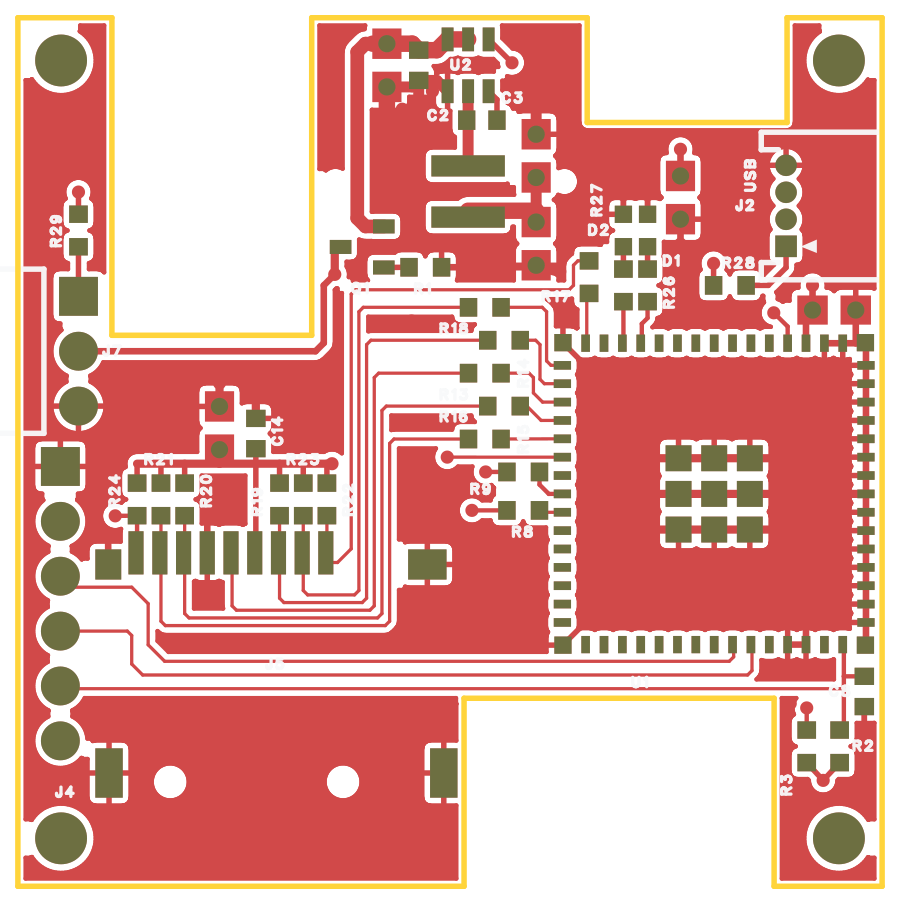

# SerialLeg 日志板

通过 USB 接收 DM-MC02 的日志，由 ESP32-S3 缓冲后写入 microSD。日志板从底面 J1 直插达妙 P16 取 5 V；当前原理图已由用户简化为 USB 数据链路，不再使用 UART 日志输入、VBUS 供电开关或主电源检测联锁。

**当前状态：v2 设计中（2026-10-29）。** 首块样板（2026-10-16 版，硬件提交 `80ef1d9`）已焊接并完成 USB 联调。v2 的各轮修改均未提交：

- 第一轮：给 J2 VBUS 加 R28（1 kΩ 接 3V3）偏置，删除 U5（USB ESD）、C9 与 SW1/SW2，D+/D− 在 PCB 上直连。
- 第二、三轮：J2 由 USB-A 改为线缆口，先用 XH2.54 4P，因偏大最终改为 MX1.25 4P 卧式通孔座（Molex 53048-0410），配外购 Type-C 转 MX1.25 线并在机身扎带做应力释放；在 DM P6 处开 U 形缺口、加凸台，用 Samtec BCS-103-L-S-TE 排母穿过缺口直插 P6，经 J7 直角排针引出 DBUS 给接收机。
- v2c（2026-10-29）：J6 需要弯尾脚，而且难买，因此取消 J6。接收机仍插 J7，S 经 R29（1 kΩ）接 J1.15，即 DM P16 的 UART8_RX（PE0）；J7 的 5V 改取本板 5V_IN；P6 不再连接，缺口只用于避让针尖。主控固件需改用 UART8（100000、8E2、RX 反相）。见 [v2c 记录](docs/reviews/2026-10-29-v2c-uart8/README.md)。
- **v2e（2026-10-29，当前）**：板形改为与达妙扩展板相同的 40 × 40 mm 外形，四角 M2 孔对准 DM，三个缺口避让 UART7、CAN3/UART10 立式座和 PWM/P6；取消托架卡扣。全板重新布局、人工规划坐标重新布线（无自动布线）。J7 改卧式直角排针，放在左边 J4 上方，针朝板外；L3 由 GND 改为 3V3 平面。原理图 ERC 0 错误，网表与 PCB 一致，覆铜重建后原生 DRC 0 项，检查用 Gerber 已逐层核对。见 [v2e 记录](docs/reviews/2026-10-29-v2e-dm-shape/README.md)。

v2c 之前曾做过布局紧凑化（面积 1540.5 → 1232.2 mm²），见 [v2b Gerber 检查](docs/reviews/2026-10-29-v2b-gerber-check/README.md) 和 [v2c 记录](docs/reviews/2026-10-29-v2c-uart8/README.md)；这些记录里的板形、布局和走线已被 v2e 取代。尚未投板。线缆线序与 M2 支撑高度待实物确认，见 [v2 改版记录](docs/reviews/2026-10-27-v2-changes/README.md) 与 [USB 联调记录](docs/reviews/2026-10-27-usb-bringup/README.md)。下文 2026-10-16 的布线、阻抗、丝印与 Gerber 检查对应 v1，只作历史追溯。

| 项目 | 当前内容 |
| --- | --- |
| 板子 ID | serialleg-logger |
| 维护入口 | [SerialLegLogger.eprj3](hardware/SerialLegLogger.eprj3)；必须连同 hardware 目录中的完整工程保存 |
| 主控 / 存储 | ESP32-S3-MINI-1-N4R2 / microSD，4-bit SDMMC |
| 器件 / 连接线 / 电气过孔 | v2e：42 / 292 / 65（v2c：42 / 353 / 86；v1：43 / 356 / 108）；另有四个 Ø2.4 mm M2 孔、J1 的两个 Ø0.65 mm 定位孔及 J5 的两个 Ø1.00 mm 定位孔 |
| L1 | Coilcraft XAL4030-472MEC，4.7 µH，名义 4 × 4 mm、高度最大 3.1 mm；已使用配套焊盘封装 |
| 板框外接尺寸 / 实际面积 | v2e：40.0 × 40.2 mm / 1302.3 mm²，达妙扩展板外形，三个缺口（v2c 为 37.57 × 40.65 mm / 1232.2 mm²，v1 为 46.60 × 44.35 mm / 1486.9 mm²）；不含 J7 针脚、U1 天线及插头外伸 |
| 层叠 | 四层，标称 1.6 mm，目标 JLC04161H-3313；v2e 起 L2 为连续 GND 平面，L3 为 3V3 平面（此前两层均为 GND），顶底空余区填 GND。阻抗待板厂确认 |
| 固定方式 | v2e：P16 直插，加四角 M2 螺丝（Ø2.4 mm NPTH，对准 DM 的 M2 孔），不再用托架卡扣；铜柱长度按 7.5 mm 叠高待实物确认。J1 仍保留两个定位孔 |
| ERC / DRC | v2e：ERC 0 错误、1 组 ATTRMATCHCODE 属性警告（U1、L1，v1 已有）；四层覆铜重建后原生 DRC 0 项（含 USB 差分等长） |
| 网表 | v2e 原理图与 PCB 146 个引脚、35 个连接组一致 |
| 软件版本 | 嘉立创 EDA 专业版 4.1.71.7a7261be |
| 板载固件 | [firmware/](firmware/README.md) v0.2.0（只在遥控使能时记录，配合主控新增的多类遥测帧），ESP-IDF v5.2；已编译和主机测试，未烧录。v0.1.0 已在样板上接 DM-MC02 记录（需 J2 VBUS 偏置飞线） |

## 当前接口

| 接口 | 连接和用途 |
| --- | --- |
| J1：1、3、5、7 | GND |
| J1：4、6 | 5V_IN，来自达妙 P16 对外 5 V；板内由 U2 转换为 3.3 V |
| J1：15 | UART8_RX，经 R29 接 J7.1（接收机 DBUS）；对应 DM P16 的 UART8_RX（PE0），DM 侧另串 R97，这一路没有硬件反相 |
| J1：2 及其余引脚 | NC；2 脚对应达妙原始 VCC_IN，但本日志板不使用 |
| J2：MX1.25 4P 卧式（Molex 53048-0410，C588275） | 1 VBUS_BIAS、2 USB_DM、3 USB_DP、4 GND。D+/D− 经 R8/R9 22 Ω 直连 U1，无 ESD 器件；VBUS 经 R28（1 kΩ）接 3V3，只为 DM-MC02 的 USB ESD 器件 U7 提供偏置，不向主控供电。v2e 位于右上角，插口朝右板边，USB 走底层（参考 L3）直接进通孔脚；配外购 Type-C 公头转 MX1.25 4P 线，**线色与线序待到货实测确认**；线缆扎到机架作应力释放。无 ESD，插拔前先断电 |
| J7：DBUS 卧式直角排针（PZ254R-11-03P，C492411） | v2e 位于左边 J4 上方，针尖朝 −x 伸出左板边，接接收机杜邦头；1 S（DBUS_S，经 R29 1 kΩ 到 J1.15 UART8_RX）、2 5V（本板 5V_IN，即 P16 对外 5 V）、3 GND。DBUS 是反相 S.BUS 信号，主控 UART8 要开 RX 反相 |
| R29：1 kΩ 0603（C21190） | J7.1 → J1.15 的串联限流电阻，位于左上角 M2 孔下方的角块内 |
| 缺口 | v2e：N1 避让 UART7、N2 避让 CAN3/UART10、N3 避让 PWM 与 P6；P6 不连接 |
| J4：1～6 | GND、3V3、PROG_TX、PROG_RX、EN、BOOT；3.3 V TTL 下载，3V3 仅作参考，不并联下载器电源 |
| J5 | microSD；C14 靠近卡座电源脚，C13 位于 SD 供电分支 |
| 按键 | v2 无板载按键；复位与下载模式由接在 J4 的下载器控制 EN/BOOT。v1 的 SW1/SW2 已删除 |
| D1 / D2 | 记录 / 错误指示，含义见[固件说明](firmware/README.md#指示灯与按键) |

原“不接 VBUS”方案依赖双方独立供电和主控关闭 VBUS 感知。2026-10-26 样板实测这还不够：DM-MC02 的 U7 由 USB-VBUS 供电，VBUS 悬空时复位后 D+ 恢复异常，必须给 J2 VBUS 一个偏置。偏置后枚举和持续记录正常；插拔重连、长时间写卡仍待测。v1 样板上的 U5 还曾使 D+/D− 漏到约 4.2 V，拆除后恢复，因此 v2 去掉了 ESD 器件。

| SD 信号 | GPIO | U1 焊盘 | 串阻 |
| --- | --- | --- | --- |
| CLK | 14 | 18 | R13 |
| CMD | 13 | 17 | R14 |
| D0 | 15 | 19 | R15 |
| D1 | 16 | 20 | R16 |
| D2 | 11 | 15 | R17 |
| D3 | 12 | 16 | R18 |
| CD | 17 | 21 | 无，R24 上拉 |

## 当前布线与下一步

v2e：[原理图](images/schematic-v2e-2026-10-29.png) · [Gerber 底面](images/gerber-bottom-v2e-2026-10-29.svg) · [整机 3D 复核](images/dm-fit-v2e-2026-10-30.svg) · [装配模拟（重布前）](images/dm-fit-sim-2026-10-29.svg) · [外形方案](images/dm-shape-proposal-2026-10-29.svg) · [检查数据](docs/reviews/2026-10-29-v2e-dm-shape/verification.json)。[布局草案](images/dm-shape-placement-plan-2026-10-29.svg) 是重布前的规划图，与最终位置不完全一致。

- SD 全部走顶层（参考 L2），相对 CLK 的最大长度差 29.4 mil；USB 走底层（参考 L3），两线长度差 0.1 mil。
- PROG_TX/RX、EN 走顶层，BOOT、UART8、SD_CD_N 走底层，长度和路径见 [v2e 记录](docs/reviews/2026-10-29-v2e-dm-shape/README.md)。
- 31 个缝合地过孔；119 个小禁布区去除窄于 8 mil 的覆铜碎条，四层无悬浮铜。
- 接插件泪滴：用户用原生工具给 J4.3～J4.6、J7.1、J7.2、J2.1～J2.3 加了 9 个泪滴（2026-11-04）。复查结果：DRC 0，到异网铜最小 11.8 mil，无碎铜。J1.15 与 J5 贴片脚未加。
- 检查用 Gerber 在 `outputs/2026-10-29-v2e-gerber/`（不入库，不是生产发布）。
- 2026-10-30 用达妙 STEP 对成品做了整机干涉复核。PWM 排针离 N3 边只有约 0.5 mm，已把 N3 朝 PWM 的两边各外扩 0.5 mm；其余各项的余量见 [v2e 记录](docs/reviews/2026-10-29-v2e-dm-shape/README.md#整机-3d-复核2026-10-30)。

**v2e 下一步**：
- 机械：STEP 复核已通过，仍需实物确认 J1/P16 实际叠高与 M2 铜柱长度、PWM 舵机插头与 N2 缺口的实插余量、J7/J2/U1 天线伸出部分与机架和线缆的关系；
- 板厂：按 L3 = 3V3 的叠层确认阻抗；
- 投板：提交源工程，从该提交重新导出生产文件并打投板标签；
- 主控固件：遥控接收改到 UART8（100000、8E2、RX 反相）；
- 其余沿用 v2c 的待办：PE0 是否 5 V 容忍、接收机 DBUS 电平、J2 外形核对、线缆线序、日志板固件取消 BOOT 长按。

以下为 v2c 及更早的图片和说明，板形、布局与走线均已被 v2e 取代，只作追溯：[v2b 画布](images/pcb-v2b-2026-10-28-canvas.png) · [v2c 原理图](images/schematic-v2c-2026-10-29.png) · [v2c Gerber 顶面](images/gerber-top-v2c-2026-10-29.svg) · [v2c Gerber 底面](images/gerber-bottom-v2c-2026-10-29.svg)；[v2b 原理图](images/schematic-v2b-2026-10-28.png) · [紧凑化规划](images/compact-plan-v2b-2026-10-28.svg) · [降压电路上移](images/buck-compact-v2b-2026-10-28.svg) · [J2 内移](images/j2-inward-v2b-2026-10-29.svg) · [DBUS 缺口与凸台](images/dbus-notch-v2b-2026-10-28.svg) · [J2 MX1.25 区](images/j2-mx125-v2b-2026-10-28.svg) · [v2 检查数据](docs/reviews/2026-10-27-v2-changes/verification.json) · [Gerber 顶面](images/gerber-top-v2b-2026-10-29.svg) · [Gerber 底面](images/gerber-bottom-v2b-2026-10-29.svg)。第一轮图片 [原理图](images/schematic-v2-2026-10-27.png)、[画布](images/pcb-v2-2026-10-27-canvas.png)、[J2 泪滴](images/usb-teardrop-v2-2026-10-27.svg) 对应 2026-10-27 的 USB-A 版本，已过期。

下列 2026-10-16 的说明对应 v1，v2e 已重做板形、布局和全部走线，仅作历史追溯。

v1 预览：[顶面](images/pcb-silk-usb-2026-10-16-top.png) · [底面](images/pcb-silk-usb-2026-10-16-bottom.png) · [丝印间距](images/silk-clearance-2026-10-16.png) · [USB 短段](images/usb-conn-2026-10-16.png) · [v1 检查数据](docs/reviews/2026-10-16-silk-usb/verification.json)

- J1 保持底层插接方向；J5 已移出 UART10 插拔通道，板框为 CAN3、UART7、UART10、PWM、SBUS 等接口留出避让。
- 保留用户可复用的走线。已检查 26 个非电源网络，将 SD_D2、SD_CLK_MCU、SD_CMD、SD_D3、BOOT 的五处焊盘外急转角改为 45° 过渡。SD 的 CLK/CMD/D0～D3 仍全部走顶层、无信号过孔，参考 L2；相对 CLK 的最大长度差约 42.45 mil，低于 50 mil 目标。
- USB 主通道走底层、参考 L3，每根线两次换层并有邻近地过孔。主网络长度差约 5.93 mil；计入 MCU 至串阻段后约 9.19 mil（0.233 mm）。
- 四层地铜均已实际填充；L2/L3 各为一个连续主地铜区域。顶层 9 个、底层 4 个平面内分区均接到地过孔或接地通孔，没有悬浮地铜。USB 和 SD 的铜线宽度投影均有连续参考地，信号自身过孔与连接器通孔的局部避空除外。
- 前轮增加的 36 个 GND 过孔保持不变，成孔 0.3048 mm、焊盘直径 0.6096 mm；集中在接口、USB 两侧、板边及模组周边。四层天线禁布区和卡扣元件禁布区保持不变，最新 Gerber 中天线禁布区无铜重叠。
- Buck 已整理高频地回路、开关节点和输出电容反馈取样；C13 移开卡座信号出口，C6 下移 0.254 mm，消除相邻丝印压焊盘。接口、U1、板框和托架接触禁布区保持原位。
- SD 主线宽 6 mil，USB 主通道宽 6 mil、耦合段间隙约 6 mil。USB_DP_CONN / USB_DM_CONN 各长 2.855493 mm，本轮由 10 mil 改为 8 mil，并调整其两个顶层覆铜避让区；间距较大的短段按包含中间/外侧地铜的截面模型估算约 87～88 Ω。原主通道与 SD 路径、线宽及参考层未变，此前均匀截面估算分别约 88.6～89.9 Ω、50.9～51.7 Ω。**上述均为估算，投板前仍须按目标 JLC04161H-3313 与板厂确认实际介质厚度、铜厚、阻焊和阻抗条件。**
- J1 定位孔按用户新图为 2×Ø0.65 mm NPTH、孔距 10.60 mm，位于 PIN1 排侧；图纸 +0.05/0 mm 成孔公差需与板厂确认。四层孔到铜距离最小约 0.2565 mm。旧无孔封装和旧 Ø0.70 mm 孔记录均不作为当前依据。
- R9、C3、R2 与 J1 PIN1 文字已移开；U1 邻近 C6/C10 的封装轮廓映射到装配层，顶层另保留独立位号文字，后续移动这两颗器件时需同时移动文字。最终 Gerber 检查：顶面丝印至铜焊盘最小约 0.1530 mm，底面约 0.3708 mm，均不小于 0.15 mm；没有丝印压住阻焊开窗。
- 已预留三组托面/卡扣元件禁布区。**旧 R0.5/R0.6 托架 STEP/STL 不适用于当前板框，需重新适配。** 准确公座料号、7.5 mm 名义叠高、插头包胶及线缆弯曲空间仍需实物试配。
- 2026-10-26 用户反馈样板已焊接并上电成功；实际投板所用的提交和生产文件待确认，因此尚未打投板标签。
- 首版无线关闭。[板载固件 v0.1.0](firmware/README.md)：USB 主机读取 DM-MC02 CDC 虚拟串口，原始字节写入 `LOGnnnnn.BIN`，同名 TXT 记录统计。2026-10-26～27 样板上已确认 PSRAM、卡检测极性（插卡为低）、SD 4 线 20 MHz 挂载，以及 J2 VBUS 加偏置后的 USB 枚举和 100 Hz 持续记录（CRC 错误与缓冲丢弃均为 0），过程见 [USB 联调记录](docs/reviews/2026-10-27-usb-bringup/README.md)。
- v1 样板发现的 VBUS 偏置与 U5 问题已在 v2 设计中处理（见上）。插拔重连、拔卡/掉电文件完整性、长时间写卡、对外 5 V 共享负载和温升仍待测试。
- 当前 Gerber 仅为本轮检查导出，保存在临时 outputs 中，不是生产发布。完成机械试配、板厂工艺确认及固件准备后再整理正式制造资料。

## 历史资料

下列资料保留追溯用途，旧尺寸、布线、供电联锁、GPIO 以外的接口说明和验证结果不能用于证明当前工程：

- [2026-10-15 删除 J1 定位孔](docs/reviews/2026-10-15-j1-no-post/README.md)
- [2026-10-15 布局与布线准备](docs/reviews/2026-10-15-placement/README.md)
- [R0.6 SD 布线检查](docs/reviews/2026-10-12-sd-r06/README.md)
- [R0.5 绝缘托架](mechanical/clip-mount/README.md)、[R0.4 接口避让](docs/reviews/2026-10-12-access-r04/README.md)
- [历史制造及首板测试说明](docs/manufacturing-and-bringup.md)、[历史设计说明](docs/design-notes.txt)

本轮没有自动布线、computer use、采购、生产发布或 Git 提交。
