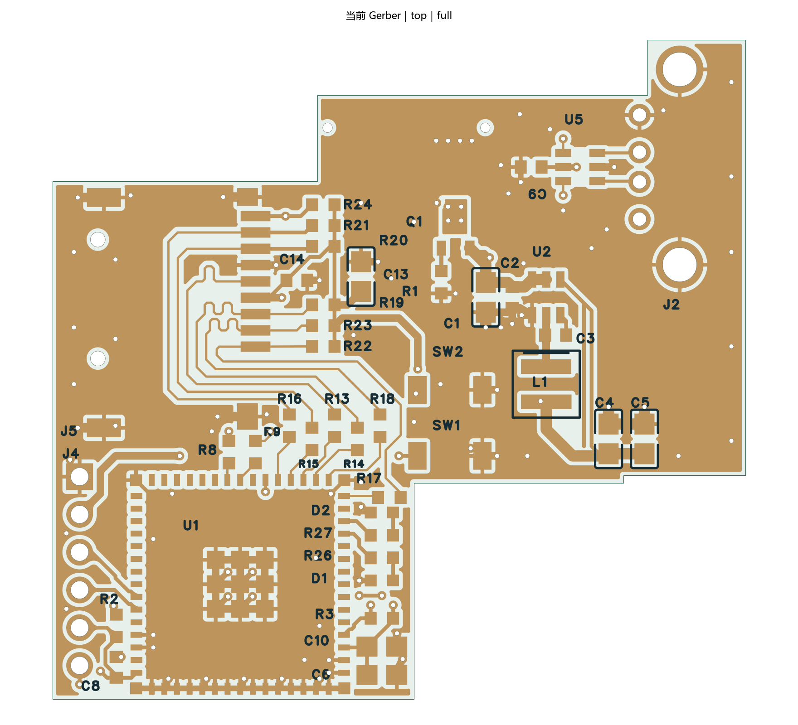

# SerialLeg 日志板

通过 USB 接收 DM-MC02 的日志，由 ESP32-S3 缓冲后写入 microSD。日志板从底面 J1 直插达妙 P16 取 5 V；当前原理图已由用户简化为 USB 数据链路，不再使用 UART 日志输入、VBUS 供电开关或主电源检测联锁。

**当前状态：2026-10-16 已修正丝印间距和 USB 插座侧短线。** R9、C3、R2 等局部丝印已避开焊盘至少 0.15 mm；USB_DP_CONN / USB_DM_CONN 改为 8 mil 并扩大顶层覆铜避让，当前目标层叠下截面估算约 87～88 Ω。重填覆铜、保存重开后原生 DRC 为 0 项，195 项引脚网络与原理图一致。J1 两个 Ø0.65 mm NPTH 和用户已完成的 U5 内部贯通接法保留；未投板、未实测。最新结果见[丝印与 USB 短线检查](docs/reviews/2026-10-16-silk-usb/README.md)；[定位孔记录](docs/reviews/2026-10-16-j1-posts/README.md)、[转角检查](docs/reviews/2026-10-16-corners/README.md)与[补铜阻抗检查](docs/reviews/2026-10-16-gnd-pour/README.md)保留为相应版本的依据。

| 项目 | 当前内容 |
| --- | --- |
| 板子 ID | serialleg-logger |
| 维护入口 | [SerialLegLogger.eprj3](hardware/SerialLegLogger.eprj3)；必须连同 hardware 目录中的完整工程保存 |
| 主控 / 存储 | ESP32-S3-MINI-1-N4R2 / microSD，4-bit SDMMC |
| 器件 / 连接线 / 电气过孔 | 43 / 356 / 108；另有 J1 的两个 Ø0.65 mm 定位孔及 J5 的两个 Ø1.00 mm 定位孔 |
| L1 | Coilcraft XAL4030-472MEC，4.7 µH，名义 4 × 4 mm、高度最大 3.1 mm；已使用配套焊盘封装 |
| 板框外接尺寸 / 实际面积 | 46.60 × 44.35 mm / 1486.9 mm²；不含器件及插头外伸 |
| 层叠 | 四层，标称 1.6 mm，目标 JLC04161H-3313；L2/L3 为连续 GND 参考面，顶底空余区也已填 GND |
| 固定方式 | P16 直插＋绝缘卡扣托架；没有安装支臂或螺丝孔；J1 保留匹配塑料定位柱的两个非金属化孔 |
| ERC / DRC | 本次 ERC 0 错误、1 组 ATTRMATCHCODE 属性警告（涉及 U1、L1）；丝印和 USB 短线修改、重填铜及保存重开后原生 DRC 0 项 |
| 网表 | 与当前原理图引脚和网络一致；本轮未改变电气连接关系 |
| 软件版本 | 嘉立创 EDA 专业版 4.1.71.7a7261be |

## 当前接口

| 接口 | 连接和用途 |
| --- | --- |
| J1：1、3、5、7 | GND |
| J1：4、6 | 5V_IN，来自达妙 P16 对外 5 V；板内由 U2 转换为 3.3 V |
| J1：2 及其余引脚 | NC；2 脚对应达妙原始 VCC_IN，但本日志板不使用 |
| J2：USB-A | 仅 D+、D−、GND；VBUS 引脚 NC，不向达妙供 USB 电源 |
| U5 | USB 数据线静电保护；1↔6、3↔4 由芯片内部贯通，PCB 不再跨接；5 脚由本地 5 V 偏置 |
| J4：1～6 | GND、3V3、PROG_TX、PROG_RX、EN、BOOT；3.3 V TTL 下载，3V3 仅作参考，不并联下载器电源 |
| J5 | microSD；C14 靠近卡座电源脚，C13 位于 SD 供电分支 |
| SW1 / SW2 | 复位 / BOOT |
| D1 / D2 | 记录 / 错误指示，行为待固件实现 |

不接 VBUS 的 USB 仅针对双方已独立供电、主控禁用 VBUS 感知、日志板主机 PHY 正确配置的固定连接方案；实际枚举、重连与持续日志写入仍待固件及样板验证。

| SD 信号 | GPIO | U1 焊盘 | 串阻 |
| --- | --- | --- | --- |
| CLK | 14 | 18 | R13 |
| CMD | 13 | 17 | R14 |
| D0 | 15 | 19 | R15 |
| D1 | 16 | 20 | R16 |
| D2 | 11 | 15 | R17 |
| D3 | 12 | 16 | R18 |
| CD | 17 | 21 | 无，R24 上拉 |

## 当前布线与下一步

[底面预览](images/pcb-silk-usb-2026-10-16-bottom.png) · [丝印间距](images/silk-clearance-2026-10-16.png) · [USB 短段](images/usb-conn-2026-10-16.png) · [本次检查数据](docs/reviews/2026-10-16-silk-usb/verification.json)

- J1 保持底层插接方向；J5 已移出 UART10 插拔通道，板框为 CAN3、UART7、UART10、PWM、SBUS 等接口留出避让。
- 保留用户可复用的走线。已检查 26 个非电源网络，将 SD_D2、SD_CLK_MCU、SD_CMD、SD_D3、BOOT 的五处焊盘外急转角改为 45° 过渡。SD 的 CLK/CMD/D0～D3 仍全部走顶层、无信号过孔，参考 L2；相对 CLK 的最大长度差约 42.45 mil，低于 50 mil 目标。
- USB 主通道走底层、参考 L3，每根线两次换层并有邻近地过孔。主网络长度差约 5.93 mil；计入 MCU 至串阻段后约 9.19 mil（0.233 mm）。
- 四层地铜均已实际填充；L2/L3 各为一个连续主地铜区域。顶层 9 个、底层 4 个平面内分区均接到地过孔或接地通孔，没有悬浮地铜。USB 和 SD 的铜线宽度投影均有连续参考地，信号自身过孔与连接器通孔的局部避空除外。
- 前轮增加的 36 个 GND 过孔保持不变，成孔 0.3048 mm、焊盘直径 0.6096 mm；集中在接口、USB 两侧、板边及模组周边。四层天线禁布区和卡扣元件禁布区保持不变，最新 Gerber 中天线禁布区无铜重叠。
- Buck 已整理高频地回路、开关节点和输出电容反馈取样；C13 移开卡座信号出口，C6 下移 0.254 mm，消除相邻丝印压焊盘。接口、U1、板框和托架接触禁布区保持原位。
- SD 主线宽 6 mil，USB 主通道宽 6 mil、耦合段间隙约 6 mil。USB_DP_CONN / USB_DM_CONN 各长 2.855493 mm，本轮由 10 mil 改为 8 mil，并调整其两个顶层覆铜避让区；间距较大的短段按包含中间/外侧地铜的截面模型估算约 87～88 Ω。原主通道与 SD 路径、线宽及参考层未变，此前均匀截面估算分别约 88.6～89.9 Ω、50.9～51.7 Ω。**上述均为估算，投板前仍须按目标 JLC04161H-3313 与板厂确认实际介质厚度、铜厚、阻焊和阻抗条件。**
- J1 定位孔按用户新图为 2×Ø0.65 mm NPTH、孔距 10.60 mm，位于 PIN1 排侧；图纸 +0.05/0 mm 成孔公差需与板厂确认。四层孔到铜距离最小约 0.2565 mm。旧无孔封装和旧 Ø0.70 mm 孔记录均不作为当前依据。
- R9、C3、R2 与 J1 PIN1 文字已移开；U1 邻近 C6/C10 的封装轮廓映射到装配层，顶层另保留独立位号文字，后续移动这两颗器件时需同时移动文字。最终 Gerber 检查：顶面丝印至铜焊盘最小约 0.1530 mm，底面约 0.3708 mm，均不小于 0.15 mm；没有丝印压住阻焊开窗。
- 已预留三组托面/卡扣元件禁布区。**旧 R0.5/R0.6 托架 STEP/STL 不适用于当前板框，需重新适配。** 准确公座料号、7.5 mm 名义叠高、插头包胶及线缆弯曲空间仍需实物试配。
- 首版无线关闭；日志板固件未实现。连续写卡峰值、对外 5 V 共享负载、电源温升、掉电文件损失均待测试。
- 当前 Gerber 仅为本轮检查导出，保存在临时 outputs 中，不是生产发布。完成机械试配、板厂工艺确认及固件准备后再整理正式制造资料。

## 历史资料

下列资料保留追溯用途，旧尺寸、布线、供电联锁、GPIO 以外的接口说明和验证结果不能用于证明当前工程：

- [2026-10-15 删除 J1 定位孔](docs/reviews/2026-10-15-j1-no-post/README.md)
- [2026-10-15 布局与布线准备](docs/reviews/2026-10-15-placement/README.md)
- [R0.6 SD 布线检查](docs/reviews/2026-10-12-sd-r06/README.md)
- [R0.5 绝缘托架](mechanical/clip-mount/README.md)、[R0.4 接口避让](docs/reviews/2026-10-12-access-r04/README.md)
- [历史制造及首板测试说明](docs/manufacturing-and-bringup.md)、[历史设计说明](docs/design-notes.txt)

本轮没有自动布线、computer use、采购、生产发布或 Git 提交。
