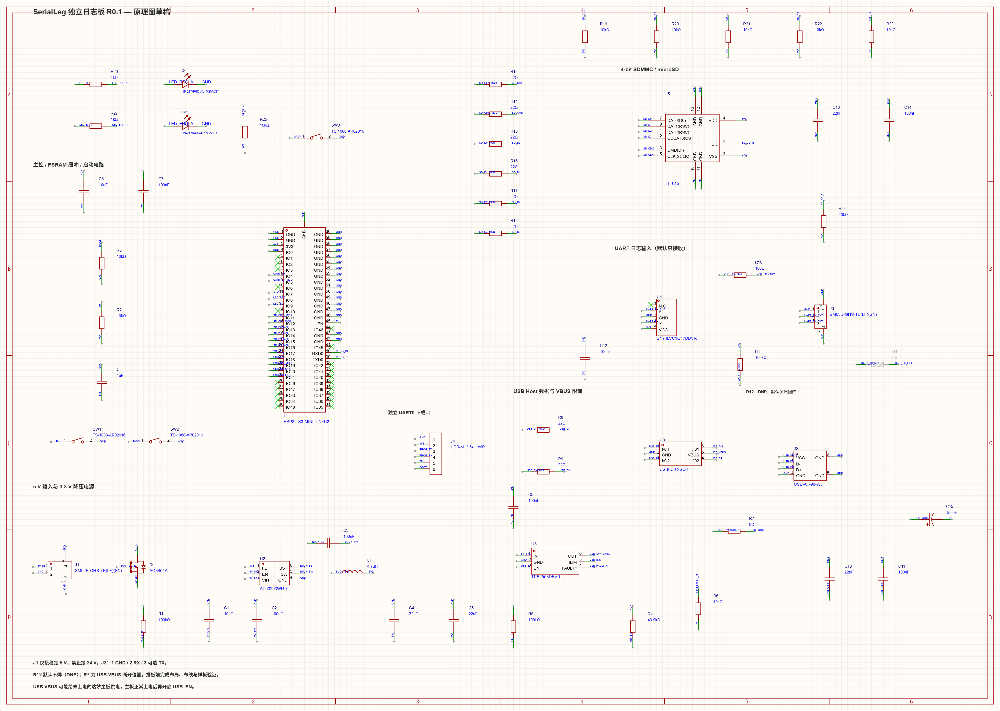
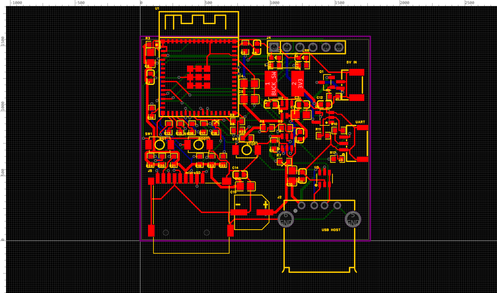

# SerialLeg 独立日志板

通过 USB 或 UART 接收机器人日志，在独立板上缓冲并写入 microSD，以减少存储操作对机器人控制任务的影响。两种接口同时预留，首版固件选择一种输入。

**当前为 R0.1 设计草稿，不能直接投板。** 导入前已有首轮自动布线，保留作历史草稿；后续按仓库约定手工规划布线。

## 当前状态

| 项目 | 内容 |
| --- | --- |
| 板子 ID | `serialleg-logger` |
| 当前设计版本 | R0.1 草稿 |
| 状态 | 设计中 |
| EDA | 嘉立创 EDA 专业版；导入时本机安装版本 4.1.71 |
| 工程入口 | [SerialLegLogger.eprj3](hardware/SerialLegLogger.eprj3) |
| 主控（草稿选型） | ESP32-S3-MINI-1-N4R2 |
| 存储接口（草稿） | microSD，4-bit SDMMC |
| 供电 | 稳定 5 V 输入；不可接机器人 24 V 电池 |
| 板框 / 层数 | 45 × 40 mm；逻辑四层，制造叠层未定稿 |
| 安装包络 | 接口与模组伸出板边，实际包络及安装方式待确认 |
| 固件 / 样板 | 尚无日志板固件，未投板、未实测 |
| 正式发布 | 无 |

## 打开与资料

使用嘉立创专业版打开 `hardware/SerialLegLogger.eprj3`，保留 `hardware/` 下的 `sch/`、`pcb/` 和其他工程文件。

- [设计说明、GPIO 分配与器件来源](docs/design-notes.txt)
- [2026-10-10 导入时的检查快照](docs/reviews/2026-10-10-import/README.md)
- [草稿 BOM](docs/reviews/2026-10-10-import/BOM.csv)：尚非生产 BOM，R12 默认 DNP。

这里是后续维护入口；原设计目录保留为迁移前副本。迁移仅整理文件，没有重新执行 EDA 检查或修复布线。

## 接口摘要

以下为现有草稿定义，最终仍须完成原理图和接口核对。

| 位号 | 功能 / 针序 | 接线要求 |
| --- | --- | --- |
| J1 | 1：5 V；2：GND | 稳定 5 V 电源，需核算供电余量 |
| J2 | USB Type-A，Host | 与主控 USB Device 连接；VBUS 可能向主控送电，详见设计说明 |
| J3 | 1：GND；2：日志 RX；3：可选 TX | 3.3 V TTL；RX 接主控 TX；R12 默认不焊，不可按达妙接口编号直通接线 |
| J4 | 1：GND；2：3V3 参考；3：UART0 TX；4：UART0 RX；5：EN；6：BOOT | 3.3 V TTL 下载器；3V3 为参考，不与其他供电输出并联 |
| J5 | microSD | 4-bit SDMMC；卡与文件系统行为待固件验证 |

## 现有检查记录

以下是导入草稿携带的历史结果，不是迁移后重新运行的结果：

- 设计定义与原理图 217 个引脚核对、原理图与 PCB 网表核对均记录为 0 差异。
- 原理图报告有一组料号匹配警告，涉及 U1 和 J4。
- PCB 报告仍有两项 USB 差分长度差错误；现行规则要求不超过 10 mil。
- 地平面尚未填充，制造叠层未配置，部分制造检查尚未开启。

详细范围和未通过项目见[原检查说明](docs/reviews/2026-10-10-import/先读我-检查结果.txt)。

## 已知问题与下一步

1. 在仓库新路径重开工程，确认完整性；按可读电路规范复核原理图及器件引脚。
2. 重新审查器件布局、供电与去耦回路，规划 USB、SD 和电源路径；不用自动布线。
3. 确定制造叠层和有依据的网络规则，处理 USB 成对走线并检查完整端到端路径。
4. 完成 GND 覆铜、连续回流、孤岛及天线禁布区检查。
5. 核对线宽、过孔载流、连接器、安装包络、丝印、阻焊和钢网。
6. 重跑相应检查后更新预览和记录；硬件定稿后再实施、验证日志固件及样板。

## 草稿预览

以下图片来自 2026-10-10 导入前草稿，后续工程修改后须重新导出。

