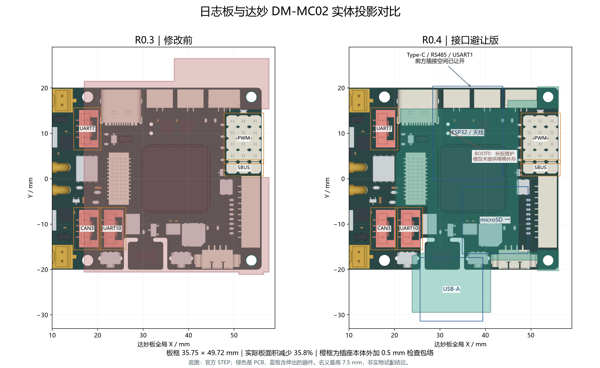

# R0.4 接口避让与紧凑布局检查

日期：2026-10-12。嘉立创专业版 4.1.71.7a7261be，使用原生 CLI/API；未使用 computer use、自动布线器或自动寻路。基线提交 `27a9aebb6f87ded35f4d1f7330f6f76075f9c465` 加工作区 R0.3 修改。PCB 版本 `1791814612820`，原理图版本 `1791733447480`。当前为设计草稿，未投板、未实物试配、无生产标签。

## 修改结果

按达妙 DM-MC02 官方 STEP 调整板框，左侧为 CAN3 / UART7 / UART10 留出竖插区域，右侧扩大 SBUS / PWM 避让；顶部退开 Type-C、RS485 和 USART1 的插接前方。USB-A 放到下方伸出区，microSD 转向达妙右侧出卡。J1 直插位置与两个 Ø2.4 mm 安装孔中心不变，安装孔距约 36 mm。

| 指标 | R0.3 | R0.4 |
| --- | --- | --- |
| 板框外接矩形 | 40.64 × 47.54 mm | **35.75 × 49.72 mm** |
| 扣除缺口后的板框面积 | 1666.03 mm² | **1070.41 mm²** |
| 面积变化 | 基线 | **减少 35.8%** |

宽度减少 4.89 mm，总长增加 2.18 mm；尺寸不包含模组天线、插座、插头和线缆伸出。面积缩减不等于 PCB 报价同比降低，板厂可能按外接尺寸、拼板和异形铣边计费。



重新安排主控、供电、USB、SD 与联锁外围；三只侧按键位于左侧，D1 / D2 均在顶面。工作副本删除旧走线后，按逐网确定的节点表调用原生 API 落图，见 [人工路径表](manual-paths.json)。最终原生保存会合并或拆分线段，以 [原生几何快照](native-geometry.json) 为准：633 条 LINE、92 个 VIA，无完全重复图元。该数量不是布线质量指标。

电气网表、器件型号和供电方案不变：仍由 P16 对外 5 V 供电，VCC_IN 仅用于主电源检测，USB 联锁保留，R12 默认 DNP。未增加电池。

## 机械依据和边界

依据 [DM-MC02 官方资料仓库](https://gitee.com/kit-miao/dm-mc02) 提交 `0ad8a919495c6da38f36b9352ca1118e490ef4c2` 的 `3D模型/CtrBoard-H7_V1.0-240112A.step`，读取 293 个实体包围盒，保存为 [来源快照](damiao-source.json)。用户 Downloads 中《达妙科技 DM-MC-Board02 电机开发板使用说明书 V1.1》PDF 第 17 页（正文第 15 页）用于核对 BOOT0；原理图参考版本为 CtrBoard-H7_V1.0-240124。

板框到插座包围盒的间隙取二维最短距离，坐标变换及逐项结果在 [mechanical-check.json](mechanical-check.json)：

```text
达妙全局 X / mm = 17.03159025 + 日志板 X / mil × 0.0254
达妙全局 Y / mm = -18.542 + 日志板 Y / mil × 0.0254
日志板底面 Z = 7.5 mm（名义配合假设），板厚 1.6 mm
```

| 达妙接口 | 裸插座到板框间隙 | 插座外扩 0.5 mm 后余量 |
| --- | --- | --- |
| P12 / CAN3 | 0.795 mm | 0.295 mm |
| P13 / UART7 | 1.175 mm | 0.675 mm |
| P15 / UART10 | 0.779 mm | 0.279 mm |
| P6 / SBUS | 1.053 mm | 0.553 mm |
| P11 / PWM | 1.053 mm | 0.553 mm |

上述五处无 PCB 投影覆盖。0.5 mm 为本轮检查余量，**不是完整插头、锁扣和线束的实际包络**。[JST GH 系列图纸](https://www.jst-mfg.com/product/pdf/eng/eGH.pdf) 中竖插配合高度约 7.3 mm，也不包含电线及弯折空间。不能以裸座不相交直接认定线束可任意出线。

Type-C、两路 RS485、USART1 处，PCB 相对插座前端分别退后约 4.26、4.30、4.30、2.36 mm；部分后部壳体仍与 PCB 投影重叠，采用叠高避让。模组天线也有伸出，USB 线缆包胶仍需单独核对。

底面普通器件高度按 2 mm、L1 按 4.5 mm 上限假设检查，最小名义垂直间隙约 1.10 mm（R2 对 P10）；L1 对主控 MCU 约 1.40 mm。此处为模型计算，未包含逐料号高度公差、连接器压缩量与板弯。H40 公座准确 SKU / 模型仍待确认。

两个安装柱按外径 4 mm 检查，临近 SWD / USART1 的平面余量约 0.40 / 0.47 mm；建议以外径不大于 4 mm 的实物试配。保留孔位需使用较窄支臂，未做承载或振动认证，不能用紧固力强行消除装配错位。

P1 / SWD 后部、主控 SW1 / SW2 本体仍有部分或全部 PCB 投影覆盖，不能把二维相交直接等同于三维碰撞，也不能据此宣称操作方便。其侧向插接、按动和手指空间须随实际调试线及主控一起试配；本轮未验证所有维护操作。

**BOOT0 / P14 仍需拆下日志板后维护。** 官方 STEP 未提供该实体；手册显示其位置仍在覆盖区，不能凭示意图估算一个孔后宣称已可操作。LCD 模组、整机机架、USB 包胶和具体线束未提供对应模型。

## 原生与文件检查

| 检查 | 本轮结果 | 证据 |
| --- | --- | --- |
| 原理图 ERC | 0 电气错误；保留 U1 的 1 条 ATTRMATCHCODE 显示属性警告 | [schematic-erc.json](schematic-erc.json) |
| 原理图 / PCB 网表 | 65 器件、250 引脚条目，0 差异；原理图与本轮基线字节一致 | [逐针比较](netlist-crosscheck.json)、[原理图网表](schematic-netlist.json)、[PCB 网表](pcb-netlist.json) |
| 实际覆铜 | 四层各一个 GND 区域，均使用原生 `rebuildCopperRegion()` 填充 | [填铜返回值](refill-result.json)、[几何](native-geometry.json)及实际 Gerber |
| 原生 DRC | 检查副本保存、关页、重开后 `check(true, false, true)` 返回 0 项 | [drc-final.json](drc-final.json) |
| 正式文件 | 正式 PCB 与已检查副本逐字节一致；PCB 头与索引版本一致，索引其他字段未改 | [canonical-verification.json](canonical-verification.json) |
| 规则 / 交付数据 | 84 项规则记录未改；J1 和安装孔位置未改，器件型号、封装、引脚网络未改 | [规则比较](rule-comparison.json)、[原生规则](pcb-rules.json)、[交付核对](delivery-check.json) |
| 正式路径独立重开 | 新 CLI 会话的 `openDocument` 超时，未取得该会话 DRC | 同上；不将这一步写成通过 |
| 重复图元 / 坐标 | 无完全重复线段或过孔；默认装配坐标 64 位号，排除 R12 | [primitive-check.json](primitive-check.json) |

正式文件已经同步完成，唯一维护入口仍为 [hardware/SerialLegLogger.eprj3](../../../hardware/SerialLegLogger.eprj3)。完整工程包含原理图、PCB 及内嵌资源，不能只复制索引。正式路径 CLI 超时发生在页面打开阶段；已检查工作副本可原生保存和重开，且正式 PCB 与该副本完全相同。这里保留工具限制，不据此声称已完成正式路径的独立客户端验证。

U1 属性警告沿用 R0.2，未隐藏、忽略或关闭规则。250 为网表引脚条目数，包含模组地焊盘别名，不等于物理焊盘数。本轮没有改原理图，原有 R0.2 原理图渲染仍适用。

## 关键走线与地参考

四层均实际填充 GND；L2 含外围低速控制线，不能称整板完全连续地平面。USB 底面主干参考 L3，顶面扇出参考 L2；SD 顶面及 L3 信号以 L2 为相邻参考，底面源端短段参考 L3。使用本轮实际 Gerber 剔除非 GND 信号、过孔和通孔铜后，比较线路中心线与地铜投影，见 [signal-reference-check.json](signal-reference-check.json)。这是二维几何核对，未进行电磁仿真。

- USB D− / D+ 中心线总长分别约 20.504731 / 20.504718 mm，差值小于 0.001 mm；小数仅供计算复现，不代表实体精度。每路 1 个换层过孔，6 mil 线宽、配对主干间距 8 mil；扇出和局部调长处不保持统一间距。
- USB 每路未被地铜投影覆盖的中心线约为 J2 通孔端接 1.005 mm、换层邻域合计 1.123 mm。将本网络通孔/过孔半径加 10 mil 的邻域单列后，仅余约 0.001～0.005 mm 的边界残差。不能把端接缺口描述为不存在。
- R15 移到顶面，消除了 SD_D0_MCU 主线原有的参考缺口。SD_CMD / SD_D2 / SD_D3 上拉支路仍分别存在约 0.979 / 0.958 / 0.149 mm 的缺口；低速 SD_CD_N 约 6.906 mm。CLK / D0 / D1 在过孔邻域外还有约 0.011 / 0.057 / 0.023 mm 的短边界残差，未作为整网无缺口通过依据。
- 首板 SD 以 20 MHz 起步检查波形和连续写卡；频率低不等于可以忽略边沿及回流。USB 90 Ω 差分阻抗仍需按实际层叠由板厂确认，长度一致不替代阻抗或眼图验证。

候选层叠继续采用 JLC04161H-3313，标称 1.6 mm；外铜 0.035 mm / PP 0.0994 mm / 内铜 0.0152 mm / core 1.265 mm，对称。实际制造材料、铜厚及阻抗尚未确认。

## 制造与装配检查

使用原生 Gerber 与 [check_manufacturing.py](../../../tools/check_manufacturing.py)，Python / Shapely 2.1.2。规则阈值沿用前版；没有放宽电气间距或关闭规则。覆铜边界相对板框内缩 13 mil，修正凹角处原生填铜到板边不足的问题。结果见 [manufacturing-check.json](manufacturing-check.json)。

| 项目 | 筛查阈值 / 方法 | 当前结果 |
| --- | --- | --- |
| 独立阻焊桥 | ≥0.10 mm | 顶底 0 违规 |
| 丝印到阻焊 | ≥0.15 mm | 顶面最小 0.169 mm，底面 0.975 mm |
| NPTH 到铜 | ≥0.20 mm，检查四层成品铜 | 最小 0.234 mm，0 违规 |
| 板边到铜 | ≥11.8 mil，约 0.300 mm | 最小 0.305 mm，无板外铜 |
| 连接器 PTH 焊盘环 | ≥0.15 mm | 12 个，最小 0.291 mm |
| 过孔尺寸 | 从导出与原生几何读取 | 92 个，最小钻径 0.305 mm、环宽 0.152 mm |
| 连接器 PTH 孔间距 | 记录最小值 | 1.080 mm |
| NPTH / 连接器 PTH 孔区锡膏 | 不覆盖孔区 | 0 违规 |
| 丝印源属性 | 字高与名义线宽 | 最小 30 mil / 6 mil；不等于字形实体笔画逐点认证 |

已查看原生顶底铜图、装配图，以及本轮 Gerber 丝印、内层地参考和叠装对比预览。底面图为底面正视。原生 PDF 的自动 BOM 页不作为装配下单资料，使用本目录 CSV。

64 个封装有 layer 48 本体外形，排除默认 DNP 的 R12 后实际筛查 63 个器件，同面无重叠、无小于 0.20 mm 的本体间隙；J1 缺少准确本体图形，未包含在该项通过范围内。变换由内嵌封装与原生焊盘坐标拟合，详见 [body-check.json](body-check.json)。该项不替代装配庭院、焊接、返修和真实器件高度检查。

制造几何筛查采用圆弧折线近似，阻焊桥仅比较独立开窗；未覆盖完整钢网开口比例、阻抗、所有高度公差或板厂 CAM。临时 Gerber / PDF 保留在板内 `outputs/access-r04-2026-10-12/`，**未作为生产包发布**。

## 装配资料与剩余事项

- [BOM.csv](BOM.csv)：65 位号，标记 R12 DNP；H40 准确采购编号仍待确认。
- [pick-and-place.csv](pick-and-place.csv)：64 位号默认装配坐标，UTF-8 BOM、逗号分隔；排除原生全量导出中仍包含的 R12。底面旋转和通孔装配约定需与装配厂核对。
- [当前板说明](../../../README.md)、[制造准备与首板测试](../../manufacturing-and-bringup.md)已更新。旧版预览、坐标和报告是历史记录，不用于本版下单。

后续需 H40/H35、安装柱及完整线束实物试配；确认出卡、侧按键和主控接口操作空间，BOOT0 按拆板维护。还需确认层叠、阻抗和装配工艺，测量共享 5 V 负载、P16 电流及掉电反灌，实现独立日志板固件并完成首板测试。本轮 DRC 和几何筛查均不能升级为实测功能通过。
