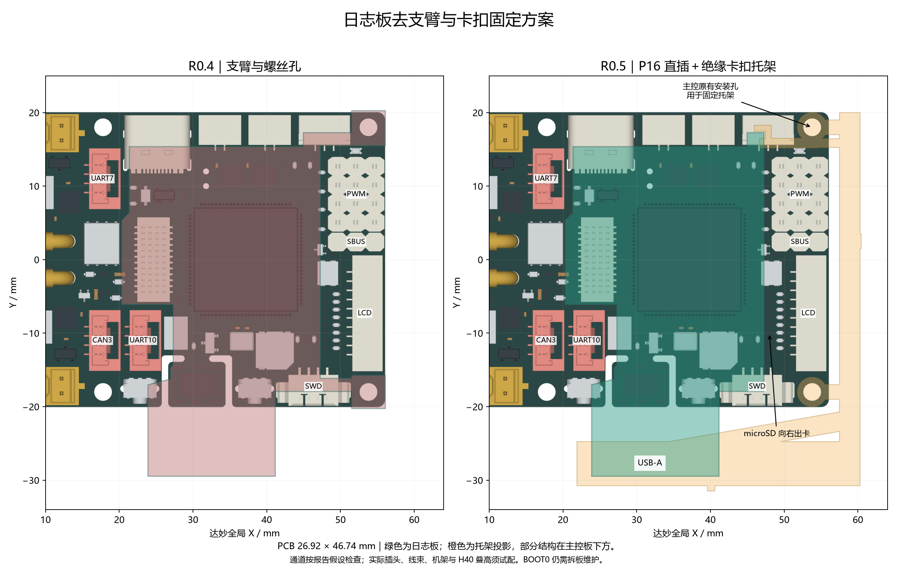

# R0.5 去支臂与卡扣固定检查

日期：2026-10-12。软件：嘉立创专业版 4.1.71.7a7261be、OCP 8.0.1.1、Shapely 2.1.2。Git 基线 `27a9aebb6f87ded35f4d1f7330f6f76075f9c465` 加此前工作区 R0.4 修改。本轮 PCB 精确版本见 [canonical-verification.json](canonical-verification.json)；原理图版本仍为 `1791733447480`。未提交生产发布、未投板或实测。

## 修改范围

- 删除日志板两条安装支臂和两个 Ø2.4 mm NPTH 安装孔，以及对应旧螺柱禁布区。J1/P16 和其余接口位置不变；封装自身的四个 NPTH 定位孔保留。
- 新板框 **26.924 × 46.736 mm**，面积 **1012.97 mm²**。相对 R0.4 的 35.753 × 49.718 mm，宽度减少约 8.83 mm、长度减少约 2.98 mm，实际面积减少约 5.37%。
- R2 向板内移动 15 mil（0.381 mm），给后部托唇留空；人工修改它的 EN、3V3 两段连接端点。器件型号、封装、引脚网络及其他器件位置不变。见 [位置差异](layout-changes.json)、[人工改动计划](pcb-plan.json)。
- 四层覆铜重新生成，覆铜边界继续内缩 13 mil；丝印版本改为 R0.5，机械层增加六处托架接触面投影。
- 新增 [绝缘卡扣托架](../../../mechanical/clip-mount/README.md)的参数源代码、STEP、STL 和装配说明。托架用达妙原有安装孔固定，日志板自身不穿螺钉。

本轮没有使用 computer use、自动布线器或自动寻路。USB、SD 等既有路线未重布。完整维护入口仍为 [SerialLegLogger.eprj3](../../../hardware/SerialLegLogger.eprj3)。

## PCB 与文件验证

| 检查 | 结果 / 证据 |
| --- | --- |
| 正式工程同步 | 正式磁盘和原生编辑页均先与基线核对；保留此前用户修改。正式文件与检查副本逐字节一致，已在原生客户端重开 |
| 原生 DRC | 工作副本与正式工程均为 0 项；[最终记录](canonical-verification.json)、[DRC](drc-final.json) |
| 原理图 / PCB 网表 | 65 器件、250 引脚条目，0 差异；原理图字节未改。[网表比较](netlist-crosscheck.json)、[新 PCB 网表](pcb-netlist.json) |
| ERC | 本轮未重跑，原理图未改；R0.4 的 U1 ATTRMATCHCODE 显示属性警告继续适用，不当作新 ERC 结果 |
| 规则 | 84 项原生规则记录与基线一致，没有放宽间距或关闭原有规则。[规则比较](rule-comparison.json) |
| 图元 | 633 条线、92 个过孔，无完全重复图元；板级安装孔 0，封装定位 NPTH 4。[图元统计](primitive-check.json) |
| 制造几何 | 指定 Gerber 检查 0 违规。最小板边到铜 0.3048 mm、NPTH 到铜约 0.2343 mm、PTH 环宽约 0.2906 mm。[制造检查](manufacturing-check.json) |
| 预览 | 已检查本轮 Gerber 铜层、丝印、原生坐标与器件本体生成的预览及托架图；原生 PDF 导出两次超时，未将旧 PDF 当作新版预览 |

原生元件禁布区把 J2 含焊脚的整体边界、R2 的器件边界与接触面判为重叠，不能表达局部实体外壳留空和上下表面的接触关系。因此六处接触面采用**机械层标注及独立三维几何核对**，没有将器件院框缩小或添加 DRC 忽略。该检查的局限必须保留，不能宣称接触区的原生元件禁布检查已通过。见 [接触面](contact-annotations-result.json)、[本体数据](body-check.json)。

## 托架与接口空间

使用官方 DM-MC02 `CtrBoard-H7_V1.0-240112A.step`，来源提交 `0ad8a919495c6da38f36b9352ca1118e490ef4c2`；[293 个部件包围盒](damiao-source.json)。日志板坐标变换仍为 X=17.03159025+x_mil×0.0254、Y=−18.542+y_mil×0.0254；板底名义 Z=7.5 mm。

PCB 对 CAN3 / UART7 / UART10 / SBUS / PWM 的已有避让保持，旧支臂去除后不增加覆盖。托架自身额外核对了这些接口的竖插通道，以及 Type-C、RS485、USART1、SWD、LCD、底面 FPC 的侧插通道、两只主控按键、microSD 出卡和安装工具通道。

- 五个竖插口：插座包围盒外扩 0.5 mm，向上检查至 Z=40 mm。
- 侧插口：包围盒外扩 0.5 mm、向外 20 mm；主控按键为 6 mm 操作通道。
- microSD：按卡座全宽向右移动 30 mm。普通底面器件高度假设 2 mm，L1 为 4.5 mm，通孔焊脚突出板底 3 mm。
- 安装螺钉上方：Ø2.5 mm 直入工具通道，后扣位置已为此退开。

上述明确假设下 **0 碰撞**，详见 [bracket-check.json](bracket-check.json)。这不是完整线束、任意包胶、手指或整机机架验证。J1 仍缺少准确 H40 模型；BOOT0 仍需拆板维护。

托架外接约 **38.56 × 51.46 × 18.00 mm**，最右 X=60.45 mm，最低 Z=−6.4 mm。按所用 STEP，需要在主控右侧另留约 **4.4 mm**、底面以下另留约 **4.6 mm**。这是为 LCD / FPC 通道让位及托架承力结构付出的空间代价，不能用 PCB 尺寸代替整个装配尺寸。

STEP 重新读取后为 1 个有效实体，STL 边界及非流形边为 0，详见 [CAD 文件检查](cad-file-check.json)。卡扣应变是小挠度梁公式估算，未验证材料允许值；没有载荷、振动和寿命实测。

## SD 回流结论修正

R0.4 报告仅将 L3 信号对照 L2，遗漏了当前层叠中更近的 L4。L2–L3 约 1.265 mm，L3–L4 约 0.0994 mm，因此不能沿用旧报告认定 SD 回流已解决。

本次基于新 Gerber，剔除非 GND 线、过孔、通孔及相应面 SMD 焊盘，L3 改对照更近的 L4。以 SD_CLK 串阻之后约 47.60 mm 线路为例，约 **26.47 mm** 中心线没有最近层地铜投影（含端接与过孔邻域）。这说明原有判断过于乐观，不能解释成只剩微小边界误差。详见 [signal-reference-check.json](signal-reference-check.json)。该数字仍是二维几何，不是电磁仿真。

**本版 SD 路径及回流仍需在投板前优化和验证。** 本轮按用户要求完成机械方案变更，没有把 SD 重布混入该变更，也不因 DRC 为 0 就将整板标成可投产。USB 两路仍各约 20.505 mm、各 1 个换层过孔，阻抗与眼图同样没有实测。

## 交付与待验证事项

- [BOM](BOM.csv) 65 位号；[默认装配坐标](pick-and-place.csv) 64 位号，R12 DNP，已反映 R2 位移。
- [托架源代码和打印文件](../../../mechanical/clip-mount/README.md)、[叠装对比 SVG](../../../mechanical/p16-stack-r05.svg)。
- 临时制造导出在板内 `outputs/clip-r05-2026-10-12/`，未作为生产包发布。

后续先取得 H40/H35 实物并校准支撑高度，确认机架右侧和底部空间、选定螺钉长度，再进行断电试配与卡扣/插拔/振动测试。修正 SD 回流并确认层叠阻抗、供电余量及掉电行为后，方可进入样板验证。固件与首板测试仍按 [制造准备说明](../../manufacturing-and-bringup.md)执行。
