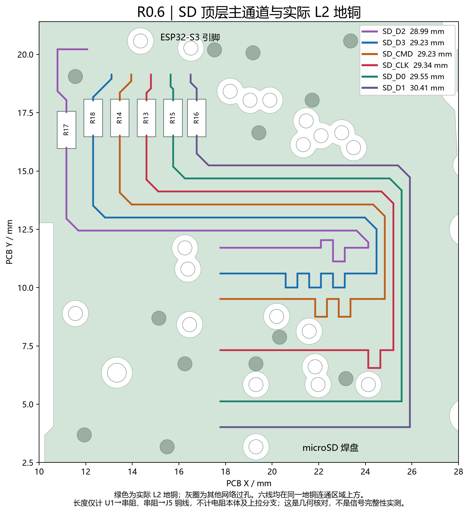

# R0.6：SD 回流修复与布线检查

日期：2026-10-12。嘉立创专业版 4.1.71.7a7261be。基线为 R0.5 卡扣工程，Git HEAD `27a9aebb6f87ded35f4d1f7330f6f76075f9c465` 加现有工作区修改；本次未提交或发布生产版本。准确的 PCB / 原理图版本号见 [正式工程回读](canonical-verification.json)。

本轮完成 SD 主通道重布、外围支路连接和工程检查。六根主信号均走顶层，其整个铜宽投影位于同一 L2 地铜连通区域。板框、P16 和所有接口位置、卡扣接触区保持。当前仍为设计草稿，未投板、未实物验证。

## 修改原因与实现

R0.5 中 SD 多根线在 L3 绕行。L3 与 L4 的间距约 0.0994 mm，而与 L2 间距约 1.265 mm；仅检查 L2 无法证明 L3 的连续参考。旧 CLK 串阻后约 47.60 mm，其中约 26.47 mm 中心线缺少最近层地铜投影。

按卡座扇出顺序重新分配 ESP32-S3 的六个 SD GPIO，将 R13～R18 放到源端扇出区。六根主线在 L1 直接进入卡座焊盘区域，以局部调长控制长度差。上拉电阻分支另行换层，其过孔偏离主通道的 L2 投影。局部 USB 使能、故障和 SD 检测等低速线及电源支路随之调整；USB 数据对、主开关电源回路、板框和接口坐标保持。

共移动 13 个器件，型号、数量、阻值、电容值和默认装配状态保持。C14 移至卡座电源引入附近，重新连接局部去耦与上拉电源。原理图同步修改 U1 的六个网标；新的 GPIO 表必须同步到后续固件。

| 信号 | GPIO / U1 焊盘 | 串阻 | 主通道铜线长 / mm | 相对 CLK / mm |
| --- | --- | --- | ---: | ---: |
| CLK | 14 / 18 | R13 | 29.344 | 0 |
| CMD | 13 / 17 | R14 | 29.226 | −0.118 |
| D0 | 15 / 19 | R15 | 29.547 | +0.204 |
| D1 | 16 / 20 | R16 | 30.408 | +1.065 |
| D2 | 11 / 15 | R17 | 28.994 | −0.350 |
| D3 | 12 / 16 | R18 | 29.231 | −0.113 |

CD 保持 GPIO17 / U1.21。上表只计算 U1→串阻及串阻→J5 的铜线中心线，不包含电阻本体、封装内部或上拉支路。五个 10 kΩ 上拉及六个 22 Ω 串阻保留。主线宽 8 mil。

Espressif 说明 SDMMC 可映射到空闲 GPIO，并建议保留串阻；其 PCB 指南建议 SD 命令/数据相对时钟控制在 ±50 mil（±1.27 mm）、缩短线路并使用连续地参考。长度与参考面已按这些建议检查；**SD 50 Ω ±10% 与 USB 90 Ω ±10% 仍需按实际制造层叠确认**，8 mil 和候选材料参数本身不能作为阻抗认证。[原理图指南](https://docs.espressif.com/projects/esp-hardware-design-guidelines/en/latest/esp32s3/schematic-checklist.html)、[PCB 指南](https://docs.espressif.com/projects/esp-hardware-design-guidelines/en/latest/esp32s3/pcb-layout-design.html)。

## 已执行检查

| 检查 | 本轮结果与范围 |
| --- | --- |
| 原理图 / PCB 网表 | 65 个器件、250 个引脚条目，差异 0；相对 R0.5 仅 U1.15～20 的 SD 分配变化 |
| 原生 ERC | 无错误；保留 1 条原有 U1 `ATTRMATCHCODE` 显示属性警告，未关闭规则 |
| 原生 DRC | 工作副本及正式工程保存重开后均为 0；包含连通与网表一致性检查 |
| 规则 | 原有 84 项规则保持，未缩小间距或屏蔽检查 |
| 铜层 | 四层 GND 均实际重填，并使用本轮原生 Gerber 检查 |
| SD 主通道地参考 | 六线均 L1、主通道换层孔 0；缺少 L2 地投影的中心线长度和整个线宽面积均为 0；六线位于同一个地铜连通区域 |
| USB | 两路铜线几何保持，各约 20.505 mm、各 1 个换层孔；最近层参考缺口保持原有端接 / 过孔邻域水平，未增加新的跨割缝 |
| 图元 | 615 条线、77 个过孔；无完全重复线或过孔；按几何并集对照人工节点表 |
| 制造几何 | 指定检查 0 违规；最小铜到板边约 0.305 mm、NPTH 到铜约 0.234 mm；孔环、阻焊开窗与丝印间距已检查 |
| 平面装配 | 默认装配且有本体外形的 63 个器件无重叠或小于 0.20 mm 的本体间隙；J1 本体数据仍不完整 |
| 托架与通道 | 用新器件坐标复算，托架仍为 1 个有效实体，与定义的部件、接触区和操作通道无几何碰撞；板框和托架参数保持 |
| 装配输出 | BOM 65 位号，默认装配坐标 64 位号；R12 DNP；坐标已核对原生回读 |
| 预览 | 本轮实际 Gerber / 坐标与原生原理图 PNG；不使用旧 PCB PDF 作为新证据 |

地铜分析从实际 Gerber 中扣除非 GND 线、过孔、通孔及相应面的 SMD 焊盘。最近参考关系为 L1→L2、L4→L3、L3→L4。主通道与上拉分支分开记录，未用带分支的网络总长充当点到点长度。支路过孔本身仍有正常的平面避让；零缺口结论仅指上表六根 SD 主通道，不泛指全板所有信号。

原生保存会合并近共线线段、在 T 形连接处拆分线段。SD 主通道与人工指定路径几何一致；一段低速 `USB_FAULT_N` 被客户端合并，最大偏移约 0.253 mil（0.0064 mm），经实际 DRC 与导出核对。所有路径由人工节点表指定，未使用自动布线器、寻路或 computer use。

本版修改了原理图标题。客户端对一个历史 TEXT 图元的修改 / 删除没有持久保存，最终仅移除该旧序列化 TEXT 记录，保留原生 API 创建的新标题；重开、ERC、网表和原生 PNG 均重新核对。

## 可追溯文件

- [网表核对](netlist-crosscheck.json)、[原生 ERC](schematic-erc.json)、[正式工程电气复核](canonical-electrical-check.json)、[DRC](drc-final.json)。
- [主通道长度与地参考](sd-main-reference.json)、[L2 连通区域](sd-plane-continuity.json)、[含分支的完整信号投影](signal-reference-check.json)。
- [布局变更](layout-changes.json)、[原理图记录差异](schematic-source-changes.json)、[规则对比](rule-comparison.json)、[图元检查](primitive-check.json)。
- [制造几何检查](manufacturing-check.json)、[器件本体检查](body-check.json)、[新坐标下的托架检查](bracket-check.json)。
- [BOM](BOM.csv)、[默认装配坐标](pick-and-place.csv)、[原生几何回读](native-geometry.json)、[人工路径表](route-plan.json)。

## 仍需实物及制造确认

1. 确认实际生产层叠及 SD / USB 阻抗，完成钢网和装配工艺复核。ERC 显示属性警告不是新增电气错误，但本版没有宣称 ERC 完全零告警。
2. 使用新的 GPIO 分配做启动、识卡、4-bit SDMMC、持续写卡及 CRC 压力测试，观察 CLK 边沿、振铃和电源跌落。20 MHz 只是首板测试起点。
3. H40 / H35 实物配合高度、卡扣承载及振动、实际线束和机架空间仍未验证。接触模型保持 R0.5 参数，不保证任意连接器包胶或公差组合。
4. 主控对外 5 V 的共享余量、USB 联锁关断反灌、掉电文件尾部丢失仍需实测；本板没有电池或掉电续写保证。未修改这些电路的额定值或验收预算。

本次未下单、未生成正式投板标签、未提交或推送 Git。
