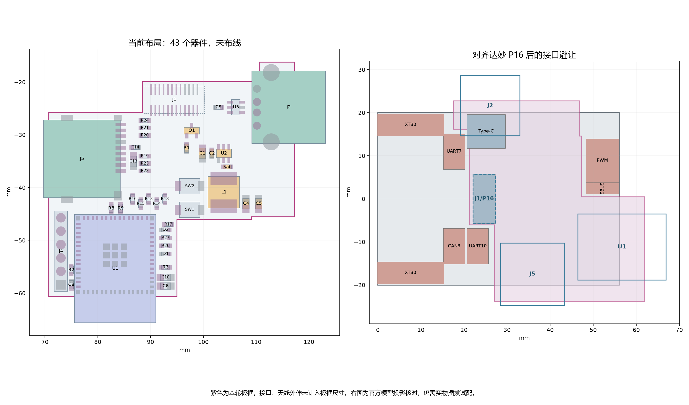

# 2026-10-15 元件布局与布线准备

本轮按用户“改到可以布线为止”的授权，完成 43 个器件的人工布局、板框避让、参考地和托架接触区规划。使用嘉立创原生 CLI/API；未使用 computer use、自动布局、自动布线或自动寻路。**工程仍为 0 条连接线、0 个过孔，尚未完成 PCB 布线。**

## 工程与检查结果

- 软件：嘉立创 EDA 专业版 4.1.71.7a7261be。
- 源入口：[SerialLegLogger.eprj3](../../../hardware/SerialLegLogger.eprj3)，PCB 为 [Logger.epcb2](../../../hardware/pcb/Logger.epcb2)。未提交、未投板。
- 实际源版本、原生检查统计、几何结果见 [verification.json](verification.json)。该记录绑定保存并重新打开后的 PCB 文档版本，不以历史 R0.6 的检查代替本轮结果。
- 43 个器件全部放入布局。所有电气焊盘在板框内；按原生焊盘几何计算，最小焊盘到板边约 0.309 mm。
- 按封装本体轮廓检查，同面本体无重叠，最小间隙约 0.216 mm。此项不等于完整焊接庭院和返修工具验证。
- 原生重开 DRC：**161 项未连接，其他错误 0 项**。未连接是本轮未布线的状态，不能称为“零 DRC”。
- 原理图 ERC：0 错误，1 条原有 U1 `ATTRMATCHCODE` 显示属性警告。
- 原理图与 PCB 位号、引脚及网络逐项一致；电气连接分组与修改前相同。
- 修复了原先存在的网表不同步：同步 5 组自动网络名称及原理图通道属性，没有更换 GPIO、器件或功能电路。
- 原生 33 条规则的阈值保持，没有关闭检查或放宽间距。

[原生 PCB 画布](native-pcb.png)；[布局坐标与板框](placement.json)。

## 布局安排

1. **J1** 保留底层、270° 和原有插接位置，4/6 脚为 5V_IN，1/3/5/7 脚为 GND；2 脚及未用引脚 NC。之前删除的两个定位孔没有恢复。
2. **J5/U1** 协调平移，J5 让出达妙 UART10 上方的插拔通道，U1 天线朝板外。SD 串联电阻在模组信号出口分布，上拉电阻位于卡座焊盘旁；C13、C14 靠卡座电源入口。
3. **J2/U5** 位于右侧出线边。U5 靠接口；R8/R9 靠 U1。C9 的 5 V 焊盘朝向 U5 的偏置引脚。
4. **Q1/U2/L1** 集中在 P16 供电端与负载之间；C1/C2 在 VIN/GND 侧，C3 在 BST/SW 侧，C4/C5 在电感输出侧。FB 预留从输出电容回到 U2 的独立取样路径。
5. **C6/C10** 靠 U1 3.3 V 入口；R2/C8 靠 EN。J4 在左侧，按键和 LED 留在顶面可操作区域。

## 板框和机械边界

当前板框外接尺寸约 **46.60 × 44.35 mm**，实际面积 **1486.9 mm²**，比修改前工作矩形面积减小约 54%。尺寸不含 USB 外壳、SD 卡口和模组天线的外伸，也不含插头及线缆。

以 J1/P16 针序和中心对齐达妙官方 `CtrBoard-H7_V1.0-240112A.step`，板框避开 CAN3、UART7、UART10、PWM、SBUS 和两只 XT30 的竖向投影检查区域。检查包络沿用插座本体外扩 0.5 mm 的设计假设；剩余最小间隙约 0.13 mm，包含外扩后计算，不是通用插拔间隙标准。

本轮在 USB 端、MCU 端和接口端各保留一组绝缘托面/卡扣元件禁布区，没有加回支臂或 PCB 安装孔。**原 R0.5/R0.6 托架 STEP/STL 不适用于新板框，后续须按这些接触区更新。** 名义板间距仍按 7.5 mm；准确公座 SKU、叠高、公差、插头包胶与出线弯曲需要实物确认。没有用二维投影宣称完成整机装配验证。

## 接下来如何布线

沿用已设置的四层、标称 1.6 mm、JLC04161H-3313 目标叠层：外铜 0.035 mm、外侧 PP 0.0994 mm、内铜 0.0152 mm、芯板 1.265 mm。该结构仍可在[板厂公开层叠表](https://jlcpcb.com/impedance)查到；实际制造及阻抗管控须在投板前确认。

| 网络 | 预定路径与参考面 | 布线重点 |
| --- | --- | --- |
| 降压电源 | 顶层局部回路，接入 L2 地 | 先接 C1/C2—VIN/GND、BST/SW—C3、SW—L1，再接输出电容；不要为走线扩大 SW 区域 |
| SD 六线 | 顶层；L2 连续 GND | 从串阻进入卡座下方预留通道，绕开两个定位孔；在卡座内部的可走线区域返回信号焊盘；不得跨地平面缺口 |
| USB D+/D− | 模组附近经串阻后转到底层主通道；L3 连续 GND；U5 在接口侧 | 成对换层并就近配地回流过孔，避开 P16 底层焊盘；到 U5 前再转回顶层 |
| 3.3 V/5 V | 保留足够载流宽度的外层路径 | 不占用 USB 参考地通道；先保证局部去耦接地，再处理普通信号 |
| EN、BOOT、烧录和 LED | 普通信号最后处理 | EN 的 C8 就近回地，下载口保持 3.3 V TTL |

L2/L3 均已实际填充。读取原生覆铜结果后，每层只有一个主体铜区；检查的 SD 主通道和 USB 底层通道均有相应连续参考地。这里验证的是**预留通道**，后续实际布线、换层和覆铜更新后仍须重新检查整个线宽下方的回流。

SD 目标为 50 Ω 单端，USB 为 90 Ω 差分，依据[乐鑫布局指南](https://docs.espressif.com/projects/esp-hardware-design-guidelines/en/latest/esp32s3/pcb-layout-design.html)。旧草稿的 SD 8 mil、USB 6 mil/间距 8 mil 只能作为该目标叠层下的起始几何，不能当作板厂确认的阻抗值；落详细线宽前核对板厂计算结果。降压布局依据 [AP63203 数据手册第 15 页](https://www.diodes.com/assets/Datasheets/AP63200-AP63201-AP63203-AP63205.pdf#page=15)。

剩余工作是逐网布线、地过孔与电源载流核算、布线后的覆铜/DRC/长度和回流检查、最终丝印与装配检查、新托架适配和样板测试。首版无线关闭；天线伸出板框并设铜禁布区不等于已经满足整机射频性能。
