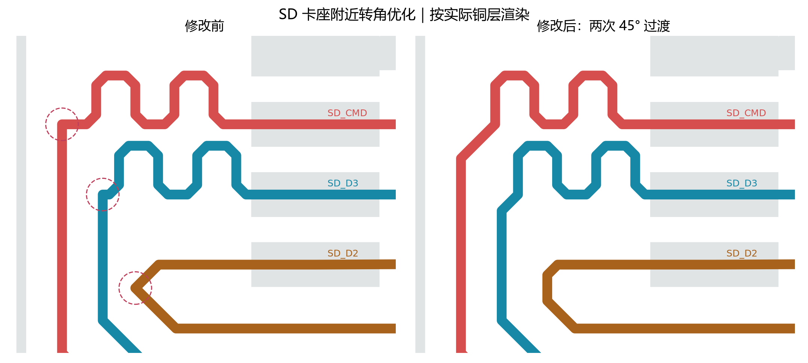

# 2026-10-16 信号转角优化与复核

检查对象为 [SerialLegLogger.eprj3](../../../hardware/SerialLegLogger.eprj3) 及完整 `hardware` 目录的未提交工作树。使用嘉立创 EDA 专业版 **4.1.71.7a7261be**。基础提交、修改前后坐标、原生 DRC 和回读量测保存在 [validation.json](validation.json)。

## 修改范围

扫描了 USB、SD、EN、BOOT、下载口、卡检测和指示灯等 **26 个非电源网络**，逐项区分焊盘/过孔内部的连接与外部连续走线转角。找到并修改五处：

| 网络与位置 | 修改前 | 修改后 | 主路径长度变化 |
| --- | --- | --- | --- |
| SD_D2，卡座前折返点 | 约 89.89° 内夹角 | 斜线—竖线—斜线，两次 45° 转向 | −6.657 mil / −0.1691 mm |
| SD_CLK_MCU，模组出口 | 90° 内夹角 | 两次 45° 转向 | −4.686 mil / −0.1190 mm |
| SD_CMD，蛇形入口 | 90° 转角及短横段 | 45° 斜段直接进入蛇形竖段 | −8.787 mil / −0.2232 mm |
| SD_D3，蛇形入口 | 90° 转角及短横段 | 45° 斜段直接进入蛇形竖段 | −2.343 mil / −0.0595 mm |
| BOOT，底层转角 | 90° 内夹角 | 两次 45° 转向 | −11.716 mil / −0.2976 mm |

按回读线段复查，未发现剩余的同类焊盘外急转角。USB 保护器 U5 焊盘内的进出线、BOOT/EN 焊盘内连接以及卡检测焊盘处的同网接入单独归类，未为改变这些中心线角度而重画焊盘或增加绕线。

转角候选筛查使用内夹角小于 134°，用于容纳 45° 走线因坐标舍入产生的小误差；这只是几何检查阈值，**没有修改 EDA 的任何规则**。改线使用人工明确的折点，通过原生 API 落实；未调用自动布线、自动寻路或 computer use。

图中彩色部分为对应网络的实际走线，浅灰为其余原生 Gerber 铜。虚线圈标出修改前的三处卡座附近急转角；另两处位于模组出口及底层。

## 线长复核

从修改后的原生 PCB 回读既有铜线，按模组焊盘中心至卡座焊盘中心量测，包含串联电阻两焊盘中心之间的跨度，不计上拉支线。SD 六路仍全部走顶层，信号过孔为 0。

| 信号 | 路径长度 mm | 相对 CLK 差值 mil |
| --- | ---: | ---: |
| CLK | 28.8281 | 0 |
| CMD | 27.8763 | −37.47 |
| D0 | 28.8925 | +2.54 |
| D1 | 29.8292 | +39.41 |
| D2 | 27.7500 | −42.45 |
| D3 | 28.0205 | −31.80 |

最大相对偏差约 **42.45 mil / 1.078 mm**，满足当前采用的 ±50 mil 目标；最长路线约 1174.38 mil，低于 2000 mil 建议值。[Espressif SDIO 布局指南](https://docs.espressif.com/projects/esp-hardware-design-guidelines/en/latest/esp32s3/pcb-layout-design.html#sdio)

USB 路径完全未变。主网络长度差仍为 **5.928 mil**，计入 MCU 至串阻段后为 **9.190 mil / 0.2334 mm**，低于现有 10 mil 目标。

## 覆铜、网表与 DRC

- 保持 10 个高速线覆铜避让区，同步调整其中受影响的一个区域，随后重填全部 7 个铜区。高速线铜边至新增 GND 覆铜的最小间距仍为约 **0.3080 mm**，满足 12 mil / 0.3048 mm 的预留条件。
- 顶层 9 个、底层 4 个地铜分区均连接到地过孔或接地通孔；两个内层各保持一个连续主地铜区域。没有悬浮地铜。
- USB/SD 实际线宽投影的相邻地参考覆盖检查通过，排除信号自身过孔及连接器通孔的局部避空；四层天线禁布区与实际铜的相交面积均为 0。
- **原生 DRC：保存、关闭 PCB 标签并重开后为 0 项。** 当前原理图与 PCB 的 **195 项引脚网络一致**。
- **43 个器件、358 段连接线、108 个过孔**。器件位置和型号、所有过孔、板框、制造层叠、原有天线/卡扣禁布区及数值规则均未改变。
- 原生 Gerber 的顶底丝印与阻焊开窗相交面积、板外面积均为 0。

本轮没有改变原理图，未重复运行 ERC。前轮 0 错误、1 组 U1/L1 `ATTRMATCHCODE` 警告继续保留。

线宽、USB 耦合段间距和层叠未变，修改后的侧铜距离仍满足[前轮阻抗估算](../2026-10-16-gnd-pour/README.md)的边界条件。本轮未重复均匀截面场求解，也没有进行转角三维电磁仿真或样板波形测试。转角几何改善与 DRC 通过不能证明反射为零。

## 当前预览

[顶面](../../../images/pcb-corners-2026-10-16-top.png) · [底面](../../../images/pcb-corners-2026-10-16-bottom.png)

临时原生 Gerber、检查回读和实施脚本在 `outputs/corner-fix-2026-10-16/`，不是生产发布。仍需板厂确认控制阻抗，并完成托架适配、机械试配和样板功能验证。本轮没有采购、下单、Git 提交或推送。
