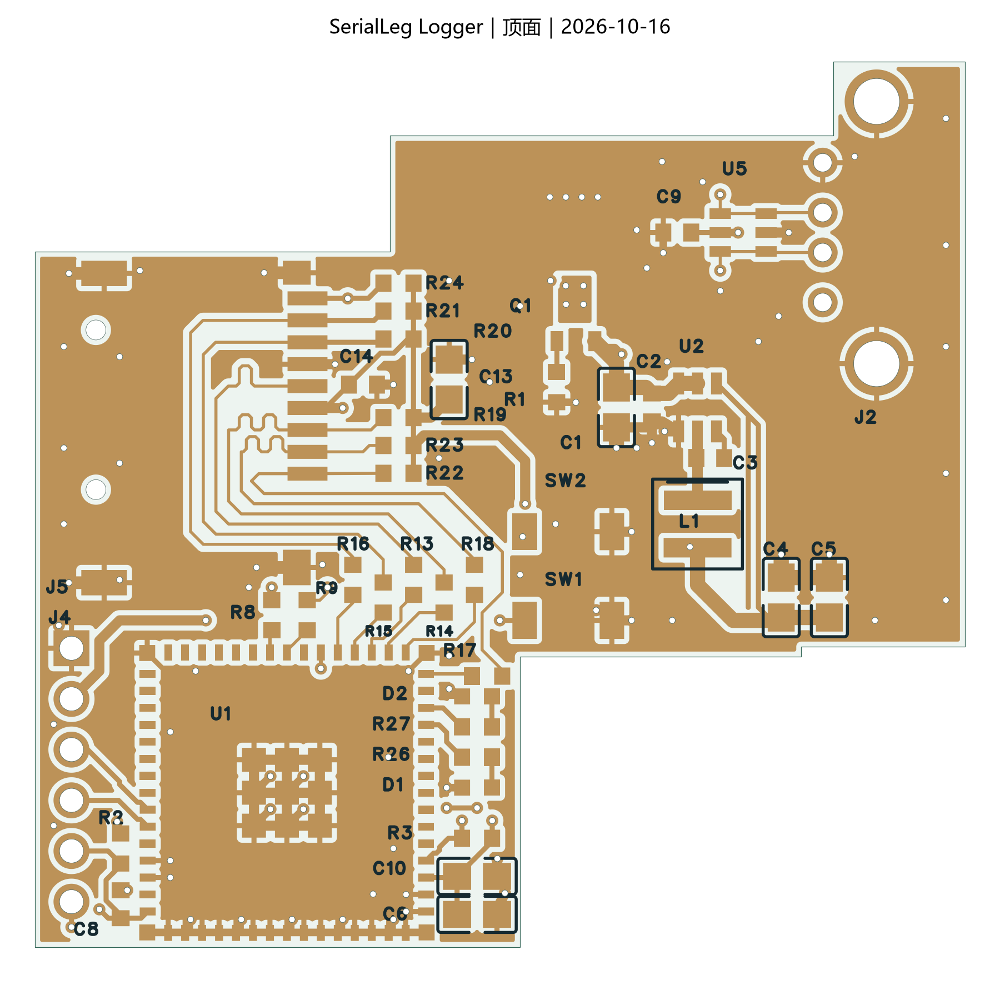
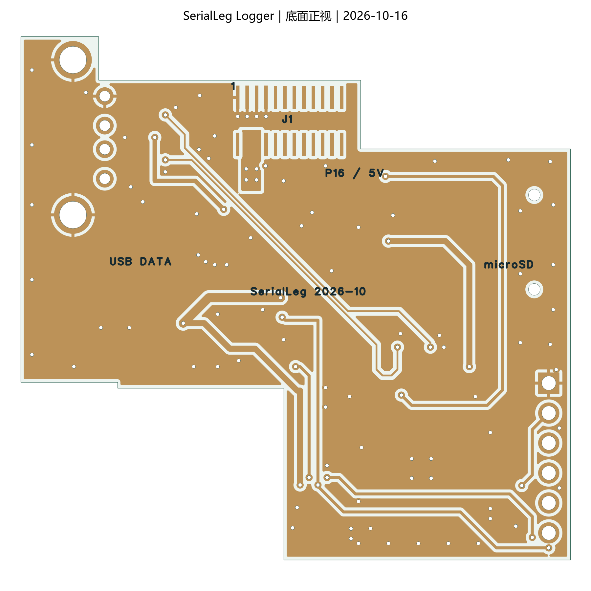

# 2026-10-16 顶底地铜与阻抗复核

本页记录补铜完成、信号转角尚未进一步优化时的版本。当前工程的线长、连接线数量及预览以[后续转角优化记录](../2026-10-16-corners/README.md)为准；层叠、线宽和过孔保持不变。

本记录对应 [SerialLegLogger.eprj3](../../../hardware/SerialLegLogger.eprj3) 及完整 `hardware` 目录的未提交工作树。软件为嘉立创 EDA 专业版 **4.1.71.7a7261be**，基础提交与原生检查数据保存在 [validation.json](validation.json)。

## 本次修改

- 顶层和底层分别添加 `GND_TOP`、`GND_BOTTOM` 实心覆铜，不保留孤岛；保留原来的 Buck 局部地铜和输入 `5V_IN` 铜区。
- 在 USB 接口及信号两侧、SD 卡座、板边、模组和供电区补充 **36 个人工选点的 GND 过孔**。孔径 12 mil / 0.3048 mm，焊盘直径 24 mil / 0.6096 mm，沿用当前工艺尺寸；总过孔数由 72 增至 108。
- 为 USB、SD 高速线添加 **10 个仅禁止覆铜的局部区域**，保留原有信号走线，规划侧铜间距至少 12 mil / 0.3048 mm。实际原生轮廓计入笔宽后，最小间距约 **12.127 mil / 0.3080 mm**；USB 长直段与 Gerber 独立对照约 0.3099 mm。
- 所有器件位置、43 个器件的型号/封装、357 段走线、已有过孔、板框、层叠和原有天线/卡扣禁布区保持不变。没有改变原理图电气内容，也没有修改或关闭 DRC 规则。

使用原生 CLI/API 创建指定的铜区、禁布区与过孔；脚本只落实人工选点和检查几何，没有使用自动布线、自动选路或 computer use。

## 检查结果

| 项目 | 结果 |
| --- | --- |
| 原生 DRC | 实际重填所有铜区，保存、关闭 PCB 标签并重开后，返回 `[]`，0 项 |
| 网表 | 回读当前原理图和 PCB，195 项引脚网络完全一致 |
| 电气/布线差异 | 原理图电气内容、信号线几何/线宽/换层、原有过孔均未改变 |
| 规则、层叠、板框 | 与本轮修改前一致；没有放宽规则或添加错误豁免 |
| 地铜连通 | Gerber 中顶层 9 个、底层 4 个平面内分区均连接到地过孔或接地通孔；L2/L3 各为一个连续主地铜区域；无悬浮地铜 |
| 天线禁布区 | 四个铜层的实际 Gerber 铜与天线禁布区相交面积均为 0 |
| USB / SD 参考面 | 完整走线宽度投影均被相邻内层地覆盖；排除信号自身过孔、连接器通孔的局部避空；换层附近原有回流地过孔保留 |
| 丝印 | 原生 Gerber 顶底丝印与阻焊开窗相交面积、板外面积均为 0 |
| 钻孔 | 108 个过孔、12 个连接器金属孔、2 个 SD 卡座非金属孔；无新增安装孔或 J1 定位孔 |

外层被走线分隔的铜区不必在同一层全部连成一片，但每片必须有可靠接地。本轮以实际 Gerber 铜区与地过孔/接地通孔交叉检查，确认各片通过内层共同接地。

原生 `POURED` 的实心轮廓还包含 `fineness` 笔宽。本工程为 8 mil，分析时需在轮廓两侧各计入 4 mil，与 Gerber 的 0.2032 mm aperture 相符。仅测轮廓路径会把侧向间距高估约 0.102 mm，也会低估地铜面积；本轮已修正该解析口径。检查前后工程源只有导出产生的文档头元数据差异，导出没有改变布线或覆铜记录。

新增地铜和地过孔会使相邻 `5V_IN` 填铜边界自动避让，两个输入铜区仍保留且连接正常。原生源回读、Gerber 几何与 DRC 分别核对，未以生成脚本自身断言替代原生检查。

## USB 与 SD 阻抗

目标层叠保持 **JLC04161H-3313**：外铜 0.035 mm，外层至相邻地层 PP 0.0994 mm、Dk 4.1。模型同时计入矩形铜厚、近似阻焊包覆（0.0152 mm、Dk 3.8）及同层两侧接地铜。[JLCPCB 层叠资料](https://jlcpcb.com/impedance)

采用固定截面的二维静电有限差分，分别计算介质与空气电容，推算准 TEM 阻抗；用两种网格检查离散误差。没有安装或调用外部自动布线器。

| 均匀走线截面 | 原有线宽/间隙 | 按实际最小侧铜间距估算 | 将较远地铜/无侧铜也计入后的范围 | 设计目标 |
| --- | --- | --- | --- | --- |
| SD 单端 | 线宽 6 mil | 50.95～51.37 Ω | 约 50.9～51.7 Ω | 50 Ω ±10% |
| USB 差分耦合段 | 线宽 6 mil，线间隙约 6 mil | 88.60～89.79 Ω | 约 88.6～89.9 Ω | 90 Ω ±10% |

两者估算均落在目标范围内，本轮不需要改变线宽或信号路径。乐鑫指南要求连续参考面，并建议 USB 周围及 SD 时钟周围铺地铜。[ESP32-S3 USB / SDIO 布局要求](https://docs.espressif.com/projects/esp-hardware-design-guidelines/en/latest/esp32s3/pcb-layout-design.html#usb)

这些数值是**目标层叠下的均匀截面估算**，不包括连接器、焊盘、串阻和过孔的完整三维不连续性，也不是实测或板厂确认值。成品铜截面、实际 PP 厚度与 Dk、阻焊厚度仍需要板厂确认。

USB 与 SD 的路径未改，前轮的长度核对继续适用：USB 计入 MCU 至串阻段后的长度差约 0.233 mm；SD 六线保持顶层、无信号换层，相对 CLK 最大长度差约 40.5 mil。

## 预览与后续

预览来自本次原生 Gerber。检查导出与工作脚本位于临时 `outputs/gnd-pour-2026-10-16/`，未作为生产包发布。

本轮未改原理图，因此没有重复 ERC；前轮原生 ERC 为 0 错误、1 组 U1/L1 `ATTRMATCHCODE` 警告。机械试配、托架适配、固件与样板功能测试仍按板 README 的待办推进；本轮没有实物测试、采购、下单、Git 提交或推送。
