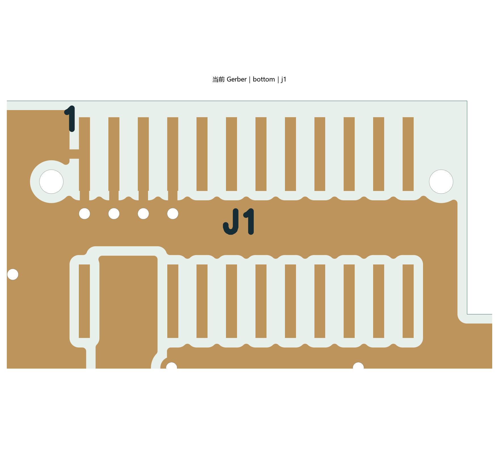

# J1 定位孔恢复与核对

日期：2026-10-16。软件：嘉立创 EDA 专业版 4.1.71.7a7261be。源工程为 `hardware/SerialLegLogger.eprj3` 及完整 `hardware/`，基于未提交工作树；未发布生产版本。

用户重新确认公座有定位柱，并提供了新的 [SGD-003 公座图纸截图](supplier-drawing.png)。本次以这张图的 P.C.B. PATTERN 和 24 针尺寸行为准：两个 **Ø0.65 mm 非金属化定位孔**，孔中心距 **10.60 mm**，孔在 **PIN1 所在排一侧**，距两排焊盘的中线 **1.25 mm**。图纸标注孔径公差为 **+0.05 / 0 mm**，实际投板需与板厂确认成孔公差。

此前引用的旧网页 PDF 与本次截图存在尺寸版本差异，不能混用。也没有直接恢复删除前的旧孔：旧孔记录为 Ø0.70 mm，本次按新图重新核定了孔径及所在排。J1 的 H40 高度选择、全部 24 个焊盘编号和电源网络保持不变；本次不改为 H10。

## 修改范围

- 更新工程封装 `01e8aa2f3ecf859d` 和 PCB 内嵌封装 `b306d946a8c90058_74047dd0201ff170`，两份均有两个定位孔；原理图中内嵌的封装也已同步保存。
- 定位孔由原生 API 创建为封装内的多层孔图元，不是电气过孔，也不是独立于 J1 的板级安装孔。
- 客户端封装保存接口未成功写回时，保留原生生成的 FILL 记录，按官方格式追加到工程内嵌封装；随后由客户端读取、正常保存并重开 PCB 验证。未重写其他焊盘、走线或电气连接。
- 七个覆铜区域全部重新填充。原生保存清除了 GND 对默认 `copperRegion` 的冗余绑定，实际仍使用同一默认规则，没有关闭检查或放宽数值。

## 验证结果

详见 [verification.json](verification.json)。

| 项目 | 本次结果 |
| --- | --- |
| PCB 保存重开后原生 DRC | 0 项 |
| 原理图 ERC | 0 错误；仍有 U1、L1 的 1 组 ATTRMATCHCODE 警告 |
| 网表 | 修改前后引脚网络不变；原理图与 PCB 的 195 项引脚网络一致 |
| 焊盘、走线、过孔、布局、板框、禁布区 | 前后核对无设计变化；仅原生数值序列化舍入 |
| 原生钻孔输出 | J1 新增 2×Ø0.65 mm NPTH；连同 J5 原有两个孔，全板共 4 个 NPTH |
| 孔中心坐标 | PCB 数据坐标，mm：`(99.788, -22.118)`、`(89.188, -22.118)`；中心距 10.60 mm |
| 新孔到铜最小距离 | 四层约 0.2565 mm，高于当前 0.20 mm NPTH 铜避让要求 |
| 地铜与参考面 | 未发现悬浮地铜；L2/L3 仍各为一个连续主地铜区域；USB、SD 参考面检查未发现新增缺口 |
| 实际渲染 | 已查看本次原生 Gerber 生成的 J1 底面局部图，孔位与预定坐标一致 |

当前为 43 个器件、356 段走线、108 个电气过孔。USB 外部铜线长度差约 0.233 mm，SD 相对 CLK 最大长度差约 42.45 mil，本次未改变路径和线宽。

本次只处理定位孔及必要的覆铜与检查。前轮发现的丝印间距不足、USB 插座侧两段 10 mil 走线的阻抗复核、制造层叠确认和新版托架适配仍需完成。准确采购版本、7.5 mm 名义叠高与实物插接仍待确认；没有据此认定整板已通过功能或装配实测。

临时完整快照、原生回读和 Gerber 位于 `outputs/j1-posts-2026-10-16/`。没有使用自动布线、computer use，未采购、下单或提交 Git。
