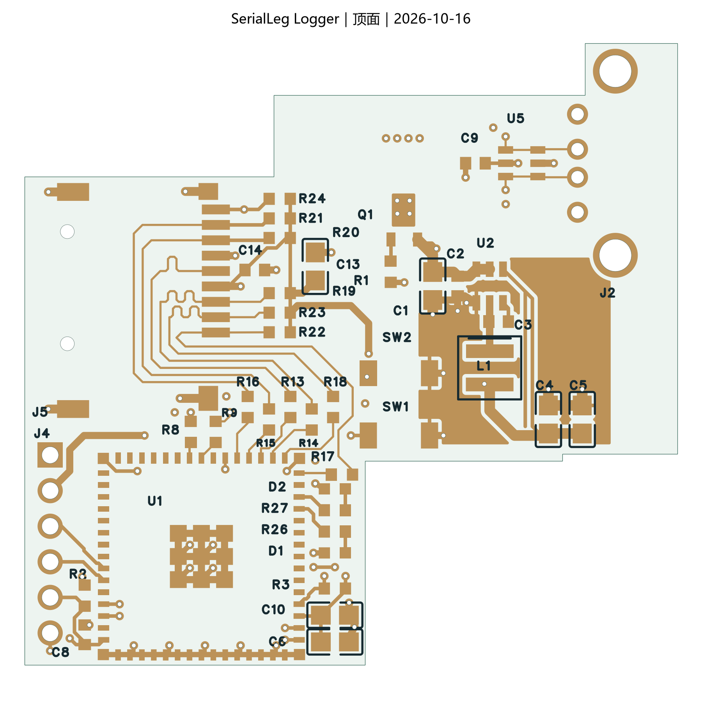
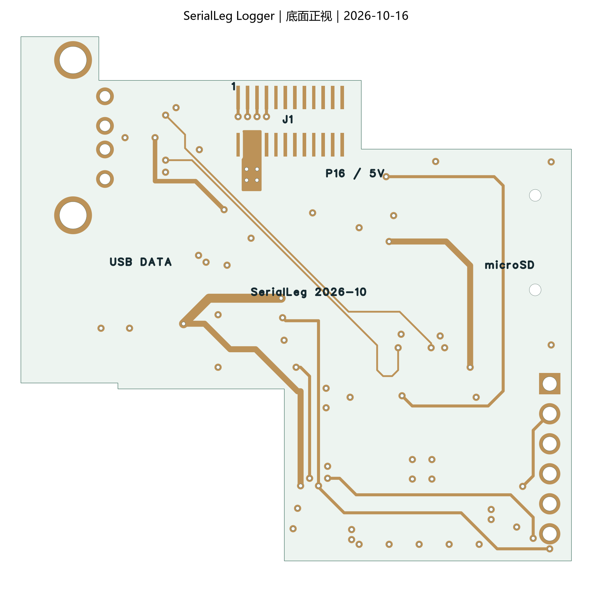

# 2026-10-16 布线与静态检查

本页对应顶底层大面积补铜之前的版本。当前工程已继续完成[顶底地铜与阻抗复核](../2026-10-16-gnd-pour/README.md)及[信号转角优化](../2026-10-16-corners/README.md)，过孔数、地铜、线长及预览以新记录为准。后续核对发现，本页约 1320.9 mm² 的地铜面积未计入原生填铜轮廓的笔宽，属于旧解析口径；新记录已计入笔宽并对照实际 Gerber。

当前原生工程为 [SerialLegLogger.eprj3](../../../hardware/SerialLegLogger.eprj3) 及完整 `hardware/` 目录。检查对象是本轮保存、关闭 PCB 标签并重新打开后的未提交工作树；基础提交、原始检查返回值与统计见 [validation.json](validation.json)。软件为嘉立创 EDA 专业版 **4.1.71.7a7261be**。

本轮保留用户已布的可复用线路，逐网人工确定路径，再通过原生 CLI/API 落实线段和过孔。几何脚本用于碰撞、长度与填铜参考面检查，没有执行自动寻路、自动布线或 computer use。

## 完成内容

- 原理图电气内容与器件型号保持不变。PCB 为 **43 个器件、357 段连接线、72 个过孔**；顶层 301 段、底层 56 段，两个内层均用于 GND。
- J1、J2、J4、J5、U1 的位置和插接方向保持不变；板框、天线禁布区、绝缘卡扣接触区保持不变。C13 移至上拉电阻右侧，释放 SD 信号出口；C6 下移 10 mil，释放相邻器件的丝印间隙。
- 完成 5 V 输入、Buck、3.3 V 分配、USB、SD、EN/BOOT、下载口和指示灯连接。Buck 的 FB 从输出电容端取样，细线避开 SW；输入电容与芯片地有短的顶层连接，电源区增加局部地铜。
- U5 的 1↔6、3↔4 分别用短直铜线贯通各自的数据网络，与器件内部贯通连接并联；两路数据线之间没有连接。5 脚仍接本地 5 V，J2 的 VBUS 仍为 NC。
- 补充去耦、连接器、模组地和 USB 换层附近的地过孔。恢复并实际填充 L2/L3 地铜，保留输入 5 V 的局部覆铜。
- 修正位号重叠、丝印压焊盘及底面文字方向。J1 的底面位号使用独立文字；以后若重新编号，需要同步该文字。

## 检查结果

| 检查 | 结果及范围 |
| --- | --- |
| 原生 DRC | 保存并重开后 **0 项**，包括未连接、间距及已配置的差分检查 |
| 原生 ERC | **0 错误**；保留 1 组 ATTRMATCHCODE 警告，涉及 U1、L1 |
| 网表 | 原理图与 PCB 的 **195 项引脚网络一致** |
| 原理图差异 | 除客户端生成的 DOCHEAD 元数据外，电气内容无变化 |
| 规则 | 数值阈值、检查开关和错误豁免未修改；69 条规则相关记录中，客户端保存清除了 5V 的冗余默认 COPPER 绑定。当前没有 5V 覆铜，不影响本次铜区；具体差异已记录 |
| 参考面 | L2/L3 各有一个连续主地铜区域，约 1320.9 mm²；USB/SD 实际线宽投影的未覆盖面积均为 0 |
| 丝印 | 最终原生 Gerber 中，顶底丝印与阻焊开窗的相交面积、板外面积均为 0 |
| 钻孔 | 72 个过孔，孔径最小 0.3048 mm；12 个连接器金属孔、2 个 SD 卡座非金属孔；没有恢复 J1 定位孔或安装孔 |

参考面检查使用实际 `POURED` 轮廓、圆弧与孔，检查整个铜线宽度，排除信号自身过孔及连接器通孔的局部避空。USB 换层旁已有地过孔。这个几何检查不等于完整电磁仿真，也不替代板厂 CAM。

U1 的属性警告原已存在；L1 使用按厂家焊盘尺寸建立的 XAL4030 封装，与供应商默认库属性不完全相同。本轮未通过删除警告或改规则隐藏它们。

## 关键走线

SD 六条高速线全部在顶层，参考 L2，没有换层。下表为模组焊盘中心至卡座焊盘中心的路径长度，计入串联电阻两焊盘之间的几何跨度，不计上拉支线。人工路径已逐段对照实际原生铜线。

| 信号 | 长度 mm | 相对 CLK 的差值 mil |
| --- | ---: | ---: |
| CLK | 28.947 | 0 |
| CMD | 28.100 | −33.37 |
| D0 | 28.893 | −2.14 |
| D1 | 29.829 | +34.73 |
| D2 | 27.919 | −40.48 |
| D3 | 28.080 | −34.14 |

最长约 1174 mil，最大相对偏差约 40.5 mil。Espressif 的指南要求以 CLK 为基准控制在 ±50 mil，建议总长度小于 2000 mil，并保持同层及连续参考地。[ESP32-S3 PCB Layout Design — SDIO](https://docs.espressif.com/projects/esp-hardware-design-guidelines/en/latest/esp32s3/pcb-layout-design.html#sdio)

USB 的主段在底层，参考 L3，DP/DM 各使用两个信号过孔。`USB_DP/USB_DM` 网络长度差为 5.93 mil；计入 MCU 到串阻的两小段后，端到端几何长度差约 **9.19 mil / 0.233 mm**。两路串阻跨度相同，两个过孔的竖直长度也相同，均不增加相对偏差。

主线使用 6 mil 宽度，USB 耦合段的边缘间隙约 6 mil。保持目标 JLC04161H-3313 四层结构：外铜 0.035 mm、外层到相邻地层的 PP 0.0994 mm / Dk 4.1。二维静电近似模型包含矩形铜截面和阻焊包覆；两种网格下，SD 单端约 **51～52 Ω**，USB 差分约 **89～93 Ω**。它们用于当前线宽选择，不能写成厂家已确认的控制阻抗或实测结果。[JLCPCB 层叠资料](https://jlcpcb.com/impedance)；[Espressif USB 布局要求](https://docs.espressif.com/projects/esp-hardware-design-guidelines/en/latest/esp32s3/pcb-layout-design.html#usb)

## L1 当前器件与后续限制

前一轮已替换的 L1 继续使用 **Coilcraft XAL4030-472MEC / 4.7 µH ±20%**，名义 4 × 4 mm、高度最大 3.1 mm；PCB 焊盘为 0.98 × 3.40 mm、中心距 2.37 mm。厂家表给出典型饱和电流 4.6 A（25 °C、30% 电感下降条件），直流电阻最大 44.1 mΩ。该电流不是本模块保证可持续提供的输出电流。[Coilcraft XAL4000 系列数据手册](https://www.coilcraft.com/pdfs/xal4000.pdf)；[AP63203 数据手册及布局建议](https://www.diodes.com/datasheet/download/AP63200-AP63201-AP63203-AP63205.pdf)

当前板仍为设计稿。投板前需要板厂确认实际层叠、阻抗、阻焊及钢网条件，并适配新的绝缘卡扣托架；旧 R0.5/R0.6 托架模型不能直接使用。P16 实际叠高、USB 插头包胶、卡扣受力和线缆弯曲空间仍需实物试配。

USB 无 VBUS 的固定系统连接方案没有改变；枚举、重新插拔、持续写卡、供电余量、温升和掉电文件损失仍待固件及样板测试。没有采购、下单、正式生产标签、Git 提交或推送。

## 当前预览与导出

预览来自最后一次成功的原生 Gerber 导出，临时导出位于 `outputs/manual-routing-2026-10-16/`。原生 PDF 的第二次导出超时，因此旧 PDF 不用于证明最终丝印；最终检查以回读源文件及最新 Gerber 为准。临时 Gerber 尚未作为生产包发布。
