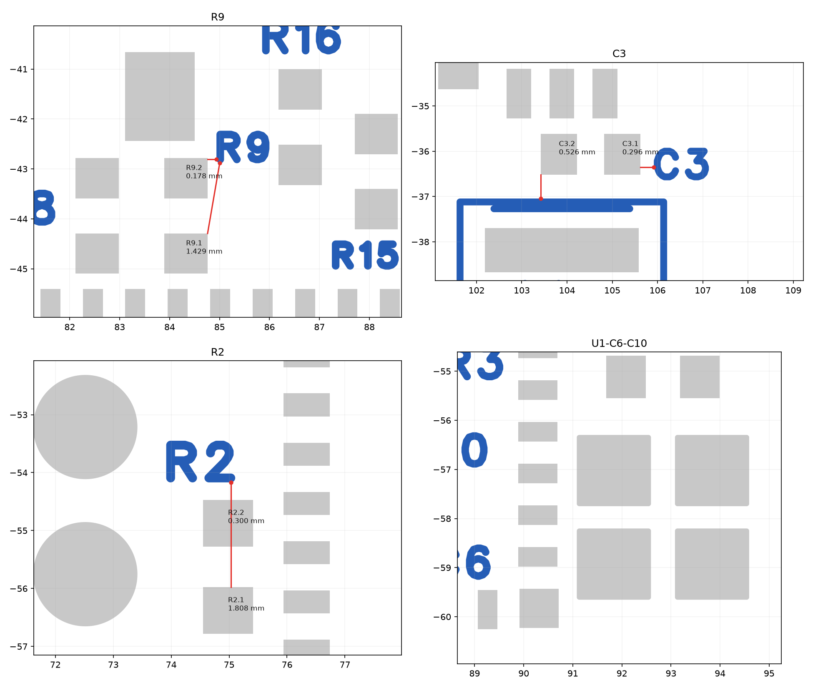
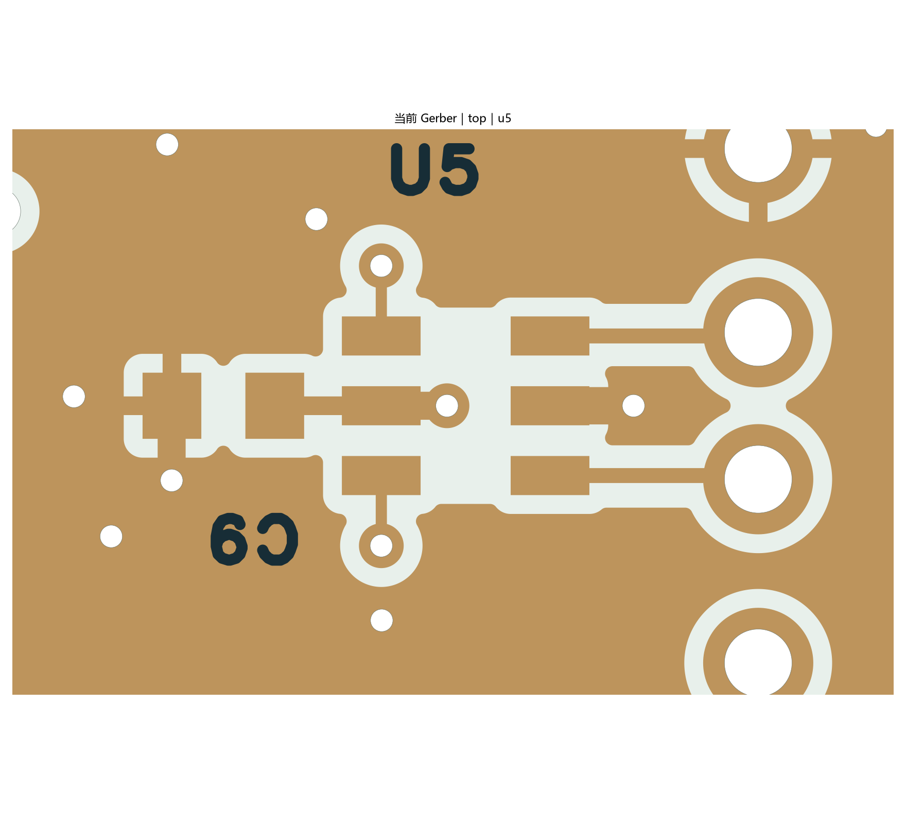

# 丝印间距与 USB 插座侧短线修订

日期：2026-10-16。软件：嘉立创 EDA 专业版 4.1.71.7a7261be。源工程为 `hardware/SerialLegLogger.eprj3` 及完整 `hardware/`；基于提交 `27a9aebb6f87ded35f4d1f7330f6f76075f9c465` 上的未提交工作树。本次未发布生产版本。

本轮解决丝印到焊盘不足 0.15 mm，以及用户新增 USB_DP_CONN / USB_DM_CONN 两段 10 mil 走线尚未按当前层叠复核的问题。详细量测、源几何差异及模型参数见 [verification.json](verification.json)。

## 丝印

移动 R9、C3、R2 位号及 J1 的 PIN1 文字。最终从原生 Gerber 与实际焊盘几何量得：

| 位置 | 修改前约值 | 修改后最小间距 |
| --- | --- | --- |
| R9.2 附近 | 0.025 mm | 0.1778 mm |
| C3.1 附近 | 0.042 mm | 0.2959 mm |
| R2.2 附近 | 0.046 mm | 0.2997 mm |
| J1.1 附近 | 0.117 mm | 0.3708 mm |

U1 旁 C6、C10 的封装轮廓也存在相同问题。这两颗器件采用 PCB 实例的层映射，将封装丝印移到顶层装配层；共享 C0805 库、物料、焊盘、编号和器件位置不变。顶层另保留 C6/C10 的独立位号文字，原装配层位号仍可见。以后移动这两颗器件时，应同时移动这两个顶层文本。

全板顶面丝印至铜焊盘最小约 **0.1530 mm**，底面约 **0.3708 mm**，未发现小于 0.15 mm 的位置。丝印与阻焊开窗没有重叠；顶面到阻焊开窗最小约 0.1016 mm。阻焊开窗包含扩展量，不等同于铜焊盘边缘，本次 0.15 mm 下限按[嘉立创工艺页面的丝印至焊盘要求](https://jlcpcb.com/capabilities/pcb-capabilities)核对。

## USB 插座侧短线

- J2 至 U5 的 USB_DP_CONN、USB_DM_CONN 各由两条线段构成，线宽由 **10 mil 改为 8 mil（0.2032 mm）**。中心线与两端焊盘均未移动，各长 **2.855493 mm**，仍等长。
- 扩展这两段所在的顶层覆铜避让边界；只限制铺铜，不禁止已有信号线。填铜后，均匀段采样的信号边缘至同层地铜约为 **0.310～0.354 mm**，两线之间保留接地铜。
- 新增 `USB_CONN` 差分对定义，使用现有规则；没有关闭检查、忽略错误或放宽规则。原来的 6 mil USB 主通道及 MCU 侧短线保持不变。

目标制造层叠仍为 [JLC04161H-3313](https://jlcpcb.com/impedance)：外层铜 0.035 mm、至相邻参考地的介质 0.0994 mm、Dk 4.1。短段中心距 1.89992 mm，耦合较弱，因此不能直接套用主通道 6 mil 线宽 / 6 mil 间隙的截面结论。

本轮使用包含两根线、中间和外侧地铜、连续 L2 参考地的二维静电截面模型。模型将侧铜距离统一取采样中的较小值 0.30988 mm；阻焊厚度 0.0152 mm、Dk 3.8 为计算假设。两档网格得到差分阻抗 **87.57 Ω、87.28 Ω**，可概括为约 **87～88 Ω**，接近 [Espressif 给出的 USB 90 Ω ±10% 目标](https://docs.espressif.com/projects/esp-hardware-design-guidelines/en/latest/esp32s3/pcb-layout-design.html)。

这是均匀截面的估算，不包含焊盘、U5 内部通路、过孔和转角的三维不连续性，也不是板厂阻抗确认或样板实测。投板应保持上述目标层叠，并让板厂按实际压合厚度、铜厚及阻焊参数确认；更换层叠后需重算。

## 最终验证

| 检查 | 结果 |
| --- | --- |
| 原生覆铜重填 | 7 个区域全部重填 |
| PCB 保存、重开后的原生 DRC | **0 项** |
| 原理图 ERC | 0 错误；保留原有 U1、L1 的 1 组 ATTRMATCHCODE 属性警告 |
| 引脚网络 | 原理图与 PCB 共 195 项一致，修改前后电气连接不变 |
| 元件 / 走线段 / 电气过孔 | 43 / 356 / 108，数量不变 |
| 焊盘、器件位置、板框、过孔 | 无物理变化 |
| USB 全部外部铜线长度差 | 0.233438 mm，修改前后不变；不计封装内部通路 |
| SD 相对 CLK 最大长度差 | 42.4467 mil，修改前后不变 |
| 参考地与回流 | USB、SD 线宽投影未发现参考面缺口，信号自身过孔及通孔局部避空除外 |
| 悬浮地铜 / 不同网络连通铜区 | 未发现 |
| 四层天线禁布区 | 无铜重叠 |
| J1 定位孔 | 两个 Ø0.65 mm NPTH 保留，四层孔至铜最小约 0.2565 mm |
| 渲染 | 已检查本轮 Gerber 的丝印局部、USB 局部及整板预览 |

原理图的电气连接和图形位置未改；C6/C10 最终仍引用原有 C0805 封装。实例层映射按官方格式保存并由客户端重开验证，未保留试用的局部封装副本或多余器件。

[当前顶面](../../../images/pcb-silk-usb-2026-10-16-top.png) · [当前底面](../../../images/pcb-silk-usb-2026-10-16-bottom.png)。临时回读与检查用 Gerber 位于 `outputs/silk-usb-2026-10-16/`。

本轮没有自动布线、computer use、采购、投板或 Git 提交。板厂层叠确认、J1 实物装配/托架适配、无 VBUS 固定 USB 方案的枚举与持续写卡测试仍属于后续工作；本记录不代表整板已通过功能实测。
