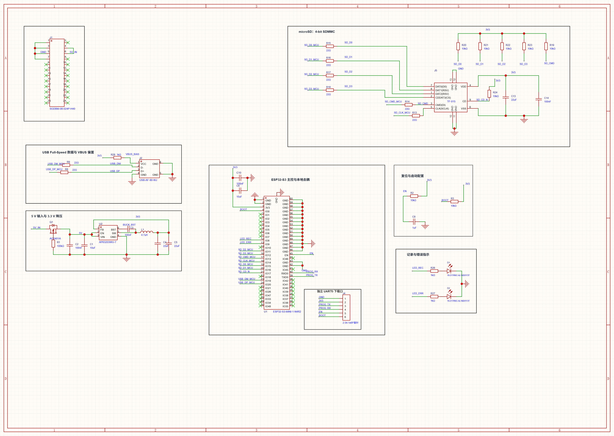
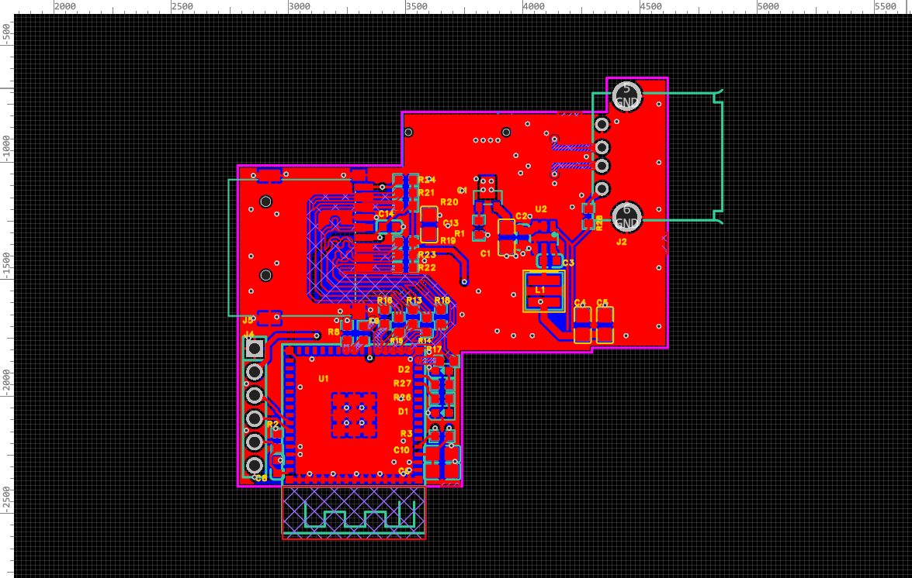
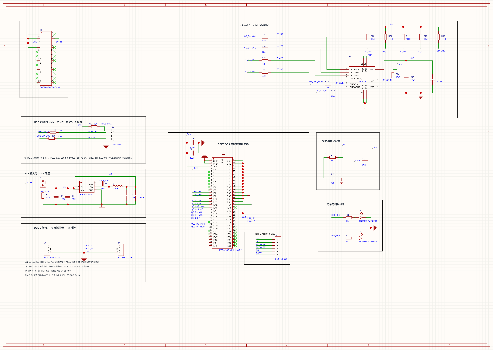
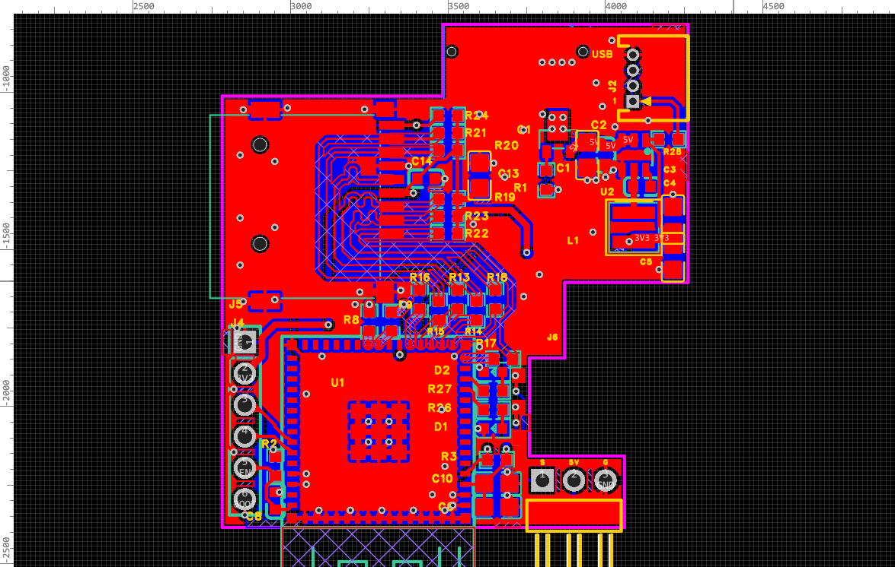
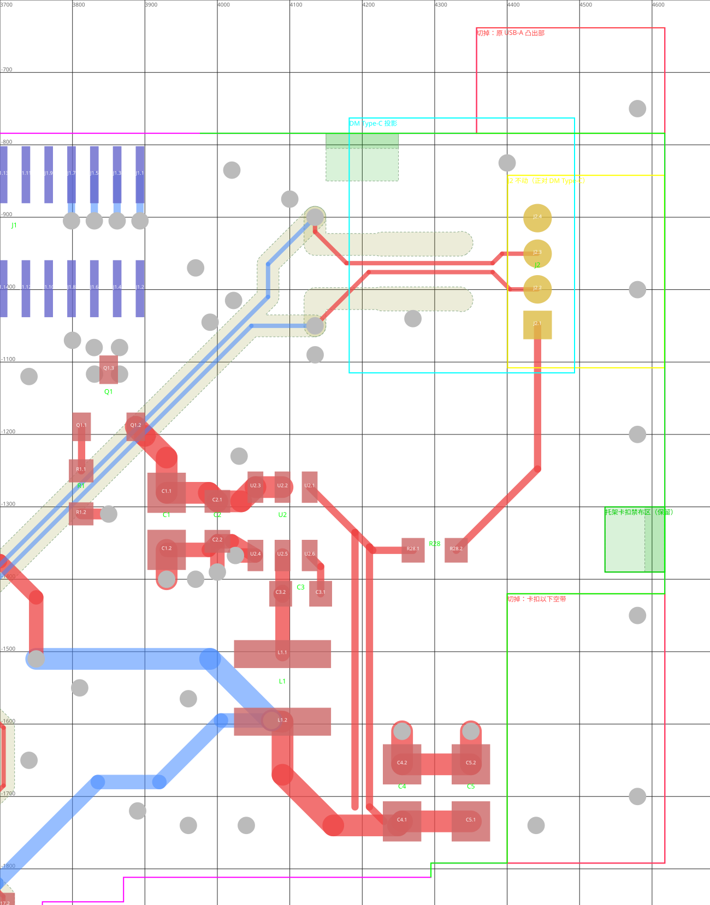
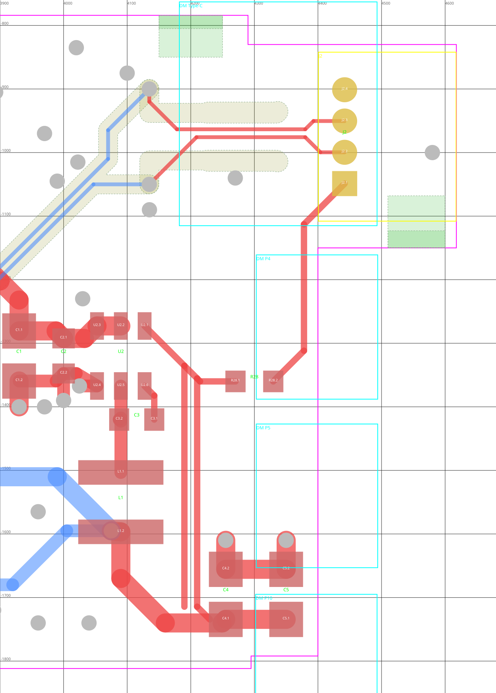
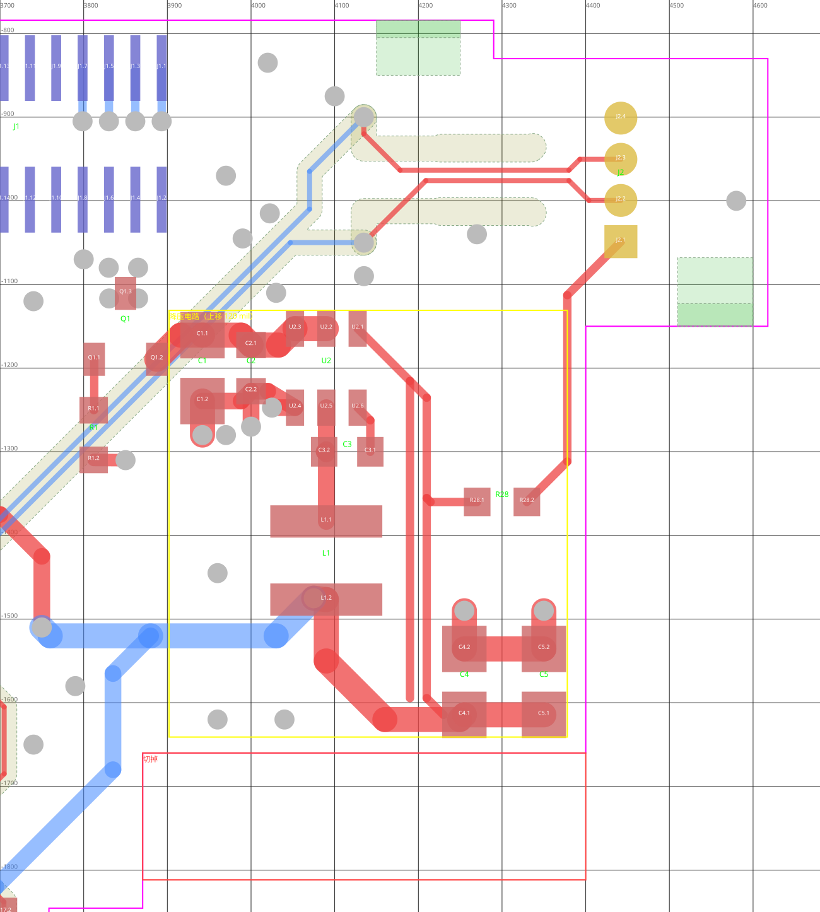
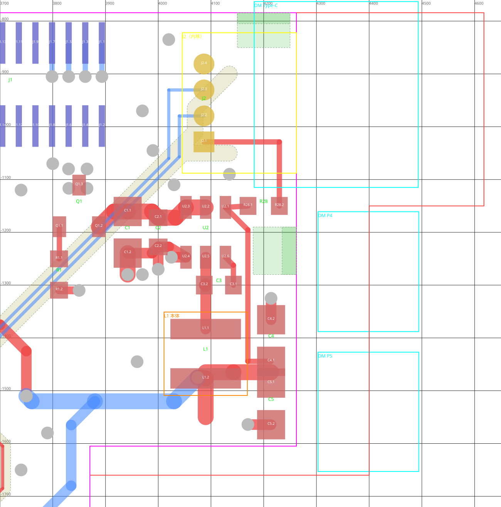

# v2 改版：VBUS 偏置、去掉 USB ESD 与按键；J2 线缆口、DBUS 穿板直插

> 2026-11-09 起，本记录引用的原始导出和旧版资料已移出 Git，文中只保留文件名、不再链接；需要时在提交 `1e0d038` 中查看，例如 `git show 1e0d038:<仓库内路径>`。

日期：2026-10-27。软件：嘉立创 EDA 专业版 4.1.71.7a7261be。分支 `codex/logger-v2`，基于硬件提交 `80ef1d9`（2026-10-16 丝印与 USB 短线修订版，即首块样板对应的设计）。本次未投板、未导出生产文件。数据见 `verification.json`。

改版依据是[首块样板 USB 联调](../2026-10-27-usb-bringup/README.md)：J2 VBUS 悬空时 DM-MC02 的 U7 无供电、根端口复位失败；样板上的 U5 使 D+/D− 漏到约 4.2 V；下载器已控制 EN/BOOT，SW1/SW2 实际不用。

> 本记录分两轮。第一轮（2026-10-27，下文“改动”至“未完成”）完成 VBUS 偏置、去 ESD、去按键；第二轮（2026-10-28，见文末“第二轮”一节）把 J2 从 USB-A 换成 XH2.54 4P 卧式座并新增 DBUS 转接；第三轮（2026-10-28，文末）因 XH 偏大把 J2 改为 MX1.25（Molex PicoBlade 53048-0410）。第一轮里 J2 USB-A 的位置、阶梯泪滴、R28 位置及当时的 DRC/网表/计数已被第二轮取代，只作追溯。

## 改动（第一轮）

| 项目 | v1 | v2 |
| --- | --- | --- |
| J2 VBUS | NC（带不连接标记） | 经 R28（1 kΩ 0603，0603WAF1001T5E / C21190）接 3V3，网络 `VBUS_BIAS`；3.3 V 低于 DM 系统 5 V，D14 不导通 |
| USB 数据线 | 经 U5（USBLC6-2SC6）内部 1↔6、3↔4 贯通 | 删除 U5 及其 5 V 去耦 C9；D+/D− 在 PCB 上直连（R8/R9 串阻保留），不再有 ESD 器件 |
| SW1 / SW2 | 复位、BOOT 按键 | 删除；J4 的 EN、BOOT 保留给下载器，EN 的 R2/C8 延时和 BOOT 的 R3 上拉保留 |
| 3.3 V 电源 | U2 + L1 降压 | 不变 |

## 原理图（第一轮）

- 删除 U5、C9、SW1、SW2 及只服务于它们的导线和两个 GND 标识；R9.2→J2.2 为 `USB_DM`，R8.2→J2.3 为 `USB_DP`；EN 线保持 C8.1–R2.1，BOOT 保留 R3 一段并补回网络名，C8.2 仍接 GND。
- 删除 J2.1 的 `NO_CONNECT` 标记；新增 R28 及 `VBUS_BIAS`、3V3 两段导线。模块标题改为“USB Full-Speed 数据与 VBUS 偏置”“记录与错误指示”，删除“U5 内部贯通”注释；USB 区标签、位号、阻值重新排布避免重叠。
- 结果：40 个器件；ERC 0 错误，仅保留 v1 已有的 `ATTRMATCHCODE`（U1、L1）属性警告。

## PCB（第一轮）

- 从原理图强制导入变更：U5、C9、SW1、SW2 移除，R28 加入，J2 焊盘网络更新。
- 按连通关系追出并删除残桩：EN（SW1.1→C8.1 支线 12 段、4 过孔）、BOOT（SW2.1→R3 旁分叉点 5 段、1 过孔）、5 V（U5/C9→(3900,-1202) 分叉点 8 段、2 过孔），以及 4 段被删器件到 GND 过孔的短线；这些 GND 过孔保留作缝合孔。删除前确认 EN 余下 U1.45→C8.1→R2.1→J4.5 连通。
- USB：插座侧 4 段短线改为 `USB_DM`/`USB_DP`，并在原 U5 两侧焊盘中心之间各补一段 8 mil 顶层直线（DM y=−1012.4、DP y=−937.6 mil，长 90.4 mil）。原顶层覆铜避让区保持不变，J2 泪滴处随覆铜重建自动加宽。
- R28 放顶层 (4280, −1230) mil，旋转 90°；J2.1→45°→竖直→R28.2，R28.1→竖直→45°→U2 输出侧 3V3 节点 (4210, −1355.4)，线宽 10 mil。位置不在任何禁布区内。
- R28 位号丝印默认位置压在 GND 过孔上，已移到 R28 右侧（字高 35 mil）：到 R28 焊盘约 0.33 mm、到 J2.6 约 0.89 mm。
- J2.1～J2.3 顶层加阶梯泪滴（USB 插拔时焊盘受力，防止近端走线撕裂）：每根线从焊盘中心沿原走线方向依次为 28 mil 至 30 mil、22 mil 至 39 mil、16 mil 至 47 mil、最后一级（USB_DM/DP 11 mil，VBUS_BIAS 13 mil）至 54.5 mil，圆头，之后接回原 8/10 mil 线。离焊盘边缘 0.4 mm 处线宽仍有 28 mil，约 1.3 mm 处过渡回原线宽。编辑器把与原线重叠的部分自动拆成首尾相接的分段，铜形与路径长度不变。
- 泪滴先试过两种做法后放弃：直接写入的 `TEARDROP` 记录和 API 建的带网络铜填充（FILL），覆铜重建都不避让，重建前后覆铜区域完全相同；因此改用走线实现。原生泪滴工具（GUI）本轮未使用。
- 所有改线均为人工给定的端点与折点，经原生 API 落图；没有使用自动布线、自动寻路或 computer use。

J2 局部（由保存后的 `Logger.epcb2` 记录绘制，覆铜圆弧已细分）：[usb-teardrop-v2-2026-10-27.svg](../../../images/usb-teardrop-v2-2026-10-27.svg)

## 验证（第一轮）

| 检查 | 结果 |
| --- | --- |
| 原理图 ERC | 0 错误；1 组 ATTRMATCHCODE 警告（U1、L1，v1 已有） |
| 原理图–PCB 网表 | 142 个引脚、33 个连接组完全一致 |
| 覆铜 | 7 个铺铜区全部重建（加泪滴后再次重建）；均不保留孤岛，23 块填充都连到同网络焊盘或过孔，无悬浮铜 |
| 原生 DRC | 0 项（重建覆铜、保存后运行，丝印调整后复查；加泪滴、重建覆铜后再次为 0） |
| J2 泪滴间距 | 三个焊盘及全部泪滴段到顶层 GND 覆铜（含热焊盘连接条）最小约 14.0 mil（0.355 mm），与焊盘到覆铜间距一致，无重叠；由文件 POURED 记录离线计算 |
| 器件 / 走线段 / 过孔 | 40 / 347 / 101（加泪滴前 333；v1 为 43 / 356 / 108） |
| 差分对 | 仅 `USB_FS`（USB_DP/USB_DM）；原 `USB_CONN` 因网络不存在已随导入移除 |
| USB 长度 | 计入 MCU 段 DM 1561.14、DP 1551.95 mil，差 9.19 mil，与 v1 相同 |

局部走线、焊盘与覆铜另用 API 读出的原生几何绘图核对。编辑器画布截图只能给出整板视图，局部缩放未生效；PDF 导出此前曾超时，本轮未使用。

## 未完成（第一轮）

- 未导出 Gerber/钻孔，未做制造几何和丝印到焊盘的 Gerber 级复核；投板前需导出并检查。
- USB 线去掉 ESD 后只适合机器人内部固定连接，插拔时应先断电。
- 板厂层叠/阻抗确认、J1 叠高与托架试配、电源温升等 v1 遗留项仍待处理。
- 固件仍保留“BOOT 长按 1 s 停止/继续记录”；v2 不再把 BOOT 当按键，取消该功能留待固件侧修改。

## 第二轮：J2 改 XH 线缆口、DBUS 穿板直插（2026-10-28 实施）

日期：2026-10-28。软件同上，分支 `codex/logger-v2`，在第一轮未提交的工作区上继续修改，仍未提交。数据见 `verification.json` 的 `round2`。下面先保留方案（“决定”“依据”“按 STEP 定的实施参数”），实施结果、验证和遗留项在其后。**其中 J2 的 XH 器件、位置、USB/VBUS 走线、计数与 USB 长度已被第三轮取代；DBUS、板框、J6/J7 部分仍有效（J6 封装已去掉板外本体轮廓，借用的 3D 模型已清空）。**

起因：样板上 USB 插拔力全部由 J1（P16 直插）承受，左右方向不抗力，焊盘有被拽脱风险；接收机立插在 DM 的 P6 上时，线的扭动会扳歪 P6 的针。

### 决定

1. **J2**：USB-A 改为 XH2.54 4P 卧式通孔座（JST S4B-XH-A 或同尺寸），1=VBUS_BIAS（R28）、2=USB_DM、3=USB_DP、4=GND。配外购“Type-C 公头转 XH2.54 4P”线，店家标注线序为红 5V、白 D−、绿 D+、黑 GND，到货后用万用表核对 Type-C 引脚再定稿。线缆出口扎到机架。
2. **DBUS 转接**：日志板在 DM P6 处开 U 形缺口，三面包住 P6，朝 P11 一侧敞开。约 7 mm 高的 1×3、2.54 mm 方孔直插排母从上方穿过缺口插满 P6，三根脚弯 90° 焊在缺口边的焊盘上；焊盘走线到板边的 1×3、2.54 mm 弯排针（卧式），接收机原杜邦头横插。针序与 P6 一致：1 S、2 5V、3 GND（达妙使用说明书 V1.1 第 6 节）。装配时先把日志板插上 J1、排母插上 P6，再焊排母的脚，消除 J1 与 P6 的位置误差。
3. 不剪 P6 的针，不改主控固件（遥控仍走 UART5）。日志板借排母与 P6 形成第二支点。

### 依据

- P6（达妙官方 `CtrBoard-H7_V1.0-240112A.step`）：1×3、2.54 mm 直排针，0.6 mm 方针；模型中塑料座高 2.0 mm，针尖距 DM 板面 8.0 mm。同一模型里 P11 的排针高 8.54 mm，P6 实物可能也更高，须实测。
- J1/P16 为山谷道 SGDBM/SGDBF 系列：P16 母座 H35 配 H40 公座，叠高 7.5 mm；按厂家图，H35 母座配公座最高 4.0 mm，叠高不能再加。
- 排母装在日志板底面不可行：P6 塑料顶到日志板底面只有 5.0～5.5 mm，针露出 6 mm。查过 Samtec SLW/CES/BCS、Sullins NPxC、Würth WR-PHD 等矮座、穿透式和底部插入式母座，均需剪针或改叠高。
- 坐标换算（J1 中心对 P16 中心，日志板相对 DM 转 90°，已用 P12/P13/P15 避让间隙核对）：x_DM = 24.652 − (y_mil + 920) × 0.0254，y_DM = (x_mil − 3720) × 0.0254。P6 三针中心约为 (3814, −1901 / −2001 / −2101) mil，P6 塑料边到现板边约 0.63 mm；P6 中间针到 P16 中心约 27.6 mm。
- P11（PWM 3 × 4 排针）在 P6 的 +x 侧，两者塑料座只差 0.13 mm，针高 8.54 mm，高于日志板底面，日志板不能盖住 P11 的针。

### 按 STEP 定的实施参数

用户要求按模型尺寸实施，不另做实测。两份达妙模型（`CtrBoard-H7_V1.0-240112A.step`、`CTRBOARD_001.stp`）在 P6 处顶点高度一致：针底 −3.0 mm、DM 板面 0、塑料顶 2.0 mm、针尖 8.0 mm。

| 项目 | 取值 | 说明 |
| --- | --- | --- |
| 高度基准 | P6 塑料顶 z = 2.0，针尖 8.0；日志板底 7.5、顶 9.1 mm | z 以 DM 上表面为 0 |
| 排母 | Samtec BCS-103-L-S-TE：高 7.37 mm，插入深度 4.34～7.24 mm，配 0.64 mm 方针，尾长 3.05 mm | 立在 P6 塑料上时顶面 z = 9.37，高出日志板顶面 0.27 mm；P6 针插入 6.0 mm。立创只见 PE-BE 型（C7219505，尾部偏置），TE 型需从 RS/DigiKey/Samtec 购买 |
| 排母本体（日志板坐标） | x 3764.5～3864.5 mil，y −1851.5～−2151.5 mil | 与 P6 塑料座投影相同 |
| 缺口 | 三面各留约 0.15 mm（6 mil）：左墙 x = 3758.5、上墙 y = −1845.5、下墙 y = −2157.5，+x 侧（P11）敞开 | 上墙由右部下边 −1811.7 下延；左墙由块状区右边 3739.7 外推 |
| 弯排针所在凸台 | 约 x 3740～4060、y −2157.5～−2384.5 mil，在 DM 右边缘之外 | 下方没有 DM 器件；离天线禁布区（x 2975～3585，板边外）约 3.9 mm；托架卡扣禁布区 x 3650～3730 紧邻 |
| 弯排针 | 1×3、2.54 mm 直角公针，针尖朝 −y（DM 外侧）伸出板边 | 接收机在 DM 右侧外平放 |
| 排母的脚 | 三根同向往 −x 弯 90°，落在左墙内侧的焊盘上 | 焊盘与 D2、R27、R26、D1 等（x 3655）间距紧，需要时内移这些元件 |
| 网络 | DBUS_S、DBUS_5V、GND 一一直通；DBUS_5V 只连 P6 2 脚与弯排针，不并到日志板 5V_IN | P6 的 5V 是 DM 板内 5V_S（0.6 A 支路），与 P16 的对外 5 V 不是同一电源 |
| 针序 | 1 S、2 5V、3 GND | P6 在 STEP 中的放置原点位于 DM x 49.58 mm 一端（日志板 y −1901.5），推断这一端是 1 脚，即 S。2026-10-29 已用达妙官方管脚标注图核对一致，见文末“P6 针序核对” |

未定或留到装配验证的：接收机型号与长度；P11 实际是否插舵机；托架按新板形重新适配；实物 P6 若比模型高（同模型 P11 为 8.54 mm），排母会被顶高，需在装配时复核。

### 实施结果

#### 器件

| 位号 | 器件 | 说明 |
| --- | --- | --- |
| J2 | JST S4B-XH-A(LF)(SN)，立创 C157925 | XH 2.5 mm 4P 卧式（侧插）通孔座。封装用嘉立创库 `CONN-TH_S4B-XH-A-LF-SN`：针距 98.43 mil（2.5 mm），孔 1.0 mm，焊盘 1.6 mm（焊环 0.3 mm），外形框宽 12.75 mm、针排前 9.33 mm／后 2.43 mm。**外形尺寸只按嘉立创库封装核对；JST 原厂图本轮未逐项读取，投板前补核** |
| J6 | Samtec BCS-103-L-S-TE | 自建封装 `BCS-103-L-S-TE_BENT-TAIL-PADS`（见下）。原理图沿用立创库 PM254-1-03-Z-8.5 的 1×3 排母符号作底，已把位号、名称、制造商与料号改为 Samtec，并清空立创编号、立创名称、供应商封装等字段，防止 BOM 按 PM254 下单 |
| J7 | PZ254R-11-03P，立创 C492411 | 1×3、2.54 mm 直角公针（`HDR-TH_3P-P2.54-H-M-W10.4`，孔 1.1 mm，焊盘 1.8 mm，配合针长 6 mm，塑高 2.5 mm） |

J6 自建封装只有三个顶层表贴焊盘：排母本体在板外缺口内（坐在 P6 上），不画在 PCB 上，以免在编辑器里看成浮空器件；本体位置见下方“DBUS 缺口与凸台”局部图。器件外形层只框三个焊盘；原点为排母本体中心（2 脚），与 P6 中间针重合。封装文档内嵌在原理图和 PCB 文件中（与 J1 自建器件相同的保存方式），没有放到外部个人库。

焊盘依据：

- 尾脚 0.64 mm 方针、尾长 3.05 mm；排母立在 P6 塑料上时顶面 z = 9.37 mm，比日志板顶面（9.1）高 0.27 mm。
- 三根尾脚在本体顶面向 −x 弯 90°。按内弯半径约 0.3 mm（约半个针厚）估算，水平段从 x ≈ 3790 mil 起，尾端约落在 x 3700～3715 mil，随弯折点前后变化。
- 焊盘 42 × 46 mil（1.07 × 1.17 mm），中心 x = 3724.5 mil，y 与 P6 三针相同（−1901.5 / −2001.5 / −2101.5），中心距 100 mil。42 mil 长覆盖从左墙内侧到尾端的落点；46 mil 宽在 0.64 mm 尾脚两侧各留约 0.26 mm 横向容差。
- 焊盘右边到板边 13 mil（规则 11.8 mil）；左边到左移后的 R27/D2/R26/D1 右焊盘 14.4 mil。
- 直接弯 90° 后尾脚下表面约高出焊盘 0.6 mm。装配时需在墙边把尾脚再向下压弯贴到焊盘，或用焊锡填满间隙；尾端多余部分剪掉。

#### 原理图

- 删除 USB-A J2 及其两个外壳脚的 GND 导线和地标识；新 J2（XH 4P）放在原位置，1～4 脚直接接原有导线：1 `VBUS_BIAS`（R28.2）、2 `USB_DM`（R9.2）、3 `USB_DP`（R8.2）、4 GND。
- 模块标题改为“USB 线缆口（XH2.54 4P）与 VBUS 偏置”。旁注：店家线序 1 红 VBUS / 2 白 D− / 3 绿 D+ / 4 黑 GND，到货实测确认。
- 新增“DBUS 转接：P6 直插排母 → 弯排针”模块：J6.1–J7.1 `DBUS_S`、J6.2–J7.2 `DBUS_5V`、J6.3–J7.3 GND。`DBUS_5V` 只连这两个脚，没有并到 5V_IN。模块内注明 J6 的装配方式、P6 1 脚按 STEP 推断需对照 DM 丝印、DBUS_5V 来自 DM 板内 5V_S。
- ERC：0 错误；1 组 ATTRMATCHCODE 警告，涉及 U1、L1（第一轮已有）和 J6（手改了制造商料号，与底层库器件的编号不一致，属预期）。

#### 板框

在原轮廓基础上只改右下角，外接尺寸仍为 46.60 × 44.35 mm，面积由 1486.9 增至 1540.5 mm²：

- 上墙：x 3739.7～3870.5 mil 一段由 y −1811.7 下延到 −1845.5，只盖住 P6 本体加 6 mil；x > 3870.5（P11 一侧）仍为 −1811.7。
- 左墙：x = 3758.5（原块状区右边 3739.7 外推）；缺口底 y = −2157.5，+x 侧敞开。
- 凸台：x 3739.7～4060、y −2157.5～−2384.5，与左下块状区连成一体。
- 缺口三面到 P6 本体投影各约 6 mil（0.15 mm）。天线禁布区（x 2975～3585，板边外）、托架卡扣禁布区（x 3650～3730）及其余禁布区未改。

#### PCB

- **J2**：中心 (4220, −1065) mil，旋转 270°，插口朝 +x。针排 x = 4220：4 GND y −917.4、3 DP −1015.8、2 DM −1114.2、1 VBUS −1212.6。
  - 外形框为 x 4124～4587、y −814～−1316，前沿离板边 4617.6 约 0.8 mm。前沿没有齐板边，是为了同时避开两处托架卡扣禁布区：顶边 (4150～4250, −784～−805) 和右边 (4590～4617, −1300～−1390)。外形框宽 12.75 mm，前沿齐板边时上下两处无法同时满足。
  - 插头从板边外插入，线缆在板外弯折。
- **USB 差分线**：J2 一侧的旧顶层短线、旧泪滴和 J2.1 到 R28 的走线全部删除，从原换层过孔 (4134.8, −900 / −1050) 就近重走。
  - DP：过孔 → 竖直 → 45° 到 J2.3，6 mil。
  - DM：过孔 → 水平 → 竖直 → 45° → 水平 → 45° 到 J2.2，6 mil。多绕约 44 mil 用于等长。
  - 主通道仍走底层、参考 L3，原换层过孔和旁边的地过孔保留。
- **R28**：移到 (4300, −1360)，旋转 0°。
  - VBUS：J2.1 → 竖直 → 45° 到 R28.2，10 mil。
  - 3V3：R28.1 → 水平 → 45° 接到原 3V3 节点 (4210, −1355.4)，10 mil。
- **过孔**：J2 范围内删除两个与新焊盘冲突的 GND 过孔 (4250, −1140)、(4210, −1190)。原 J2 外壳脚的 GND 连接随旧封装删除；GND 连通由 DRC 连接检查和覆铜孤岛检查确认。
- **新焊盘泪滴**：原 J2.1～J2.3 的阶梯泪滴随旧焊盘删除；新 J2 未加泪滴，焊环也未加大。依据：
  - 新座为通孔，插拔力由镀铜孔壁和四层焊盘承受；
  - 线缆在机身上扎带做应力释放，不再由插座直接承受侧拉；
  - 1.6 mm 焊盘 / 1.0 mm 孔的 0.3 mm 焊环满足 JLC 常规工艺。
  - 若装配后仍担心，可在 DP/DM/VBUS 入焊盘处补阶梯泪滴。
- **DBUS**：
  - J6 中心 (3814.5, −2001.5)；J7 中心 (3900, −2235)，针排 y = −2235（S 3800、5V 3900、G 4000），针尖朝 −y 伸出板边约 6.7 mm。塑料本体底边超出板边约 0.28 mm。
  - S：J6.1 → 过孔 (3716, −1951.5) → 底层 8 mil → x 3740 → J7.1。
  - 5V：J6.2 → 过孔 (3716, −2051.5) → 底层 12 mil → y −2300 → J7.2。
  - G：J6.3 → 顶层 12 mil → x 3740 → y −2300 → J7.3。
  - 两个信号过孔放在相邻焊盘之间的空隙里，到两侧焊盘各约 15 mil。
- **让位**：为 J6 焊盘让位，R27、D2、R26、D1 左移 12 mil，改了它们的 LED_REC、LED_ERR、`$1N337`、`$1N339`、GND 连线。LED_REC 改走 x 3582，避开左移后的 R27.1。C10、C6 的两个地过孔移到 (3688, −2208)、(3688, −2282)，给 DBUS_5V 底层让路。
- **丝印**：
  - J2：板右上空出的角上加“USB”字样和 J2 位号，1 脚下方加“1”。
  - J7：针上方顶层“S / 5V / G”。底层镜像注“J7 P6:1=S 2=5V 3=G”“装配前对照DM丝印”。
  - J6：位号放在缺口上方。
  - 估算新丝印到焊盘最小约 0.23 mm（J7 针名），S/5V/G 到缺口底板边约 0.2 mm。
- 所有改线均为人工给定的端点与折点，经原生 API 落图；没有使用自动布线、自动寻路或 computer use。

局部（由 API 读出的原生几何绘制，不含覆铜）：[DBUS 缺口与凸台](../../../images/dbus-notch-v2b-2026-10-28.svg)（XH 版 J2 局部图已随第三轮替换为 MX1.25 版）

### 第二轮验证

| 检查 | 结果 |
| --- | --- |
| 原理图 ERC | 0 错误；1 组 ATTRMATCHCODE 警告（U1、L1、J6） |
| 原理图–PCB 网表 | 146 个引脚、35 个连接组完全一致；嘉立创“导入变更”同步后原生 DRC 无网表错误 |
| 覆铜 | 7 个铺铜区在全部布线后重建；23 块填充都连到同网络焊盘或过孔，无悬浮铜 |
| 原生 DRC | 0 项（含 J6 焊盘到板边 ≥ 11.8 mil、USB_FS 差分对长度差 ≤ 10 mil 两条规则；丝印最后调整后复查） |
| 器件 / 走线段 / 过孔 | 42 / 350 / 101 |
| USB 长度 | 主通道 DP 1417.47、DM 1416.31 mil，差 1.16 mil；计入 MCU 段 DP 1462.62、DM 1476.58 mil，差 13.96 mil（0.35 mm） |
| 板框 | 外接 46.60 × 44.35 mm，面积 1540.5 mm² |

过程中遇到的工具问题，供后续参考：

- 先画走线、后放过孔时，DRC 报走线未连接；删掉与过孔相接的线段后重画即正常。以后应先放过孔再画线。
- 修改原理图器件属性后，需要再执行一次“导入变更”，DRC 的网表错误才会消失。

### 第二轮遗留与待验证

- **J2**：XH 外形未对照 JST 原厂图逐项核对。线缆线序（红/白/绿/黑）按店家标注，到货后用万用表对 Type-C 引脚核对再定稿。插头外伸、线缆出口与扎带位置需实物试配。
- **J6**：
  - 借用的 PM254 排母 3D 模型已从内嵌器件文档清空。没有 BCS-103 的 3D 模型，3D 预览里缺口处不显示排母。
  - 尾脚弯折后约有 0.6 mm 高度差，需压弯或用焊锡填补。尾端落点为估算值。
- **P6 1 脚**：方向按 STEP 推断为 y −1901.5 一端；2026-10-29 已用达妙官方管脚标注图核对一致（见文末“P6 针序核对”）。
- **高度**：模型中 P11 针高 8.54 mm；实物 P6 若比模型高，排母会被顶高，装配时复核。
- **托架**：需按新板形（缺口与凸台）重新适配。凸台紧邻卡扣禁布区。
- **接收机**：型号、线长与 P11 是否插舵机未定。
- **制造**：未导出 Gerber/钻孔，未做 Gerber 级制造几何与丝印检查；板厂层叠/阻抗确认等第一轮遗留项照旧。
- **固件**：“BOOT 长按停止/继续记录”的取消仍留给固件侧。

## 第三轮：J2 改 MX1.25（2026-10-28）

用户认为 XH2.54 偏大，J2 改为 MX1.25（PicoBlade）4P 卧式通孔座。网络、针序、R28 偏置和无 ESD 均不变，DBUS 部分不受影响。

| 项目 | 内容 |
| --- | --- |
| 器件 | Molex 53048-0410（立创 C588275），PicoBlade 1.25 mm 4P 直角通孔。嘉立创库封装 `CONN-TH_530480410`：针距 49.21 mil（1.25 mm），孔 0.6 mm，焊盘 1.0 mm，外形 6.75 × 5.5 mm。**外形只按嘉立创库封装核对，Molex 原厂图未逐项读取** |
| 针序 | 1 VBUS_BIAS、2 USB_DM、3 USB_DP、4 GND，与原 J2 相同；需改配 Type-C 公头转 MX1.25 4P 线，线色与线序到货实测确认 |
| 位置 | 中心 (4442, −975) mil，旋转 90°，插口朝 +x。外形框 x 4400.7～4617.2、y −842.1～−1107.9，前沿齐板边（4617.6）。两处托架卡扣禁布区都不再冲突 |
| 焊盘坐标 | 针排 x = 4442：4 GND y −901.2、3 DP −950.4、2 DM −999.6、1 VBUS −1048.8 |
| USB | 从原换层过孔重走，顶层 6 mil、线距约 6.4 mil 耦合，进 J2 前 45° 散开到 1.25 mm 针距。DP：过孔 (4134.8, −900) → (4134.8, −920) → (4178.2, −963.4) → (4380, −963.4) → (4393, −950.4) → J2.3。DM：过孔 (4134.8, −1050) → (4209, −975.8) → (4380, −975.8) → (4403.8, −999.6) → J2.2。参考 L2 |
| VBUS | J2.1 → (4442, −1247.7) → 45° 到 R28.2 (4329.7, −1360)，10 mil；R28 位置与 3V3 走线不变 |
| 过孔 | GND 缝合孔 (4270, −975) 挡在差分对上，移到 (4270, −1040) |
| 丝印 | “1”移到 J2.1 左侧 (4380, −1048.8)，到焊盘约 0.84 mm。“USB”和 J2 位号保持在板右上角；库封装自带 1 脚三角标记 |
| 泪滴 / 焊环 | 未加。新座为通孔，线缆扎带应力释放；0.2 mm 焊环满足 JLC 常规工艺，但比 XH 小，若装配后担心可在 DP/DM/VBUS 入焊盘处补阶梯泪滴 |

局部（原生几何绘制，不含覆铜）：[J2 MX1.25 区](../../../images/j2-mx125-v2b-2026-10-28.svg) · [DBUS 缺口与凸台](../../../images/dbus-notch-v2b-2026-10-28.svg)。原理图图片 [schematic-v2b-2026-10-28.png](../../../images/schematic-v2b-2026-10-28.png) 已按第三轮更新。

### 第三轮验证

| 检查 | 结果 |
| --- | --- |
| 原理图 ERC | 0 错误；1 组 ATTRMATCHCODE 警告（U1、L1，第一轮已有） |
| 原理图–PCB 网表 | 146 个引脚、35 个连接组完全一致 |
| 覆铜 | 7 个铺铜区重建；23 块填充都连到同网络焊盘或过孔，无悬浮铜 |
| 原生 DRC | 0 项 |
| 器件 / 走线段 / 过孔 | 42 / 351 / 101 |
| USB 长度 | 主通道 DP 1616.94、DM 1608.24 mil，差 8.70 mil（规则 ≤ 10 mil）；计入 MCU 段 DP 1662.09、DM 1668.51 mil，差 6.42 mil |
| 板框 | 未改，外接 46.60 × 44.35 mm，面积 1540.5 mm² |

工具注意：原理图文字经 API 修改后编辑器里显示已改，但保存不落盘（第二轮的 USB 模块标题也因此未改成功）。两条文字改为在关闭编辑器后向 `Main.esch2` 追加同 id、更高 ticket 的记录，重开后确认显示正确。每次重开工程后通道号会重新编号，需要再执行一次“导入变更”，否则 DRC 报网表错误；本轮已同步，DRC 0 项。

### 第三轮遗留

- Molex 53048-0410 外形未对照原厂图逐项核对。
- 配套线缆需改为 Type-C 转 MX1.25 4P，线序到货实测。
- 插头外伸与扎带位置需实物试配。
- 其余遗留项同第二轮：P6 1 脚、J6 尾脚弯折、托架、Gerber 与板厂层叠确认、固件 BOOT 长按功能。

## J6 焊盘锚定（2026-10-28）

J6 的三根尾脚只焊在表贴焊盘上。拆装日志板时，把排母从 P6 上拔下来的力全部经尾脚作用在焊盘边缘，振动时也会反复拉扯，焊盘有被掀起的风险。本轮在 PCB 上加锚定：

| 措施 | 内容 |
| --- | --- |
| 阻焊压边 | 三个焊盘顶层阻焊扩展改为 −3 mil：铜皮仍为 42 × 46 mil，阻焊开窗约 36 × 40 mil（0.91 × 1.02 mm），阻焊压住焊盘四周，防止从边缘起皮；开窗仍大于 0.64 mm 尾脚 |
| 焊盘内过孔 | S、5V 焊盘内各加一个 0.3048 / 0.6096 mm 过孔，位于 (3714, −1901.5)、(3714, −2001.5) mil，孔壁把顶层焊盘与底层焊环连成“铆钉”；原焊盘间换层过孔保留 |
| 地焊盘实心连接 | J6.3（GND）焊盘与顶层 GND 覆铜由两条 10 mil 辐条改为实心连接（DIRECT），焊盘与大面积地铜连成一体 |
| 走线调整 | 为给 5V 焊盘内过孔让路，DBUS_S 底层线改为：过孔 (3716, −1951.5) → (3740, −1975.5) → x 3740 直下到 J7.1 |

结果：原生 DRC 0 项（覆铜重建后）；原理图–PCB 网表 146 引脚、35 组一致；22 块覆铜填充都连到同网络焊盘或过孔，无悬浮铜；器件 / 走线段 / 过孔为 42 / 350 / 103。

注意事项：

- S、5V 的焊盘内过孔没有塞孔，手焊时会有少量焊锡流进孔内，属正常现象；若改用回流焊或在意外观，下单时可选树脂塞孔。
- PCB 上的加固只是补充。**装配后应用环氧把排母本体粘到缺口三面墙上**，让拆装和振动的力由胶和板边承担；拆日志板时手指顶住 J6 本体一起抬起。

## 布局紧凑化（2026-10-28）

起因：USB-A 换成 MX1.25 后，原 USB-A 占用的右上角凸出部和右侧一条板面空着，用户认为整板显得太空。做法：先按固定件确认哪些板边必须保留，再优先缩板框。网络和走线未改，只删除落到新板框外的过孔。

### 固定件与保留的板边

- **J2（MX1.25）不动**：正好位于 DM Type-C 的投影上方。DM 的 Type-C 在官方 STEP 中位号为 J1、模型名“USB Type C Port”，换算到日志板坐标为 x 4182～4493、y −763～−1115、z −1.0～3.2 mm；P10 是 3 脚 SM03B，不是 Type-C。两头都朝 +x，线缆在板外绕一个短 U 形回来，最短，也方便扎带。
- 右边 x = 4617.6 在 y −830～−1420 保留：上段是 J2 前沿，下段是右侧托架卡扣禁布区 (4535/4590～4617, −1300～−1390)，另留 30 mil 余量。
- 顶边 x 3975.9～4290 仍为 y −784.1：顶部卡扣禁布区在 x 4150～4250，且此边离 DM P13 约 1 mm。
- 天线禁布区、J1/P16 对位、J5 出卡方向、J4、P6 缺口与 J7 凸台均未改。

### 板框改动

| 位置 | 原 | 现 |
| --- | --- | --- |
| 右上角原 USB-A 凸出部 | x 4357.8～4617.6、y −638.4～−784.1 | 切掉 |
| J2 上方顶边 | x 4290～4617.6 在 y −784.1 | 下移到 y −830（J2 外形框顶 −842.1，留 12 mil） |
| 卡扣以下右侧 | x 至 4617.6，y −1420～−1792 | 内收到 x = 4400（C5 焊盘右缘 4378，满足 11.8 mil 板边间距） |
| 外接尺寸 / 面积 | 46.60 × 44.35 mm / 1540.5 mm² | 46.60 × 40.65 mm / 1454.1 mm²（减少 86.4 mm²） |

只缩板框不会侵入 DM 任何接口的避让区；切掉的区域原来也没有覆盖接口。

### 其他改动

- 删除落到新板框外的 5 个 GND 缝合过孔：(4400, −825)、(4580, −750)、(4580, −1450)、(4580, −1700)、(4440, −1740)。
- 丝印“USB”移到 J2 左侧 (4335, −895)，字高 35 mil；J2 位号移到 J2 左下 (4385, −1150)。
- 没有移动器件，没有改动走线。

### 空带检查

按 25 mil 网格统计：距焊盘、走线、过孔 30 mil 以内算占用，J2 本体和天线禁布区也算占用，不计覆铜。

| 区域 | 紧凑化前 | 紧凑化后 |
| --- | --- | --- |
| 右侧（J2 以下到板底） | 85.5 mm²（x 4233～4608，y −1110～−1785） | 46.8 mm²（x 4233～4608，y −1110～−1610），由右侧卡扣把板边固定在 x 4617.6 |
| 右上角原 USB-A 凸出部 | 26.6 mm² | 已切除 |
| U2 上方、USB 走线下方 | 46.8 mm²（x 3958～4408，y −1010～−1310） | 未变 |
| J2 左侧顶部 | 23.8 mm² | 22.2 mm² |

### 验证

| 检查 | 结果 |
| --- | --- |
| 原理图 | 未改动；ERC 结果同第三轮 |
| 原理图–PCB 网表 | 146 个引脚、35 个连接组完全一致 |
| 覆铜 | 7 个铺铜区重建；22 块填充都连到同网络焊盘或过孔，无悬浮铜 |
| 原生 DRC | 0 项 |
| 器件 / 走线段 / 过孔 | 42 / 350 / 98 |
| 丝印 | “USB”到 J2 焊盘约 1.4 mm，J2 位号到 J2.1 焊盘约 1.2 mm（按字号估算） |

### 剩余空带与可选的下一步（未实施）

- **J2 与右侧卡扣之间的空带**：已按用户决定移卡扣后收掉，见下节。
- **U2/C1/C2 上方的空带**（约 46.8 mm²）：要收掉需整体上移降压电路，并重新整理开关回路、反馈与 3V3 出线。改动较大，本轮未做。
- 托架需按新板形（缺口、凸台、右侧内收）重新适配。

### 第二步：移右侧卡扣后再收（2026-10-28，用户确认）

- **卡扣位置**：不能放在新的右边 x = 4400。这条边正下方是 DM 的 P4、P5、P10 侧插座（日志板坐标 x 4302～4494、y −1161～−1970，高 4.3～4.4 mm），卡扣臂会和它们的插头冲突。
  - 改为卡在 J2 下方的一段短横边上（边 y = −1150，朝 −y）。这段在 DM 板边（Type-C、P4 前沿约 x 4494）之外，卡扣臂能从 DM 旁边上来。
  - 禁布区沿用原尺寸：顶层 (4510～4600, −1150～−1123)，底层 (4510～4600, −1150～−1068)。顶层禁布区离 J2 外形框 15 mil。
  - **托架需按此位置重做**，DM 板边的准确位置和卡扣臂空间需实物或托架模型确认。
- **板框**：右边 x 4617.6 只保留到 J2 下方 y −1150；从这里水平收到 x 4400，再向下到右下角。面积 1454.1 → 1416.2 mm²，外接尺寸仍为 46.60 × 40.65 mm。
- **VBUS**：J2.1 → 45° 到 (4378, −1112.8) → 竖直到 (4378, −1311.7) → 45° 到 R28.2，10 mil；离新板边 17 mil 以上。删除落到板外的 GND 缝合孔 (4580, −1200)。
- **空带**：J2 以下到板底的右侧空带由 46.8 mm² 降为 R28 与 C4/C5 之间约 19.8 mm²（x 4233～4408、y −1335～−1610）；U2 上方 38.7 mm²、J2 左侧顶部 22.2 mm² 仍在。
- **验证**：覆铜重建后原生 DRC 0 项；网表 146 引脚、35 组一致；23 块覆铜填充均连接，无悬浮铜；器件 / 走线段 / 过孔为 42 / 351 / 97；USB 长度未变（主通道差 8.70 mil）。
  - 编辑器移动禁布区后画布一度残留旧框，重开工程后消失，文件中只有新位置。

### 第三步：降压电路整体上移、右块底边上移（2026-10-28）

用户看过第二步后认为降压电路一带仍太空。U2 上方到 USB 走线之间约 46.8 mm² 没有铜，而降压电路下方到右块底边还有一条空带。处理办法是把降压电路整体平移进上方空区，再上移右块底边。

- **整体平移**：U2、C1、C2、C3、L1、C4、C5 及其全部局部走线和过孔一起上移 120 mil。C1 另右移 12 mil，避开 Q1。开关节点、BST、输入电容回路和输出电容回路的相对几何与原布局相同，按端点逐段重画，没有用自动布线。
  - 新位置（mil）：U2 (4090, −1200)、C1 (3942, −1200)、C2 (4000, −1200)、C3 (4115, −1300)、L1 (4090, −1430)、C4 (4255, −1575)、C5 (4350, −1575)。Q1、R1、R28 不动；R28 仍接在 3V3 竖线上，走线不变。
- **过孔**：随电路上移 10 个 GND 过孔和 1 个 3V3 过孔。删除 (3890, −1720)；为让 3V3 底层干线通过，(3810, −1550) 移到 (3790, −1580)。所有新过孔离底层 USB 斜线至少 15 mil。
- **3V3 底层干线**：L1 输出过孔 (4075, −1475) → (4030, −1520) → (3760, −1520) → (3750, −1510)，30 mil。去 U1 的支路改为 (3835, −1680) → (3835, −1565) → (3880, −1520)，20 mil，避开新板边。
- **BUCK_GND 覆铜区**：随电路上移 120 mil，范围 x 3890～4430、y −1120～−1645。
- **板框**：右块底边在 x 3870.5～4400 由 y −1792 / −1811.7 上移到 −1660。C4、C5 焊盘离新边 18.6 mil。原 x 4294.8 处的台阶随之取消。面积 1416.2 → 1365.7 mm²，外接尺寸仍为 46.60 × 40.65 mm。
- **丝印**：C1、C2、L1 位号随器件移动后离焊盘不足 0.15 mm，分别移到 (3845, −1262)、(3955, −1125)、(3995, −1450)。复核后相关位号到焊盘最小约 0.19 mm（C2、C4、C5、L1），C1 约 0.33 mm，位号之间无重叠（按字号估算）。
- **空带**：最大空区由 46.8 mm² 降为 23.4 mm²（U2 右侧，x 4158～4383、y −1010～−1310）。其余空区为 J5 左侧边缘 22.6、J2 左侧顶部 22.2、原 C1/C2 下方新空出的 21.4 mm²（x 3783～4033、y −1285～−1485，位于板内，切不掉）。
- **验证**：覆铜重建后原生 DRC 0 项，丝印调整后复查仍为 0；网表 146 引脚、35 组一致；23 块覆铜填充均连接，无悬浮铜；器件 / 走线段 / 过孔为 42 / 352 / 96；USB 长度未变（主通道差 8.70 mil）。
- **未做**：降压电路的回路面积和热性能按原相对布局保持，没有重新仿真或实测。L1 和 C4/C5 下方覆铜随区域上移，温升仍待样板实测。

### 第四步：J2 内移、输出电容重排、右边收到 x 4262（2026-10-29，用户确认 J2 内移）

用户认为第三步后这一块仍太空。可收缩的部分主要受 J2 位置限制，因此与用户确认后，J2 离开 DM Type-C 正上方，内移到 J1 右侧。

- **J2**：移到 (4086.8, −955)，旋转 90°，插口仍朝 +x，前沿与新右边 x = 4262 平齐。外形框 x 4045.5～4262、y −822～−1088，离顶部卡扣禁布区 17 mil。DM Type-C（x 4182～4493）大部分不再被日志板盖住；线缆从 J2 出来向右下约 1 cm 即到 Type-C 插头。
- **USB**：差分对改为底层直接进 J2 通孔脚，删除原两个换层过孔和顶层段。
  - DM：(3430, −1667) → (4040, −1057) → (4040, −979.6) → J2.2。
  - DP：(3525, −1555) → (4020, −1060) → (4020, −930.4) → J2.3。DP 在 (3650, −1430) 处加一个 16 mil 的 45° 凸起补长。
  - 参考层为 L3。主通道 DP 1287.22、DM 1286.95 mil，差 0.27 mil；计入 MCU 段差 14.85 mil。
  - 原为顶层 USB 画的两个覆铜避让区不再需要，已删除。
- **降压电路**：U2、C1、C2、C3、L1 保持第三步位置。
  - L1 焊盘实际为 38.6 × 133.9 mil（横向），右边到 x 4157，本体约 4 × 4 mm。输出电容放不进 L1 右侧的横排，改为 L1 右侧竖排：C4 (4214, −1405) 旋转 90°，C5 (4214, −1525) 旋转 270°，两颗电容的 3V3 焊盘相对。
  - L1.2 用一段 30 mil 横线接两个 3V3 焊盘。两端 GND 焊盘各打一个地过孔 (4214, −1325)、(4170, −1564)。
  - U2.1 的 3V3 检测线：(4127.4, −1152.8) → (4170, −1195.4) → x 4170 竖直 → C4.1，离 L1 开关节点焊盘 8 mil。
- **R28**：移到 (4200, −1150)，R28.1 直连 U2.1（同为 3V3）。VBUS：J2.1 → 在 J2 本体下方顶层水平到 x 4229.7 → 竖直到 R28.2，10 mil。
- **右侧卡扣禁布区**：随右边移到 x 4262：顶层 (4235～4262, −1190～−1280)，底层 (4180～4262, −1190～−1280)。**这段板边在 DM 板面之内，下方有 P4（x 4303 起，高 4.3 mm），托架重做时须确认卡扣臂能越过 P4 从侧上方扣住；做不到就要改用其他边。**
- **板框**：右边由 x 4400/4617.6 收到 4262；右块底边 x 3870.5～4262 为 y −1605（C5 GND 焊盘离边 14 mil）；顶边 x 3975.9～4262 为 y −784.1。外接尺寸 46.60 × 40.65 → 37.57 × 40.65 mm，面积 1365.7 → 1232.2 mm²。
- **其他**：BUCK_GND 覆铜区改为 x 3890～4262、y −1100～−1605。删除落到板外或与新走线冲突的过孔 10 个，新增输出电容地过孔 2 个。
- **丝印**：
  - “USB”移到 (3990, −880)，J2 1 脚“1”移到 (4028, −1028.8)，J2 位号竖排放在 J2 左侧。
  - R28、C3、C4 位号放在检测线右侧，U2、C5、L1 放在附近空处。
  - 按字号估算，位号到焊盘最小 0.199 mm（C2），位号之间无重叠。Q1 位号压在一个过孔上，原来就是这样，未改。
- **验证**：覆铜重建后原生 DRC 0 项；网表 146 引脚、35 组一致；23 块覆铜填充均连接，无悬浮铜；器件 / 走线段 / 过孔为 42 / 340 / 88。
- **剩余空区**：除去 U1/J5 侧原有的边缘空带，最大空区为 C1 下方约 21.4 mm²（x 3783～4033、y −1285～−1485）和 J1 上方顶层约 11.7 mm²。J1 是底层器件，其顶面区域只有过孔，再收缩需要改 J1/P16 对位，不在本轮范围。

## 走线与覆铜规范复查（2026-10-29）

对全板走线与覆铜做一次规则化检查并人工修整。没有改动器件、网络和板框。

### 检查方法

- **走线**：由 API 导出全部线段，逐段检查：
  - 是否为 45° 的整数倍；
  - 拐角是锐角还是直角；
  - 线段是否短于 4 mil；
  - 端点是否悬空（不在焊盘、过孔或其他线段上）；
  - 同网络相接处线宽是否突变。
- **覆铜**：用文件中的 POURED 记录（圆弧已细分）按 1 mil 栅格栅格化，做半径 4 mil 的圆盘开运算，残余部分即窄于 8 mil 的细颈或碎铜。

### 修整内容（人工给定端点，未使用自动布线）

- **悬空线**：删除 L1.2 下方的 3V3 残桩 (4090, −1476.7)～(−1550)，是第四步删线时遗留的。
- **USB 补长**：DP 的 90° 补长凸起改为 45° 拐角的补长段：(3640, −1440) → (3640, −1385.9) → (3650, −1375.9) → (3704.1, −1375.9)。主通道 DP/DM 长度差 0.03 mil。
- **直角改 45° 倒角**：
  - J2 处 DM、DP 的进脚拐角，VBUS 进 R28 的拐角，3V3 检测线进 C4 的拐角；
  - DBUS_S / DBUS_5V 底层进 J7 的拐角，J6.3 地线的拐角，LED_ERR。
- **非 45° 线段改 45°**：
  - DBUS 焊盘出线，C10/C6 地过孔短线，U2.4 地线，R28.1–U2.1 连线；
  - D2 地线、SD_D2_MCU 入 R17 处、J4 侧 3V3 短线。
- **合并开关节点线**：$1N304（SW）原在 C3 焊盘处来回折两次，改为一条 20 mil 直线穿过 C3.2 焊盘到 L1.1。
- **删除冗余线段**：
  - 焊盘内的极短线段（D1.2、D2.2、R3.2、R1.1）；
  - SD_CD_N 一段完全重复的短线。
- **覆铜禁布**：在细颈处加禁止覆铜区（NO_POURS，共 37 个，名称 NO_POUR_SLIVER）：
  - J6 左墙内层细条、J6 5V/G 焊盘间；
  - J7 脚间、J4 的 3/4、4/5、5/6 脚间；
  - J5 左侧板边细条、底层底边细条；
  - 几处顶层 SD 区细条。
- **保留的两处地连接**：J4 的 1/2、2/3 脚间原本也加了禁布，但这两处是 J4.1 和 (2820, −1945) 地过孔接地的唯一覆铜通道，加禁布后 DRC 报连接错误，已撤销。

### 结果

| 检查 | 结果 |
| --- | --- |
| 原生 DRC | 0 项（覆铜重建后） |
| 网表 | 146 引脚、35 组一致 |
| 覆铜 | 25 块填充均连到同网络焊盘或过孔，无悬浮铜 |
| 器件 / 走线段 / 过孔 | 42 / 342 / 88 |
| 走线检查剩余项 | 1 段非 45°（L1.2 焊盘内的过孔短线，位于焊盘内）；5 段短于 4 mil（均为焊盘出线的转角段或焊盘内连接）；1 处锐角（U2.4 焊盘上两条地线分叉）；7 处直角（均为原有地 / 电源短桩及 BOOT、EN 出线）；无悬空端点 |
| 窄于 8 mil 的覆铜残余 | 四层合计由 75 块降为 16 块，最大 94 mil²。其中 J4 1/2、2/3 脚间为必要的地连接，其余为 ≤ 64 mil² 的拐角残余 |

编辑器画布上 J4 附近可能残留上一次 DRC 的黄色标记，重新运行 DRC 或重开工程后消失。

### 第二次修整（2026-10-29，用户要求把剩余项也改掉）

- **3V3 底层直角**：(3685, −1820) 改为 (3685, −2135) → (3685, −1830) → 45° 直达 (3835, −1680)，与原来 45° 段合并为一段。
- **U2.4 锐角**：U2.4 处的地过孔短线 (4052.6, −1247.2)→(4025, −1247.2) 改为从旁边的地线 (4025, −1227.6) 竖直接到过孔，U2.4 焊盘上只剩一条出线。
- **D2 地线**：1.5 mil 短段改为从焊盘 (3615, −1890) 一段 45° 直达地过孔 (3600, −1875)。
- **J4 地连接**：原来 J4.1 和 (2820, −1945) 地过孔只靠 J4 第 1/2、2/3 脚间约 6 mil 宽的覆铜细条接地。改为顶层 10 mil 地线：J4.1 → (2800, −1850) → x 2800 竖直（离焊盘约 14.5 mil、离板边 12 mil）→ (2820, −1945) 过孔 → (2800, −1965) → x 2800 竖直 → (2820, −2145) 地过孔。之后在这两处脚间也加上覆铜禁布。

| 检查 | 结果 |
| --- | --- |
| 原生 DRC | 0 项（覆铜重建后） |
| 网表 | 146 引脚、35 组一致 |
| 覆铜 | 29 块填充均连到同网络焊盘或过孔，无悬浮铜 |
| 器件 / 走线段 / 过孔 | 42 / 347 / 88 |
| 走线检查剩余项 | 无锐角、无悬空端点。7 处直角的顶点都在焊盘或过孔内部（U1 中心地焊盘 3 处、R3.1、C8.1、C1.2、(2820, −1945) 过孔），外观上看不到拐角。1 段非 45° 和 4 段短于 4 mil 的线都在焊盘内或是焊盘出线 |
| 窄于 8 mil 的覆铜残余 | 四层合计 4 块，最大 55 mil²（第一次修整前为 75 块） |

## Gerber 导出与制造检查（2026-10-29）

见 [v2 Gerber 检查记录](../2026-10-29-v2b-gerber-check/README.md)。检查中对工程做了以下丝印修改，没有改动铜、网络或板框：

- C1、C4、C5、L1、C13、J7 的封装丝印映射到装配层，并为 C1、C4、C5、L1、C13 补加独立位号文字；
- 底面“USB DATA”改为“USB”，移回板内。

修改后原生 DRC 0 项。

## P6 针序核对（2026-10-29）

依据达妙资料包中的官方管脚标注图（`dm-mc02/2D图纸/原理图/CtrBoard-H7_V1.0-管脚标注图240127.pdf`，同内容 PNG 在 `dm-mc02/图片/H7_管脚标注图.png`），该图为 DM 顶视图：

- P6 标为“UART5 RX（PD02）/ 5V / GND”，旁注 SBUS。从靠 MCU 一侧到 DM 右边缘依次为 RX、5V、GND，GND 在板边一端。上方 PWM 排针同样是“信号 / 5V / GND”由内向外排列。
- 在图上以 P16 中心（px ≈ 815）和 P6 中针（px ≈ 1700）定比例（32.2 px/mm），量出 RX / 5V / GND 三针中心为 DM x ≈ 49.73 / 52.21 / 54.69 mm。
- 本板 J6.1 / J6.2 / J6.3（y −1901.5 / −2001.5 / −2101.5 mil）按坐标换算为 DM x = 49.58 / 52.12 / 54.66 mm，三针都对上（差 ≤ 0.15 mm）。

结论：J6.1 = DBUS_S 对 P6 RX，J6.3 = GND 对 P6 GND，GND 在靠凸台一端，与现设计一致，**不需要改板**。J7 丝印 S / 5V / G 也正确。底面“装配前对照DM丝印”的提示文字保留，作为装配时的目视复核。

这一核对依据官方图纸，没有在实物 DM 上量测；P6 实际针高仍按模型 8.0 mm，装配时复核。

## v2c：取消 J6，DBUS 改接 UART8（2026-10-29）

J6 需要弯尾脚，Samtec 料号在国内也难买，用户因此决定取消 J6。接收机仍插 J7，S 经 R29（1 kΩ）到 J1.15，即 DM P16 的 UART8_RX（PE0）；J7 的 5V 改取本板 5V_IN；P6 不再连接。本文上面关于 J6 的封装、锚定、P6 针序和 DBUS_5V 的内容只作历史记录，不再对应当前工程。改动、检查和待办见 [v2c 记录](../2026-10-29-v2c-uart8/README.md)。
