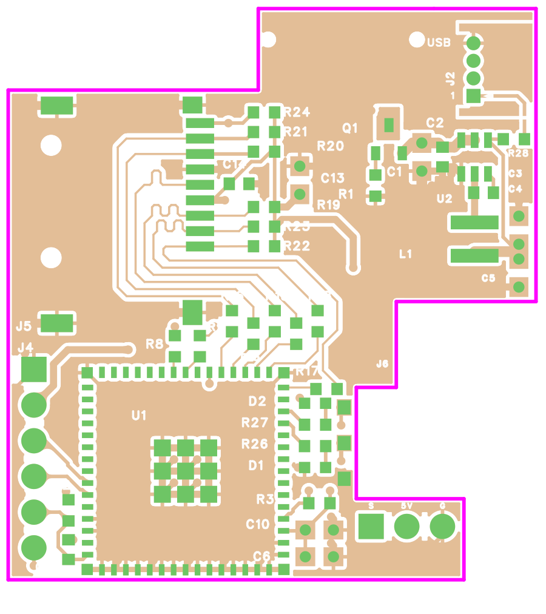
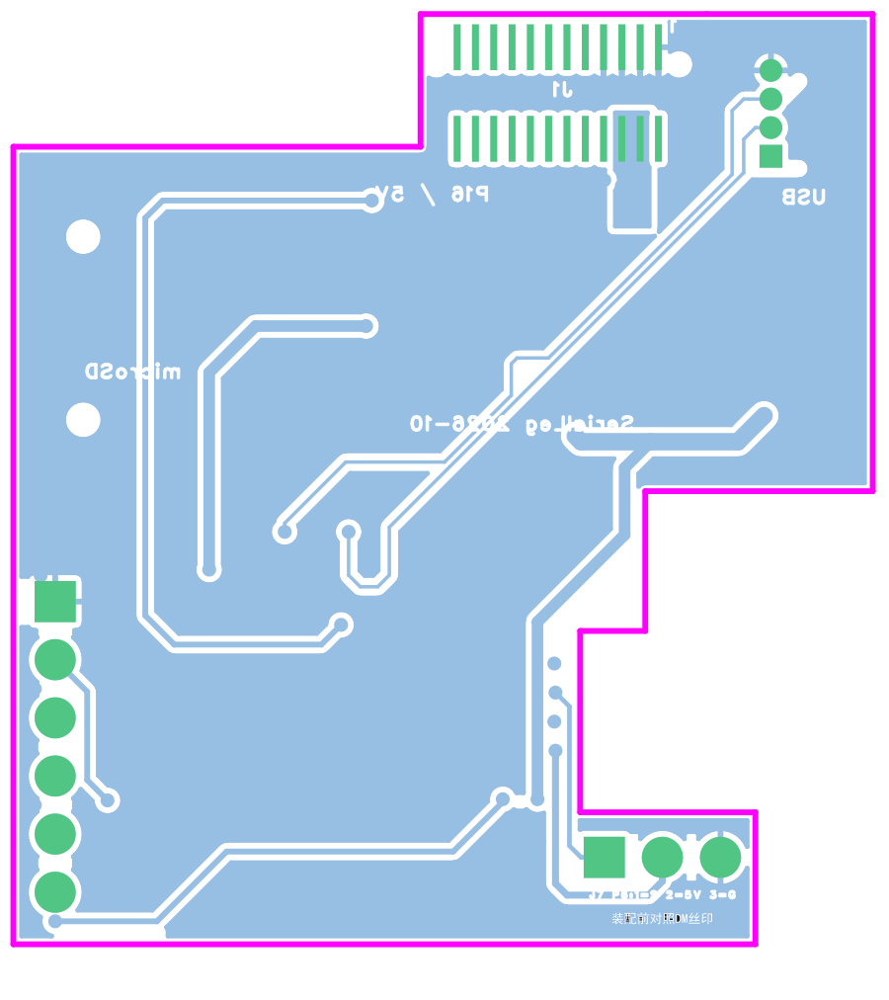

# v2 Gerber 导出与制造检查

> 本记录对应 v2b（含 J6）。同日的 v2c 取消了 J6、DBUS 改接 UART8，并重新导出、复查了 Gerber，见 [v2c 记录](../2026-10-29-v2c-uart8/README.md)。本文下面“投板前仍需完成”中关于 P6 与 J6 的条目已不适用。

日期：2026-10-29。软件：嘉立创 EDA 专业版 4.1.71.7a7261be。

源工程为分支 `codex/logger-v2` 上的**未提交**工作区，基于提交 `1cb5f2c`，内容与 [v2 改版记录](../2026-10-27-v2-changes/README.md) 中“走线与覆铜规范复查”之后的状态一致。数据见 [gerber-check.json](gerber-check.json)。

**这是检查用导出，不是生产发布。** 压缩包放在被 Git 忽略的 `outputs/2026-10-29-v2b-gerber/`，SHA-256 为 `5d1e0785…b3822d004`。正式投板前须先提交源工程，再从该提交重新导出，用投板标签对应。

## 导出设置

- 用编辑器 API `getGerberFile` 导出：单位 mm、4:5 格式；含金属化与非金属化钻孔、钻孔表；导出层与对象为默认（与编辑器“一键导出”相同）。
- 共 19 个文件：
  - 四层铜（GTL / G1 / G2 / GBL）；
  - 顶底阻焊、钢网、丝印、装配层；
  - 板框 GKO、文档层、钻孔图；
  - 3 个钻孔文件（PTH、PTH 过孔、NPTH）。

## 检查方法

用 Node 编写的检查脚本（[tools/gerber-check](../../../tools/gerber-check/)）直接解析导出的 Gerber 与 Excellon 文件：

- 支持 RS-274X 圆形/矩形光圈、RoundRect 宏、直线与圆弧、区域及极性。
- 以 0.01 mm 栅格栅格化，用欧氏距离变换量测间距。
- 判据：
  - 铜到板边 ≥ 0.2 mm；
  - 丝印到阻焊开窗 ≥ 0.15 mm（与工程 DFM 规则一致）；
  - 阻焊桥 ≥ 0.1 mm。

结果不依赖编辑器 DRC，但量测精度受栅格限制，约 ±0.01 mm。

## 结果（最终导出）

| 检查 | 结果 |
| --- | --- |
| 板框 | 13 段闭合，无断口；外接 37.567 × 40.650 mm，面积 1232.2 mm²，与设计一致；无内部挖空 |
| 铜到板边 | 顶层 0.260、L2 0.260、L3 0.260、底层 0.262 mm（最近处在缺口上墙右端附近）；四层均无板外铜 |
| 阻焊桥 | 顶、底面均无窄于 0.1 mm 的阻焊桥 |
| 丝印压开窗 | 顶、底面均为 0 |
| 丝印到开窗 | 顶面最小 0.13 mm；底面最小 0.38 mm。小于 0.15 mm 的只有 J2 封装自带丝印靠近 J2.1 通孔焊盘的一小段（约 0.13～0.14 mm）；板厂会把压在开窗上的丝印裁掉，影响很小，未修改 |
| 丝印出板 | 底面无；顶面只有 J2 封装前沿一条丝印线落在板边上（J2 前沿与板边平齐），板厂裁边时会去掉 |
| J6 焊盘 | 铜 1.067 × 1.168 mm，阻焊开窗 0.914 × 1.016 mm，阻焊压边生效。钢网开口与铜同尺寸，若 SMT 时让 J6 焊盘上锡，可作手焊预镀 |
| 钻孔 | PTH 101 个：0.3048 mm ×81 与 0.305 mm ×7（过孔，两种尺寸实际相同）、0.6 mm ×4（J2）、1.1 mm ×3（J7）、1.2 mm ×6（J4）。NPTH 4 个：0.65 mm ×2（J1 定位孔）、1.0 mm ×2（J5 定位孔）。孔壁到板边最小：PTH 0.788 mm，NPTH 0.375 mm（J1 定位孔，原设计未改）。无板外孔 |

## 检查中发现并已修复的问题

导出共做了 6 轮，前 5 轮的压缩包已移到回收站。

1. **C4/C5 丝印压焊盘**：两颗电容竖排、3V3 焊盘相对，各自封装的外框线压到对方的焊盘开窗上（顶面重叠 4350 像素）。按 C6/C10 的既有做法，把 C4、C5 的封装丝印映射到顶层装配层（器件属性 `layerIdReplacements: {3: 9}`）。
2. **J7 丝印出板**：直角排针封装把针脚和本体外形画在丝印层，大部分在凸台板边外。同样映射到装配层；S / 5V / G 及底面说明文字保留。
3. **底面“USB DATA”出板**：这是原 USB-A 时期的底面文字，已在新右边之外。改为“USB”，放在 J2 下方 (4180, −1120) mil，居中对齐。
4. **C1 丝印离 C2 焊盘 0.05 mm**：C1 在紧凑化时右移了 12 mil，导致外框贴近 C2。C1 封装丝印映射到装配层。
5. **L1 丝印离 C4/C5 焊盘 0.11 mm**：L1 外框右边贴近 C4/C5 的 3V3 焊盘。L1 封装丝印映射到装配层。
6. **C13 丝印离自身焊盘 0.11 mm**：原有库封装，未改动过的位置。同样映射到装配层。
7. **位号补回**：器件丝印映射到装配层后，属于器件的位号也随之移走（C6/C10 同理，早先用独立文字代替）。为 C1、C4、C5、L1、C13 补加独立丝印文字，位置和字高与原位号相同。

每轮修改后都重开工程，原生 DRC 均为 0 项。

## 渲染

由最终 Gerber 绘制；铜为半透明，绿色为阻焊开窗，白色为丝印，紫色为板框。

## 投板前仍需完成

- **P6 的 1 脚方向**：已于 2026-10-29 用达妙官方管脚标注图核对，GND 在 y −2101.5 一端（靠近凸台），与设计一致，见 [v2 改版记录](../2026-10-27-v2-changes/README.md) 文末“P6 针序核对”。
- **层叠**：按目标 JLC04161H-3313 或嘉立创标准四层下单；本板 USB 全速走线短，不要求阻抗控制。
- **提交与标签**：提交源工程，从该提交重新导出生产文件，打 `serialleg-logger/r<版本>` 标签；不要直接使用本目录的检查用导出。
- **备料与装配**：J6（Samtec BCS-103-L-S-TE）需另购，尾脚弯折装配建议先试一颗。托架需按新板形重做，右侧卡扣能否越过 DM P4 待确认。
- **底面版本文字**：仍为“SerialLeg 2026-10”，如需区分 v2，可改为带版本号的文字。
