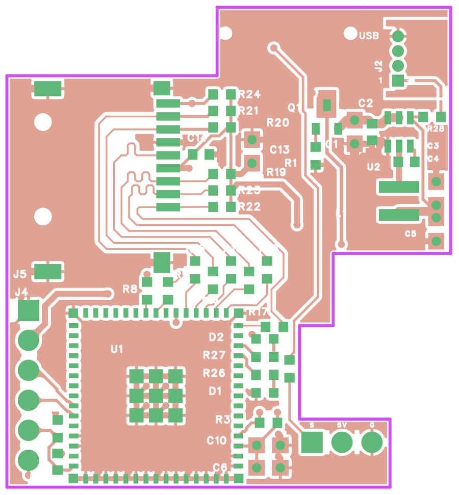
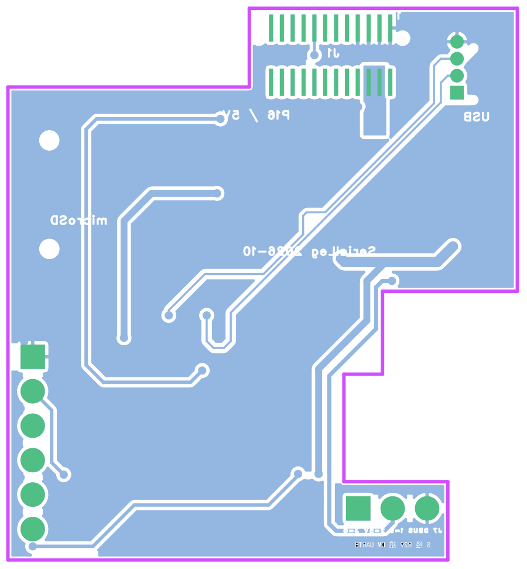

# v2c：DBUS 改接 DM UART8，取消 J6

日期：2026-10-29。软件：嘉立创 EDA 专业版 4.1.71.7a7261be。源工程为分支 `codex/logger-v2` 上的**未提交**工作区，基于提交 `1cb5f2c`，在 [v2b Gerber 检查](../2026-10-29-v2b-gerber-check/README.md) 之后修改。

> 后续：同日的 [v2e](../2026-10-29-v2e-dm-shape/README.md) 改为达妙扩展板外形并全板重布。本记录中的原理图修改仍有效，PCB 位置、走线、检查数据和 Gerber 已被取代。

## 起因

v2b 用 Samtec BCS-103-L-S-TE 排母从缺口倒插 DM P6，再把尾脚弯 90° 焊到日志板上。用户认为弯尾脚装配不可靠，这个料号在国内也很难买到，因此决定不再从 P6 取 DBUS，改为把接收机信号经 P16 送到 DM 的 UART8。

## 依据

依据达妙资料包 `CtrBoard-H7_V1.0-240124.pdf` 原理图的文字层：

- **P16**：15 脚为 `UART8_RX(PE00)`，经串联电阻 R97 接 MCU；17 脚为 `UART8_TX(PE01)`，经 R99。R97 的阻值没有从文字层读出，待确认。P16 左列 9～23 脚依次为 UART9_TX、UART9_RX、PE14、UART8_RX、UART8_TX、SPI3_MOSI、SPI3_MISO、SPI3_CLK。日志板 J1 的 15 脚原为 NC。
- **P6**：S 脚经 Q1 和 R19/R21 组成的反相级到 `UART5_RX(PD02)`，所以原来主控 UART5 按普通极性接收。
- **STM32H723 数据手册**：PE0 的复用功能里有 UART8_RX。PE0 引脚表中的 I/O 结构（是否 5 V 容忍）没能从 PDF 文字中提取出来，**未核对**。
- 管脚标注图上 PE0 只标了 UART8，没有标给 DCMI 等其他功能。主控固件里 UART8 是否被其他功能占用，需要在主控仓库确认。

## 原理图修改

- 删除 J6。原 DBUS_5V 网络取消，P6 不再与日志板有任何电气连接。
- 新增 R29：1 kΩ 0603，C21190，与 R28 同料。J7.1（DBUS_S）→ R29 → J1.15（UART8_RX）。R29 用于限流：信号不再经过 DM 的 Q1 反相级，而是直接进 PE0，PE0 的电平容忍又没核对。
- J7.2 改接本板 5V_IN（P16 对外 5 V），J7.3 仍为 GND。
- J1.15 取消不连接标记。
- DBUS 模块标题与说明改写：
  - DBUS 为反相 S.BUS 信号，这一路没有硬件反相；
  - 主控 UART8 要用 100000 波特率、8E2，并打开 RX 反相（HAL 为 `UART_ADVFEATURE_RXINVERT_INIT`）。
- 操作中遇到的工具问题：
  - 从系统库新建器件在本机一直不返回。库搜索正常，R28 记录的旧器件 ID `a6538729069088ba` 已查不到。R29 改为在文件中复制 R28 的记录生成：新 id、新 ticket，Unique ID 为 `gge76`。
  - API 删除文字后没有写入文件（与此前修改文字不落盘的问题相同）。在编辑器关闭时，把 5 条旧文字记录改成删除记录，格式与 J6 的删除记录一致。重开后核对旧文字已消失。

结果：ERC 0 错误，仅剩 v1 已有的 ATTRMATCHCODE 警告（U1、L1）。网表中 `UART8_RX` = J1-15、R29-1，`DBUS_S` = J7-1、R29-2，`5V_IN` 增加 J7-2。

## PCB 修改

所有线段和过孔都是逐段人工规划坐标后，用脚本落实的，没有使用自动布线或自动寻路。

- **R29**：顶层 (3725, −1990) mil，旋转 270°，1 脚朝上。放在原 J6 焊盘所在的窄带内，焊盘到缺口左墙约 16.5 mil（0.42 mm）。位号字高改为 30 mil，竖排放在 R29 下方。
- **删除 J6 遗留铜**：
  - DBUS_S、DBUS_5V 的全部走线（13 段）和过孔（4 个，含锚定过孔）；
  - 原 J6.3 接地短桩，以及 J6.3 → J7.3 的顶层地线（共 6 段）。J7.3 为通孔，直接接 L2/L3 地平面。
- **UART8_RX（8 mil）**：
  - J1.15（底层）先向下引出，在 J1 两排焊盘之间打过孔 (3672.8, −920)，然后转顶层；
  - 顶层斜下到 x 3770，从地过孔 (3740, −1120) 和 (3800, −1070) 之间穿过，两侧各约 14 mil；
  - 沿 x 3778 下行，经过 Q1、R1 左侧，再斜到 x 3820，越过底层 USB 差分对和底层 3V3 粗线；
  - 下行到 −1750 后斜到 x 3740，沿缺口左墙内侧接 R29.1。
- **DBUS_S（8 mil，顶层）**：R29.2 → (3725, −2160) → J7.1。
- **5V_IN（12 mil）**：
  - 顶层从 Q1.3 沿 x 3850 下行，穿过 R1 与 Q1.2 之间，斜到 x 3898，在 (3898, −1575) 打过孔转底层；
  - 底层穿过 3V3 粗线与板边之间的窄口，到 x 3852；斜到 x 3716，沿原 DBUS_5V 的路径经凸台下方接 J7.2。
- **底层 3V3**：为了给 5V 让出窄口，竖段由 x 3835 左移到 x 3825（其上端 45° 段同步调整，下方斜段的直线不变）。
- **覆铜禁布**：新线旁出现了窄于 8 mil 的覆铜碎条，按既有做法加了 5 个 `NO_POUR_SLIVER` 禁布区：
  - 底层：5V 线与缺口墙之间，以及 UART8 过孔旁各 1 个；
  - 顶层：DBUS_S 线左侧 2 个，UART8 线与 Q1 之间 1 个。
- **底面丝印**：
  - J7 说明改为“J7 DBUS 1=S 2=5V 3=G”“S 经 R29 接 DM UART8”。
  - 这两行原先的镜像属性是 true，与其他底面文字不一致。底层本身会自动镜像，两次镜像后在实物上会印成反字（v2b 已有此问题），现已改为 false。

| 检查 | 结果 |
| --- | --- |
| 原生 DRC | 0 项（重开工程、同步通道号、重建覆铜后） |
| 网表 | 原理图与 PCB 146 个引脚、35 个连接组一致 |
| 器件 / 走线段 / 过孔 | 42 / 353 / 86 |
| 覆铜 | 33 块填充均连到同网络焊盘或过孔，无悬浮铜 |
| 窄于 8 mil 的覆铜残余 | 四层合计 4 块，最大 55 mil²，与改版前相同 |
| 走线检查 | 无悬空端点、无锐角。直角、短段、线宽突变各项与改版前相同，都不在本次修改的线上 |

## Gerber 导出与检查

导出设置同 [v2b 检查](../2026-10-29-v2b-gerber-check/README.md)，检查脚本为 [tools/gerber-check](../../../tools/gerber-check/)，数据见 [gerber-check.json](gerber-check.json)。

导出文件为 `outputs/2026-10-29-v2c-gerber/SerialLegLogger-v2c-2026-10-29-r2.zip`，SHA-256 `e16eff8c…a9d95d`。这是检查用导出，不是生产发布。修正底面文字镜像之前的第一次导出已移到回收站。

| 检查 | 结果 |
| --- | --- |
| 板框 | 13 段闭合；37.567 × 40.650 mm，面积 1232.2 mm²，未变 |
| 铜到板边 | 顶层 0.260、L2 0.260、L3 0.260、底层 0.262 mm；四层均无板外铜 |
| 阻焊桥 | 顶、底面均无窄于 0.1 mm 的 |
| 丝印压开窗 | 顶、底面均为 0 |
| 丝印到开窗 | 顶面最小 0.13 mm，仍是 J2 封装自带丝印靠近 J2.1 的一段；底面 0.38 mm |
| 丝印出板 | 只有 J2 前沿丝印线落在板边上，与 v2b 相同 |
| 钻孔 | 过孔 86 个（0.3048 mm ×79、0.305 mm ×7）；元件孔 0.6 mm ×4（J2）、1.1 mm ×3（J7）、1.2 mm ×6（J4）；NPTH 4 个。PTH 孔壁到板边最小 0.61 mm（新 5V 过孔），NPTH 0.375 mm（J1 定位孔，原设计） |

检查脚本里的 J6 焊盘一项已无对象，结果为空。

[原理图](../../../images/schematic-v2c-2026-10-29.png)

## 影响与待办

- **主控固件**（不在本仓库）：遥控接收由 UART5 改到 UART8，参数为 100000、8E2、RX 反相，DMA 与中断按原 UART5 的写法改。
- **机械**：取消了 J6 这个第二支点，日志板只靠 J1 和托架卡扣固定。P6 缺口保留，只用于避让 P6 针尖；凸台和 J7 不变。
- **未核对**：
  - PE0 是否 5 V 容忍；
  - DR16 的 DBUS 输出电平；
  - R97 阻值；
  - 主控固件里 UART8 是否已被占用。
- 接收机 5 V 改由 P16 对外 5 V 供电，与日志板共用这一路。实际负载与温升待测。
