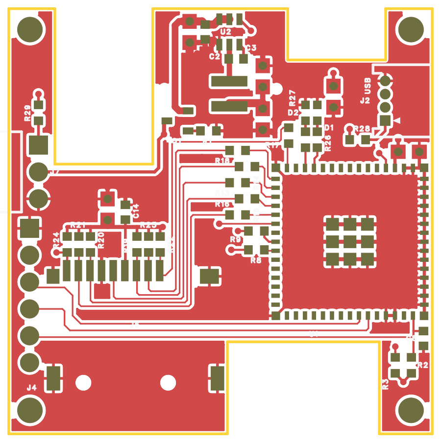
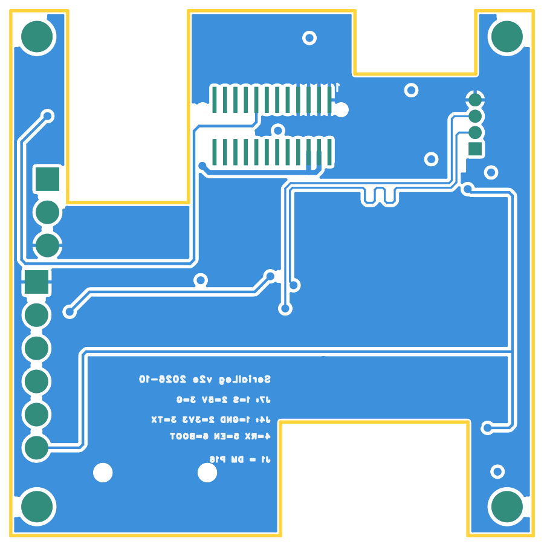

# v2e：改为达妙扩展板外形并全板重新布局布线

日期：2026-10-29。软件：嘉立创 EDA 专业版 4.1.71.7a7261be。源工程为分支 `codex/logger-v2` 上的**未提交**工作区，基于提交 `1cb5f2c`，在 [v2c 记录](../2026-10-29-v2c-uart8/README.md) 之后修改。电气连接与 v2c 相同（J7 由立式改为卧式直角排针 PZ254R-11-03P，网络不变）。

## 起因

v2c 的板子只靠 J1 插在 P16 上，另需托架卡扣；J7 放在底边凸台上，容易和 DM 上的插头干涉。用户参考现成的达妙扩展板（x--c IO 拓展板），要求日志板做成同样的外形：与 DM-MC02 同尺寸、四角 M2 孔、用缺口避让 DM 顶面的立式插座，"这样什么都不会挡住"。随后要求整板重新布局，J7 改卧式并放在 J4 旁，降压电路可重排，SD 线可绕到卡座下方。

## 外形与固定

DM 坐标与日志板坐标的换算：x_DM = 24.652 − (y + 920)·0.0254，y_DM = (x − 3720)·0.0254（mm / mil）。DM 板 56 × 40 mm，外形和插座位置取自达妙 STEP 的逐实例包围盒，见 [装配模拟](../../../images/dm-fit-sim-2026-10-29.svg) 与 [外形方案](../../../images/dm-shape-proposal-2026-10-29.svg)。

- 板框 16 点闭合，外接 40.0 × 40.2 mm，面积 1302.3 mm²（Gerber 量得；2026-10-30 扩大 N3 后）。右边 x 4507.4 与 DM 的 y_DM = +20 mm 板边对齐，左边 x 2932.6 对齐 y_DM = −20 mm。
- 三个缺口：
  - N1：x 3970–4334.2、y > −763.2，避让 UART7 立式座；
  - N2：x 3103.9–3468、y > −1151，避让 CAN3、UART10 立式座。比插座外形（到 y −980）多挖约 4.3 mm，给插头和线缆留空间；
  - N3：x 3745.6–4310.6、y < −1812.4，避让 PWM 排针与 P6。2026-10-30 复核后，朝 PWM 的上边和右边各外扩 0.5 mm（原为 x ≤ 4290.9、y < −1832.1），见下文“整机 3D 复核”。
- 四个 M2 孔：Ø2.4 mm NPTH，(3011.3, −650.2)、(4428.7, −650.2)、(3011.3, −2067.6)、(4428.7, −2067.6)，对应 DM 的 M2 孔。孔周约 Ø4.5 mm 内不放器件和过孔，给螺丝头和垫片留位。
- 本轮修正：前一稿的板框把左上角 M2 孔所在的角块误切掉了（孔落在板外）。已恢复该角块，四层覆铜同步改为新板框。
- 不再需要托架卡扣；J1 定位孔保留。

## 层叠变化

L3（内层 2）由 GND 改为 **3V3 整层平面**，L2 仍为整层 GND。改动原因：重排后 3V3 负载分散（U1、C6、C10、R28、R2、R3、J4.2、SD 上拉组、降压输出），顶底层已被 SD、USB、下载口和 DBUS 长线占满，用平面配电才能不绕线。各 3V3 负载就近打过孔到 L3。

- 顶层信号以 L2（GND）为参考；底层信号（USB、BOOT、SD_CD_N、UART8、5V_IN）以 L3（3V3）为参考，L3 经 C6、C10 和降压输出电容对地去耦。
- 叠层仍按 JLC04161H-3313 估计，**阻抗未经板厂确认**。

## 布局

| 区域 | 器件 |
| --- | --- |
| 左上角块（N2 左侧） | R29（3043, −960，竖放），UART8 过孔 |
| 左边 | J7 卧式（3043, −1180），针朝 −x 伸出板边，接收机杜邦头水平插；J4（3010, −1640），6 针竖排 |
| 左下 | J5 microSD（3403, −1748）；上方一排上拉 R24、R21、R20、R19、R23、R22 与 C13、C14 |
| 中上（J1 上方，顶层） | 降压 U2、L1、C1–C5 保持原拓扑整体平移；Q1、R1 在 J1 左侧 |
| 中间 | SD 串阻 R13–R18，USB 串阻 R8、R9 |
| 右侧 | U1（4201.4, −1440），天线朝 +x、伸出右边约 5 mm（模组本体 x 3900–4706），天线下方没有铜 |
| U1 上方 | D1、D2、R26、R27、C6、R28；C10 横放在 U1.3 正上方 |
| 右上 | J2 卧式 MX1.25（4332.4, −915），插口朝右板边 |
| 右下（N3 右侧） | R2、R3、C8 |

本轮为满足 0.3 mm（11.8 mil）焊盘到板框规则，U1 和 J5 各左移 2 mil。C10 原先竖放时压到 J2 外壳下方，现已改为横放；J2 上移 40 mil，C10 与 U1 模组边留约 10 mil。

2026-10-30 发现降压输出电容 C4、C5（均为 0805，上下对放）的 3V3 端焊盘重叠了 14.3 mil，连成一整块铜。因为同属 3V3 网络，DRC 不报，但回流时容易拉偏或立碑。这个问题沿用自原降压布局，已处理：

- C4 上移 40 mil 到 (3877, −824)，两颗电容的焊盘间隙现为 25.8 mil（0.65 mm）。
- C4.1 用 20 mil 线接回 3V3 主干；C4.2 的地过孔上移到 (3877, −725)。
- 新出现 1 处碎铜，已加禁布区。

随后扫描了全板不同器件之间的焊盘间距：没有其他重叠，最近为 9.1 mil，出现在上拉电阻排相邻的 0603 之间。

## 布线

没有使用自动布线或自动寻路。所有线段和过孔都是逐网规划坐标后，用脚本按坐标落实的；直角拐点补 45° 倒角。

- **SD（顶层 6 mil）**：MCU 侧从 U1 左排脚出线到 R13–R18；卡侧经 x 3540–3610 的竖向通道下行，在卡座下方横向走线，从焊盘下端进 J5。D2 改为从 J5.1 右侧进焊盘，以缩短长度。上拉从焊盘上端引出，3V3 横线在 y −1385。
- **USB（底层 6 mil，间距 8 mil）**：R8、R9 旁各打 1 个过孔，然后经 U1 上方走到 J2，从左侧进通孔脚。DM 在 U1 上方加两个蛇形补偿，两线长度为 1196.8 / 1196.7 mil。
- **下载口**：
  - PROG_TX、PROG_RX、EN 走顶层（6 mil），从 U1 下排脚向下，沿 U1 与 N3 之间的窄带向左，经 J5 下方进 J4.3–J4.5；
  - BOOT 在 U1.4 旁打过孔转底层，沿 U1 右侧下行，再经 U1 下方和 J5 下方从右侧进 J4.6，并在右下角打过孔接 R3。
- **UART8（8 mil）**：底层从 J1.15 引出，在 J1 两排焊盘之间向左，沿 N2 右墙下行，从 J7、J4 之间横穿，再沿左边上行，到左上角块打过孔接 R29.1。DBUS_S 为顶层 R29.2 → J7.1。
- **5V_IN**：
  - 底层由 J1.4、J1.6 引出（15 mil），经过孔到 Q1.3；
  - 顶层（12 mil）沿 N2 右墙下行，再横到 J7.2。
- **5V**：Q1.2 → C1.1，25 mil，从 J1 左侧上行。
- **地**：U1 模组内部打 6 个地过孔，用顶层地线连起中心散热焊盘、右排与四角地焊盘。全板 31 个缝合地过孔由脚本在空位按间距选点，避开焊盘、走线、M2 孔、板边和连接器本体。
- **覆铜**：四层重建后，用 119 个 `NO_POUR_SLIVER` 小禁布区去掉窄于 8 mil 的碎条，主要在 M2 孔与板边之间以及焊盘缝里。
- **接插件泪滴**：
  - 2026-10-30 曾用叠加短线的方式加过阶梯泪滴，用户认为形状不好，2026-11-04 已全部删除。
  - 随后用户在编辑器里用原生泪滴工具加了 9 个泪滴：J4.3～J4.6、J7.1、J7.2、J2.1～J2.3。
  - 复查时 J5.7、J5.8 上又出现了旧的阶梯段，宽度与原来一致，推测是撤销操作带回来的，已删除。删除后走线与加泪滴前逐段一致（292 段）。
  - 复查结果（2026-11-04）：
    - 重建覆铜后 DRC 0 项；
    - 由文件中的覆铜填充数据离线计算，泪滴到异网覆铜最小 14.1 mil、到异网焊盘最小 11.8 mil（PROG_TX 泪滴到 J5.10），没有重叠；
    - 四层无窄于 8 mil 的碎铜，19 块覆铜全部连通，网表一致，SD 与 USB 长度不变；
    - Gerber 顶层、底层中已含泪滴铜。
  - 没有加泪滴的接插件焊盘：J1.15（UART8，0.8 mm 间距的贴片板对板座）、J5 各信号脚（microSD 贴片座）。

SD 路径长度从 U1 焊盘到 J5 焊盘计，不含上拉支线：

| 信号 | MCU 段 | 卡侧 | 合计 | 相对 CLK |
| --- | --- | --- | --- | --- |
| CLK | 149.9 | 953.3 | 1103.2 | 0 |
| CMD | 148.5 | 933.8 | 1082.3 | −20.9 |
| D0 | 89.5 | 1042.7 | 1132.2 | +29.0 |
| D1 | 113.7 | 1018.9 | 1132.6 | +29.4 |
| D2 | 91.8 | 998.7 | 1090.5 | −12.7 |
| D3 | 210.0 | 887.6 | 1097.6 | −5.6 |

单位为 mil，均在 ±50 mil 目标内。

## 丝印

- 顶层位号全部重新摆放：用脚本选点，避开焊盘、过孔、孔、板边和其他器件本体，字高 32 mil、线宽 6 mil。U1 位号放在模组下方，J5 位号在卡座本体内，J4 位号在 J4 下方。
- 旧版本残留的独立文字（C10/C6/C1 等重复位号、旧 J7 的 S/5V/G、底面 USB、microSD 等）已删除。
- 底面新增说明：
  - `SerialLeg v2e 2026-10`
  - `J7: 1=S 2=5V 3=G`
  - `J4: 1=GND 2=3V3 3=TX` / `4=RX 5=EN 6=BOOT`
  - `J1 = DM P16`

  这些文字的镜像属性为 false，底层会自动镜像。Gerber 透视图中显示为反字，说明实物上从板底看是正字。
- 原理图：删除旧的"J7 立式排针放在 J1 与 J2 之间"说明，把 J7 说明改为"放在板左边 J4 上方"。API 修改原理图文字不落盘，因此两处都是在编辑器关闭时直接改文件记录，重开后核对。

## 检查

| 检查 | 结果 |
| --- | --- |
| 原生 DRC | 0 项（重开工程、同步通道号、四层覆铜重建后）；含 USB 差分对等长规则 |
| ERC | 0 错误，1 组 ATTRMATCHCODE 警告（U1、L1，v1 已有） |
| 网表 | 原理图与 PCB 146 个引脚、35 个连接组一致 |
| 器件 / 走线段 / 过孔 | 42 / 292 / 65（不含泪滴） |
| 覆铜 | 19 块填充均连到同网络焊盘或过孔，无悬浮铜；四层窄于 8 mil 的残余为 0 |
| 走线检查 | 无悬空端点。剩余直角都在焊盘内或 T 形接点处；锐角只有 R2/R3 的 3V3 过孔汇合处 1 处 |
| 器件干涉 | 用封装包围盒两两比对，重叠只出现在相邻阻容的丝印外框之间。C10 与 J2 外壳、U1 模组的干涉已消除 |
| 丝印 | 48 处文字均不压焊盘、过孔、孔，不出板，彼此不重叠 |

## Gerber 导出与检查

检查脚本为 [tools/gerber-check](../../../tools/gerber-check/)，数据见 [gerber-check.json](gerber-check.json)。

导出文件为 `outputs/2026-10-29-v2e-gerber/SerialLegLogger-v2e-2026-10-29.zip`（2026-11-04 用户加原生泪滴后重新导出），SHA-256 `bf04544a…2ba2a138`。这是检查用导出，不是生产发布。

| 检查 | 结果 |
| --- | --- |
| 板框 | 16 段闭合，40.000 × 40.201 mm，1302.3 mm² |
| 铜到板边 | 四层均 0.26 mm，无板外铜 |
| 阻焊桥 | 顶、底面均无窄于 0.1 mm 的 |
| 丝印压开窗 | 顶、底面均为 0 |
| 丝印到开窗 | 顶面最小 0.13 mm（J2 封装自带丝印靠近 J2.1），底面 0.38 mm |
| 丝印出板 | 顶面 8 块，都是封装自带丝印：J7 卧式针脚轮廓伸出左边，J2 外壳前沿压在右边线上。板厂会裁掉板外部分 |
| 钻孔 | 过孔 0.3048 mm ×65；元件孔 0.6 mm ×4（J2）、1.1 mm ×3（J7）、1.2 mm ×6（J4）；NPTH 2.4 mm ×4（M2）、1.0 mm ×2（J5）、0.65 mm ×2（J1）。PTH 孔壁到板边最小 0.467 mm（N3 右侧的缝合地过孔），NPTH 0.776 mm |

[原理图](../../../images/schematic-v2e-2026-10-29.png)

## 整机 3D 复核（2026-10-30）

用达妙 STEP 的逐实例包围盒与成品 v2e 的板框、焊盘逐项比对。日志板底面高度取 J1/P16 名义叠高 7.5 mm，板厚 1.6 mm。叠合图见 [dm-fit-v2e-2026-10-30.svg](../../../images/dm-fit-v2e-2026-10-30.svg)。

| 项目 | 结果 |
| --- | --- |
| 高于 7.5 mm、会穿过日志板高度的 DM 器件 | PWM 三排排针（8.54 mm）和 P6（8.0 mm）都在 N3 内；两只 XT30（8.93 mm）在板外 |
| PWM 排针到 N3 边 | 原为 0.49～0.53 mm，再算上 M2 孔约 ±0.2 mm 的间隙，舵机插头可能被板边卡住。**已把 N3 的上边和右边各外扩 0.5 mm**，现为 0.99～1.03 mm |
| P6 到 N3 边 | 0.48 mm。v2c 起 P6 不再插线，只有针体穿过；这一侧紧邻 J5 外壳焊盘，不再外扩 |
| XT30 到日志板顶边 | 0.5 mm，水平相邻但不重叠；XT30 插头从板外一侧插入，不经过日志板 |
| UART7、CAN3、UART10 立式座 | 座体高 4.06 mm，在日志板下方；座外形到缺口边 0.48～0.52 mm。插头在座体外形内，线缆可向缺口开口一侧弯出 |
| 日志板下方的其他 DM 器件 | 最高为 LCD、USART1 座 4.4 mm，到日志板底面余量 ≥ 3.1 mm |
| 日志板通孔针尾 | 按 J4、J7 伸出 3.0 mm、J2 伸出 1.5 mm 估算：J4 下方是 SWD 座和侧按键，余量 1.1～1.2 mm；J7 下方余量 3.6 mm；J2 下方是 DM Type-C，余量 2.8 mm |
| M2 孔 | 四孔换算到 DM 坐标为 (17.799, ±18.001)、(53.801, ±18.001)，与 STEP 中 DM 孔位 (17.8, ±18)、(53.8, ±18) 相差 ≤ 0.002 mm；孔径同为 2.4 mm |
| 伸出 DM 板边的部分 | J7 的针和接收机杜邦头在左边（y_DM < −20），下方没有 DM 器件，两侧按键在 3 mm 以外。U1 天线在右边（y_DM 20～25），正下方是 485、USART1 侧插座的插头和线缆，高差约 4 mm 以上。J2 插头在右边，正下方约 8 mm 处是插 DM Type-C 的同一根线 |
| microSD | 插卡口朝 DM 的 x_DM = 56 板边，高度约 9 mm 以上。该处 DM 只有 LCD 侧插座（4.4 mm），可以伸手插拔 |
| 被日志板盖住的 DM 器件 | 板载 LED（LED3 等）只能从侧面缝隙看到。两个侧按键、SWD、CAN1/2、485、USART1、LCD、Type-C 都是侧插或侧按，日志板底面离它们 ≥ 3.1 mm，不挡插拔 |

外扩 N3 后的配套修改：
- 3 个贴边的缝合地过孔右移，其中 1 个改到 (4335, −2020)，给 R3 位号腾位；
- R3 位号原先落在扩大的缺口内，改为竖放在 R3 左下；
- 顶层新出现 2 处碎铜，各加了 1 个禁布区。

改完后：DRC 0 项，网表一致；19 块覆铜全部连通，四层窄于 8 mil 的碎铜为 0；48 处丝印文字无冲突；Gerber 已重新导出并复查。

这次复核**没有**覆盖：
- 实际叠高和针尾长度；
- 舵机插头的真实外形（按与排针外形相近估计）；
- 机架、外壳和线缆走向；
- 器件真实 3D 外形（DM 一侧只用了包围盒）。

## 待确认

- **M2 支撑**：日志板底面距 DM 顶面按 J1/P16 名义叠高 7.5 mm 取值，铜柱长度需要按实物确认。如果实际叠高更低，J4 针尾到 SWD 座和按键的约 1.1 mm 余量会相应缩小，必要时把 J4 针尾剪短到 ≤ 2 mm。
- **伸出板边的部分**：J7 和接收机插头、U1 天线、J2 插头与机架和线缆是否冲突，需要整机确认。
- **N2 缺口**：比 CAN3/UART10 插座多挖了约 4.3 mm；插头带线弯折后是否够用，待实物确认。
- **PWM 舵机插头**：外扩后余量约 1.0 mm，仍以实插为准。
- **L3 改为 3V3 平面**：底层 USB 的参考面随之改变，阻抗按板厂叠层另行确认。
- v2c 中未核对的项目仍未核对：PE0 是否 5 V 容忍、DBUS 电平、R97 阻值、主控 UART8 是否被占用。
