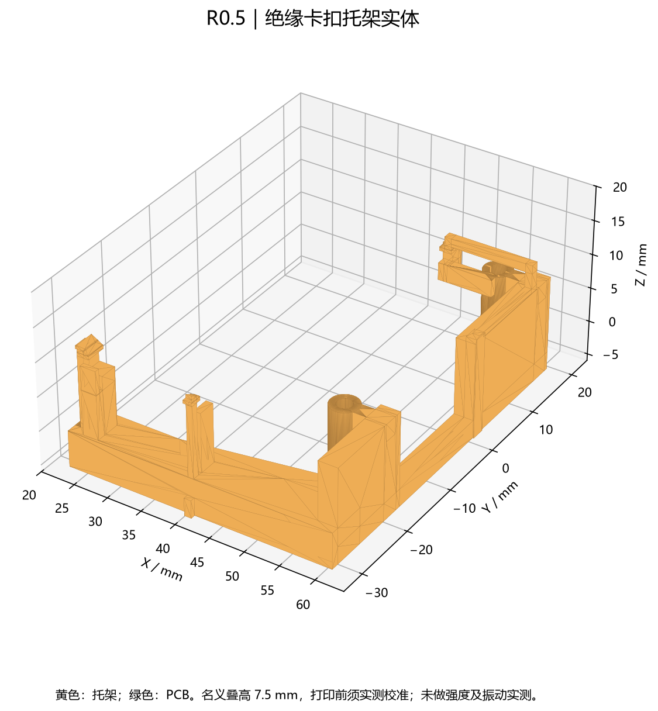
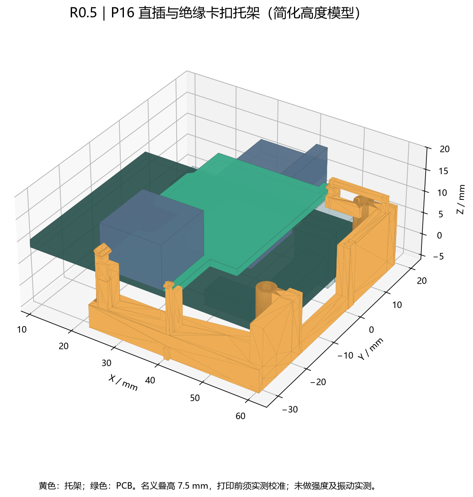

# R0.5 绝缘卡扣托架

> **2026-10-15：当前日志板已经重新布局并修改板框，本目录 R0.5/R0.6 托架 STEP/STL 不再与当前 PCB 匹配。** 后续须按[新布局接触区与板框](../../docs/reviews/2026-10-15-placement/README.md)重新适配；以下为历史试配记录。

R0.6 沿用此托架和板框。已按本轮新器件坐标重新检查，定义的接触面及操作通道无几何碰撞，见 [R0.6 检查记录](../../docs/reviews/2026-10-12-sd-r06/bracket-check.json)。以下试配限制仍适用。

用于 DM-MC02 上的 SerialLeg 日志板。日志板通过 P16 直插，托架在板边提供三个支撑面和三个卡扣，日志板自身没有安装螺钉。托架利用达妙右侧原有两个安装孔，与主控的固定结构连接。

**这是可编辑、可导出打印的试配设计，未完成实物装配、载荷、振动或卡扣寿命测试。** H40 公座准确采购型号及配合高度仍待实物确认，不能直接按名义尺寸下单装机。





## 文件与尺寸

- [STEP 实体](logger-clip-bracket.step)：一个有效实体，适合 CAD 修改。
- [STL 网格](logger-clip-bracket.stl)：单位 mm，闭合网格；用于打印试配。
- [参数](parameters.json)、[生成源代码](build_bracket.py)。
- [干涉与通道检查](../../docs/reviews/2026-10-12-clip-r05/bracket-check.json)、[STEP/STL 重读检查](../../docs/reviews/2026-10-12-clip-r05/cad-file-check.json)。

| 项目 | 名义尺寸 / 约定 |
| --- | --- |
| 日志板 PCB 外接矩形 | 26.924 × 46.736 mm，无两侧支臂和两个 Ø2.4 安装孔 |
| 托架自身外接尺寸 | 约 38.56 × 51.46 × 18.00 mm |
| 坐标 | 达妙 STEP 坐标；主控 PCB 顶面 Z=0 |
| 日志板底面 / 板厚 | Z=7.5 mm / 1.6 mm，配合高度须实测校准 |
| 卡扣与板顶面间隙 | 0.25 mm，设计值，不是制造公差保证 |
| 卡扣压边量 | 0.50 mm |
| 托架安装孔中心 | (53.80063, −18.00098)、(53.80063, 18.00098) mm |
| 托架螺钉孔 | M2 通孔，名义 Ø2.2；一孔沿 Y 加 0.4 mm 调节量 |
| 安装工具通道 | 螺钉轴线上方预留 Ø2.5 mm 直入通道；按实际工具确认 |
| 托架最低处 | Z=−6.4 mm；按所用 STEP，比主控底面低约 4.6 mm |
| 右侧外伸 | 最右 X=60.45 mm，超出主控 PCB 右边约 4.4 mm |

PCB 更小，不等于整套装配没有额外空间需求。机架必须容纳托架右侧和底部外伸；USB 插头及线缆还需另留空间。

## 固定与受力

USB 端两处托面承担插拔时的支撑，后部托面位于板边空白处。左侧卡扣扣住 USB 端左边缘，右侧卡扣改扣前边缘以避开 SWD，后扣使用外侧长弹臂。前后挡边限制板子纵向移动。结构目标是让外力通过 PCB 主体、托架和主控安装点传递，减少 P16 单独承载的情况；没有测得可承受的最大插拔力或冲击载荷。

为避开主控 LCD 插头和底面 FPC，右侧中段承力梁降到它们的出线通道下方；其余部分加厚并加入斜撑。不得删除这段避让后仍引用当前干涉结果。

原生 PCB 机械层标有六个接触面投影。它们是结构标注，**不是元件禁布规则通过的证明**：原生元件禁布按含焊脚的整体器件边界判断，无法直接表达插座前端无实体外壳的局部接触位置。本轮以实际封装本体、通孔焊脚包络和托架三维位置核对，并保留这一限制。

## 材料、打印与装配

目标材料为绝缘、非碳纤填充 PA12，优先按 SLS/MJF 试配；不要把普通 PLA 样件视为抗振定型件。该选择参考 [HP 的打印设计说明](https://www.hp.com/us-en/printers/3d-printers/learning-center/how-to-design-3d-print-model.html)和[卡扣设计说明](https://www.hp.com/us-en/printers/3d-printers/learning-center/3d-printed-joint-design.html)。材料批次、打印方向、含水状态和尺寸误差会影响弹臂性能。

程序按等截面悬臂小挠度公式估算卡扣变形，应变仅是筛查数据；未考虑全部根部应力集中、后扣横臂柔度及打印各向异性，也没有获得所用打印件的允许应变。不能用该估算替代强度或寿命试验。

1. 先测量实际 H40/H35 完全插合后的板间距和 PCB 厚度，修改参数、重建并重做干涉检查。高度不符时，不能拧螺钉或用卡扣把日志板压弯。
2. 断电，将托架放到达妙右侧，两个安装座对准原有安装孔。螺钉长度按托架安装座高度、主控厚度和实际机架螺纹啮合长度选择；本工程未代选机架和螺钉长度。
3. 日志板保持平行，对准 P16 下压插合。确认三个支撑面配合、卡扣越过板边、P16 插合到位，PCB 无预弯；不能仅凭卡扣声音判断连接器已经插好。
4. 装上实际 USB、SWD、UART、CAN、SBUS、PWM、LCD 和 FPC 线缆，核对锁扣、包胶、弯折和按键操作。检查 microSD 可向右完整取出。
5. 拆卸前先断电、拔掉 USB 线；左扣向 −X、右前扣向 −Y、后扣向 +X 释放。全部扣齿脱离后平行拔出 P16，必要时使用绝缘拨片辅助，不能单边撬起。

实际试配后记录插拔力、板弯、卡扣形变和重复拆装次数。运行前再按机器人实际振动及线缆载荷进行试验，发现松脱、发白、裂纹或接触不稳即重新设计。

## 检查范围

使用官方 STEP 的 293 个部件包围盒，结合日志板原生封装本体进行保守检查。日志板普通底面器件按 2 mm、L1 按 4.5 mm、通孔焊脚突出板底按 3 mm 假设；这些不是逐料号实测高度。J1 缺少准确 H40 模型，配合仍需单独确认。

竖插接口按裸插座外扩 0.5 mm 至 Z=40 mm 检查；侧插口按外扩 0.5 mm、向外 20 mm 检查；按键保留 6 mm 的工具操作通道；microSD 按卡座全宽向右 30 mm 检查。当前模型无碰撞，但这些假设不能覆盖任意插头包胶、手指空间和线束弯折。BOOT0 仍需拆下日志板维护，整机机架尚未建模。

## 重新生成

从 `boards/serialleg-logger/` 执行，需已有 OCP、Shapely 和 Matplotlib；本工程不会自动安装依赖：

```sh
python mechanical/clip-mount/build_bracket.py --geometry docs/reviews/2026-10-12-clip-r05/native-geometry.json --bodies docs/reviews/2026-10-12-clip-r05/body-check.json --damiao docs/reviews/2026-10-12-clip-r05/damiao-source.json --out outputs/clip-bracket-rebuild
```

检查生成报告中的碰撞、实体有效性、间隙和图像后再使用新模型。本轮使用 OCP 8.0.1.1、Shapely 2.1.2；所有尺寸均为模型尺寸，不是实测记录。
