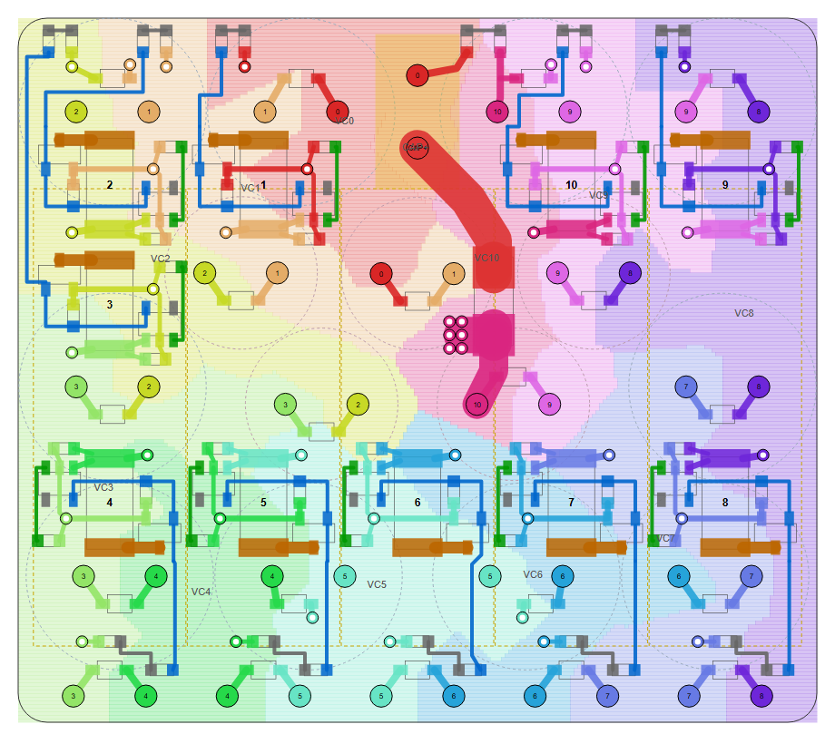
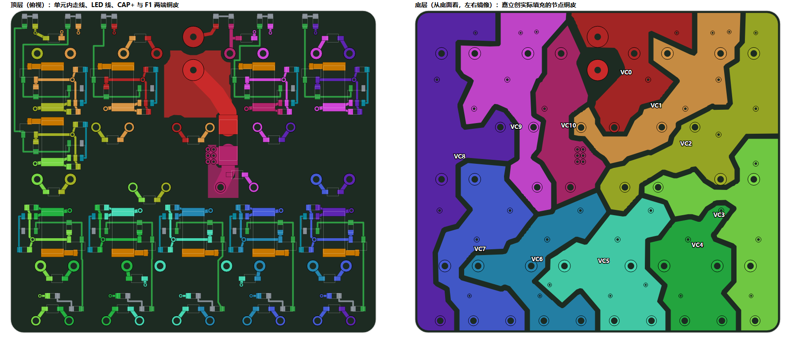
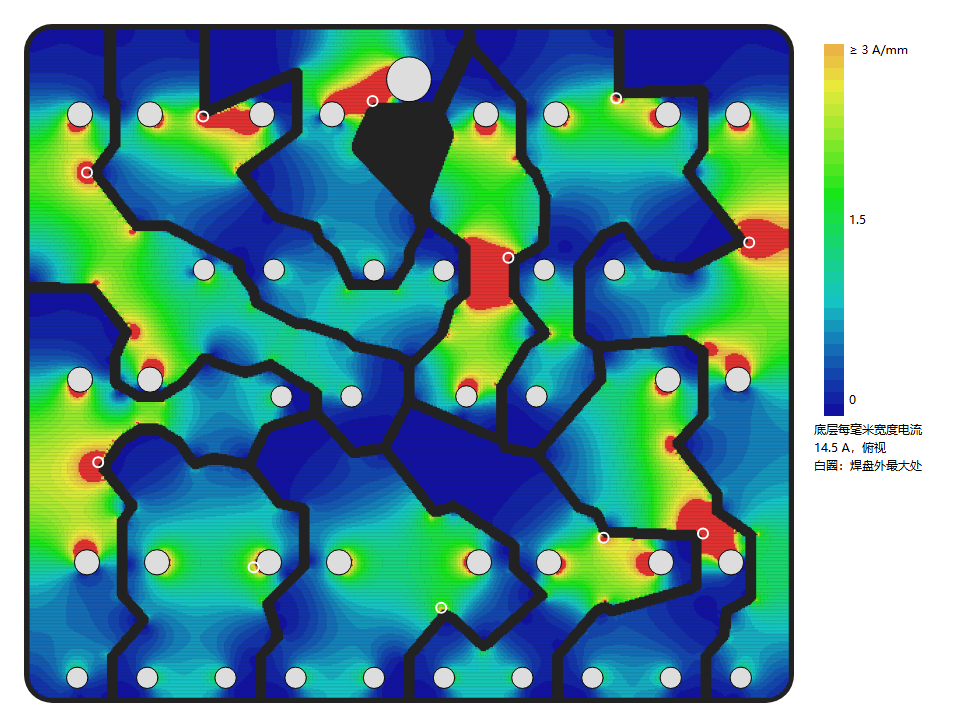
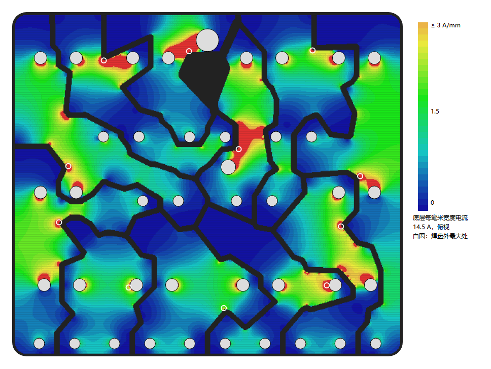
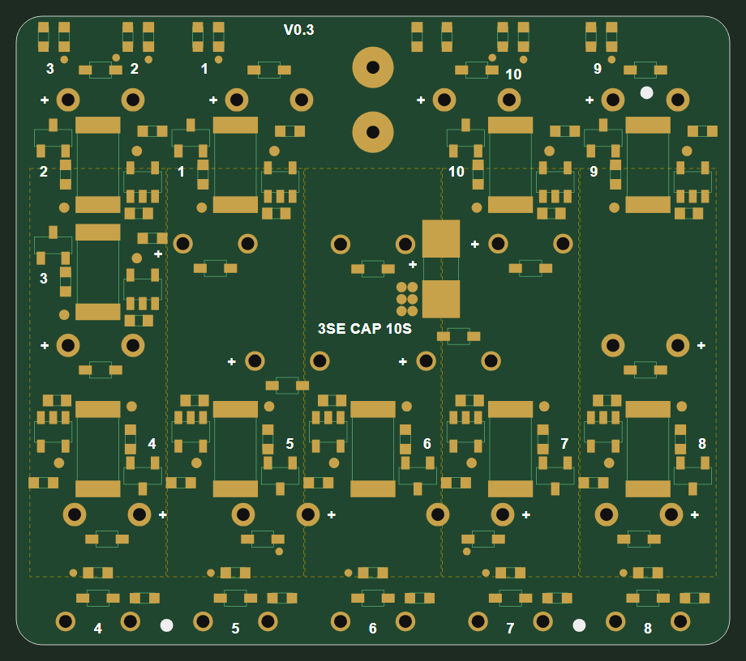

# V0.3 布局规划（H：下立上卧）

本文记录 V0.3 PCB 重排的依据和进度：板框、单体坐标、串联配对与顺序、卧放 10 F 封装、泄放电阻改动和控制单元排法。每串仍是 `Ck01` 34 F 并 `Ck02` 10 F，接在 VC(k−1) 与 VCk 之间；与 V0.2 相比，电路上只把每串的泄放电阻由两只 2 Ω 串联改为一只 6.8 Ω（见第 4 节）。截至 2026-10-28 器件已全部摆放，顶层走线与底层节点铜皮已完成（第 6 节），DRC 0 错误；丝印、载流核算和生产文件未做。

## 1. 安装约束与板框

- 安装位置：2027 两个装甲支撑架之间，内侧净宽 71 mm（RoboMaster 2027 机器人制作规范手册 V1.0.0，图 3-15）。装甲背面到支撑架背面的深度是按 1:2 图纸量的估计：顶部约 43 mm、底盘面约 67 mm，误差几毫米，需实测。
- 板框 55 × 48.5 mm。坐标：u 沿板宽（0～55），v 从前沿（装甲一侧）量起（0～48.5）。
- 前沿 v = 0～3.6 mm 为卧放单体的引脚带，板子下面不放单体。
- 高度约 62.7 mm（34 F 49 + 板 1.6 + 垫高 1.5 + 卧放 10 F 10.5）。按估计的支撑架深度，两侧各 8 mm，离装甲约 4.6 mm，前面超出支撑架底面 15 mm。
- 固定方式未定：先不打安装孔。

## 2. 单体位置与串联配对

单体尺寸按 Eaton 规格最大值：34 F（TV1245-3R0346-R）Ø12.9 × 49 mm，10 F（TV1030-3R0106-R）Ø10.5 × 31.5 mm，引脚距 5.0 mm。单体之间的最小间距 0.1 mm。15 只立放单体的两个引脚一律左右横排（焊盘在中心 ±2.5 mm 处，见第 5 节）。

| 串 | 节点 | 34 F 中心 (u, v) | 10 F | 10 F 中心或卧放引脚中点 | 两者距离 |
| --- | --- | --- | --- | --- | --- |
| 1 | VC0–VC1 | B2 (19.5, 42.05) | 下面立 | (27.5, 30.9) | 13.7 |
| 2 | VC1–VC2 | B1 (6.5, 42.05) | 下面立 | (15.35, 30.95) | 14.2 |
| 3 | VC2–VC3 | SL (6.5, 23.1) | 下面立 | (20.9, 21.9) | 14.5 |
| 4 | VC3–VC4 | F1 (7, 10.05) | 上面卧，第 1 只 | (6.3, 1.8) | 8.3 |
| 5 | VC4–VC5 | F2 (20, 10.05) | 上面卧，第 2 只 | (16.9, 1.8) | 8.8 |
| 6 | VC5–VC6 | F3 (35, 10.05) | 上面卧，第 3 只 | (27.5, 1.8) | 11.1 |
| 7 | VC6–VC7 | F4 (48, 10.05) | 上面卧，第 4 只 | (38.1, 1.8) | 12.9 |
| 8 | VC7–VC8 | SR (48.5, 23.1) | 上面卧，第 5 只 | (48.7, 1.8) | 21.3 |
| 9 | VC8–VC9 | B4 (48.5, 42.05) | 下面立 | (39.65, 30.95) | 14.2 |
| 10 | VC9–VC10 | B3 (35.5, 42.05) | 下面立 | (34.1, 21.9) | 20.2 |

- 串联顺序沿 34 F 一圈走：从后沿正中的 XT30（VC0）出发向左，经左侧到前排，从右侧回到后沿，VC10 回到 XT30。VC0 与 VC10 在 XT30 两侧相邻，压差约 29 V。
- 卧放的 5 只 10 F 是第 4～8 串，从左到右与前排顺序一致。每只的负极在左、正极在右，相邻两只的相邻引脚属于同一节点（VC4～VC7），可在前沿引脚带直接用铜皮连起来。
- 有两段较长的配对躲不开：
  - 前排只有 4 只 34 F，5 只卧放 10 F 中必有一只要配侧面的 34 F，最短约 21 mm（第 8 串）。
  - 中间前排两只立放 10 F 离前排 34 F 最近，但前排 34 F 已配给卧放单体，其中一只只能配后排 34 F，约 20 mm（第 10 串）。
- 配对用模拟退火（代价为各节点所连单体位置的最小生成树长度之和）与手工枚举对比确定；上表是两段长配对总长最短、且卧放单体节点在前沿连成一串的方案。

## 3. 卧放 10 F 的封装

- 焊盘与 V0.2 的立式封装 `CAP-TH_BD10.5-P5.00-D0.6-FD_TV1030-3R0106-R` 相同：孔径 0.914 mm、焊盘 Ø1.524 mm、两孔距 5.0 mm。
- 两孔沿 u 方向排在 v = 1.8 mm；单体轴线沿 v，本体占 v = 5.25～36.75 mm、宽 10.5 mm，作为丝印外形和禁布参考。
- 单体垫高 1.5 mm，轴线离顶面 6.75 mm。引脚从端面伸出约 2 mm 后 90° 折下，到孔中心约 3.45 mm。所需引脚长度约 2 + 6.75 + 1.6 + 1.5 ≈ 12 mm。TV 系列引脚长度这次没有从 Eaton 手册里查到（下载超时），要用实物或手册确认；Eaton B 系列同类图纸标的最短引脚为 20 mm，只作参考。
- 长脚为正极。封装上标出正极和本体外形，自建封装随板保存在本工程库里，只给第 4～8 串的 `Ck02` 用。

## 4. 泄放电阻改为每串一只

- 原设计每串两只 CRM2512-FX-2R00ELF（2 Ω、2 W）串联，单体 2.95 V 时泄放约 0.73 A、每串约 2.2 W。两只 2512 的单元在 H 布局的顶面排不成统一网格，所以改为每串一只：删去 `Rk05`，`Rk04` 改为风华 RPL-12L6R80FT（6.8 Ω ±1%、2 W、2512，立创 C5119988），一端接本串正端 VCk，另一端直接接 MOS 漏极 `Sk_DRN`（原 `Sk_B1` 网络取消）。
- 单体 2.95 V 时泄放约 0.43 A、每串约 1.3 W，为电阻额定功率的 64%。均衡电流比原设计小约 40%，满电附近均衡变慢；单体已挑片配组，平时静置在阈值以下不泄放，影响主要在首次充满和长时间满电时。泄放电阻在卧放单体正下方，顶面离单体外皮约 0.9 mm，温升需样板实测。
- 同为 6.8 Ω、2 W 的 2512 还有 FOJAN FRP2512J6R8 TS（C7468160）、FPS2512J6R8 TS（C55174722），均为 ±5%，可作替代；三者库存都没有核对。

## 5. 工程进度（2026-10-28）

软件：嘉立创 EDA 专业版 4.1.71，通过客户端 CLI（后台会话）和 API 修改；没有使用自动布局或自动布线。

- **卧放封装** `CAP-TH_L31.5-D10.5-P5.00_TV1030-H`（uuid `2303f9e554ae88a4`）：由 V0.2 的 10 F 封装复制，焊盘不变（焊盘 1 为正极），丝印改为本体矩形（距焊盘中心 3.45～34.95 mm、宽 10.5 mm，朝 -Y），“+”移到本体内正极一侧。这个半离线客户端的库接口（复制/新建封装）不可用，所以按官方格式直接改文件：在原理图和 PCB 文件里各插入这份封装文档，并为 `C402`、`C502`、`C602`、`C702`、`C802` 追加覆盖记录（PCB 的 `Footprint` 属性；原理图的 `Footprint` 属性和元件行的 `FootprintName`），文档头 ticket 同步为新的最大值。
- **坐标**：PCB 单位 mil，原点在板子左前角，x = u，y = v（前沿即装甲一侧在 y = 0）。
- **板框** 55 × 48.5 mm，四角 R2。
- **单体**：34 F 和立放 10 F 在底层，按第 2 节坐标摆放，引脚左右横排，正极朝串联下一串所在的左右方向（第 1 串的负极朝 XT30，第 10 串的正极朝 XT30），另有 3 只为让底层铜皮不交叉而反向（见下节）；卧放 10 F 在顶层、旋转 180°，正极在右。读回焊盘网络与第 2 节一致。最初摆放时引脚是沿串联方向斜放的，排控制单元时改为横排。
- **XT30**（J1）在顶层 (27.5, 42.05)，旋转 90°：CAP+ 针在 (27.5, 39.55)，VC0 针在 (27.5, 44.55)。2026-10-29 改为焊线孔，位置不变，见 6.10 节。
- **已删除**：V0.2 的全部走线、过孔、覆铜、规则区域、丝印文字，以及 4 个 M2 安装孔（固定方式未定，先不打孔）。3 个 Mark 点保留并移位，见下节。
- **ERC 例外**：原理图 ERC 有 1 条警告 `ATTRMATCHCODE`，原因是同一料号 C2620710 的 10 F 用了立式、卧式两种封装，属于预期内的例外。

### 控制组摆放（2026-10-28，模板 E2）

先后试过逐件约束搜索（能放下但每串排法都不同，较乱）、整块单元加宽到 61 mm（被否决）。参照港科大 RM2025 电容组（[论坛](https://bbs.robomaster.com/article/760959)、[KiCad 工程](https://github.com/hkustenterprize/RM2025-Super-Capacitor-Array)）定下做法：立放单体引脚全部左右横排，焊盘落在 y ≈ 10、22～23、31、42 四条横线上；y = 11.2～20.7 与 y = 32.1～40.9 两条横带空出来，排同一模板的控制单元。

图中底色是底层节点铜皮的粗分区（按大电流焊盘、单元过孔和下文的走廊点就近划分），只用来检查各节点能否连成一块，不是最终铜皮形状。

**单元模板 E2**（[单元走线示意](../images/v0.3-unit-routing-2026-10-28.png)，以第 5 串为例）：

- 2512 竖放，中心压在卧放单体轴线上（轴线两侧限高，只放 2512 和 0603）。上端为正极 VCk，下端为 DRN。
- BW6103 转 180° 放在左侧，VDD、GND、SEL 一排朝上，LED（报警，2026-10-29 起不接）、IOUT 朝下；AO3400A 在右下，漏极朝下，用 0.8 mm 线接 2512 下端。
- 正极件（2512 上端、VDD、`Ck03` 正端）集中在右上，汇到一个正极过孔；负极件（GND、MOS 源极、`Rk01`、`Rk02`、`Ck03` 负端）集中在左下，汇到一个负极过孔。两个过孔各接底层本节点铜皮。
- 栅极线从 BW6103 的 GATE 脚经 2512 本体下方（两焊盘之间）横穿到 MOS 栅极和 `Rk02`；MOS 源极的负极线也从 2512 本体下方回到左侧过孔。
- GATE 从右侧引出，朝本串黄灯走。V0.3 初稿另有一根 WARN 线从 `Rk01` 两焊盘之间穿出接红灯，2026-10-29 随红灯取消（6.8 节）。
- 单元外形 10.1 × 7.9 mm（不含引出线）。线宽：DRN 0.8 mm，正负极 0.3～0.5 mm，信号 0.25 mm。模板单独检查：不同网络间距 ≥ 0.2 mm，器件本体不重叠，6 个网络在单元内各自连通。

**排列**（单元中心即 2512 中心）：

| 位置 | 串 | 单元中心 | 朝向 | LED 组 |
| --- | --- | --- | --- | --- |
| 前排 | 4、5、6、7、8 | (6.3 / 16.9 / 27.5 / 38.1 / 48.7, 15.1) | 原样，引出线朝前 | 前沿，本串卧放单体那一列 |
| 后排 | 2、1 / 10、9 | (6.3 / 16.9 / 38.1 / 48.7, 37.03) | 转 180°，引出线朝后 | 后沿 |
| 左中 | 3 | (6.3, 28.76) | 转 180° | 后沿左角 |

- 前排 5 个单元各自正对本串的卧放单体和前沿 LED 组，两根 LED 线竖直下行约 7 mm；第 4、5、6、8 串的线在 34 F 焊盘旁有小折线或小平移。
- 后排第 1、10 串的 2512 正上方是后排 34 F 焊盘，单元只能放到 37.03，4 个后排单元都放在这个高度。初稿第 2、9 串曾放 37.17，给第 3 串的 WARN 线留走廊，取消红灯后对齐。
- 第 3 串夹在左侧中间，上下都是单元：
  - GATE 线从单元左侧直接出；
  - GATE 线沿左板边的顶层走廊（x = 0.6）上到后沿左角的黄灯。初稿 WARN 线也走这条走廊，取消红灯后删去。
  - 右侧中间对应的位置空着，只有 F1。
- **单体极性改动**：为让底层节点铜皮不交叉，以下 3 只立放单体反向（正极朝左）：
  - 第 3 串的 SL（34 F）和第 3 串的 10 F（20.9, 21.9），使 VC3 沿左板边连成一列；
  - 第 1 串的 10 F（27.5, 30.9），使它的 VC0 引脚离开 F1。VC0 与 CAP+、VC10 压差约 29 V，要求 ≥ 1.0 mm，原来只有 0.54 mm。

  其余单体仍按“正极朝串联下一串”。
- **LED**：
  - 前沿每组为 `Dk04`（卧放单体的肖特基）与 `Dk02`（黄灯），`Rk03` 在上方。
  - 后沿每组竖放 `Dk02`、`Rk03`。
  - 初稿每组另有红灯 `Dk01`，2026-10-29 取消。
  - 后沿左角为第 3 串，然后是第 2、1 串；XT30 右侧为电源灯 `R1`、`D1`；再右为第 10、9 串。
- **电源灯** `R1`、`D1` 从右后角挪到 XT30 右侧：
  - 位置 (30.9, 46.9)、(33.2, 46.9)，`D1` 转 180°；
  - 就近接 XT30 的 VC0 针和第 10 串 34 F 的 VC10 引脚；
  - 两者的 VC0、VC10 焊盘净距 > 1 mm。
- **肖特基**：`Dk03`（34 F）和立放 10 F 的 `Dk04` 横放在本单体两焊盘连线的上方或下方。
  - 前排 34 F 的放在下方 1.9 mm，第 5、6 串再左右错开 1 mm，让开 LED 线；
  - 后排 34 F 的放在上方 2.3 mm，给后排引出线留出横向走廊。
- **保险丝 F1**（2.7 mm 高）只能放在两列卧放单体之间的缝里，仍在 (32.75, 29)、竖放。
- **Mark 点**：(11.6, 1.5)、(43.4, 1.5)、(48.6, 42.6)，三点不对称（2026-10-29 整理丝印时，前面两个从 (6.1, 1.5)、(48.9, 1.5) 挪到前沿 LED 组之间，给第 4、8 串的 LED 串号让位）。
  - 移位后，Mark 焊盘边外到最近顶层铜 1.29 / 1.29 / 1.01 mm（要求 ≥ 1.0 mm）。
  - 原来的 (2, 46.4) 等位置已被 LED 线和第 3 串 LED 组占用。

**检查**（离线脚本）：
- **器件约束** 0 违规：通孔焊盘外净距 ≥ 0.4 mm（肖特基 ≥ 0.25 mm），器件之间 ≥ 0.3 mm，板边和圆角 ≥ 0.4 mm，卧放单体下按圆柱下沿限高。
  - 通孔焊盘按实际尺寸：34 F Ø1.801 mm，10 F Ø1.524 mm，XT30 Ø3.2 mm。
  - 第一轮检查曾把所有单体焊盘按 Ø1.524 算，第一次布线后 DRC 报出 7 处 LED 线离 34 F 焊盘过近，才改为实际尺寸，并按上表重排后排与第 3 串。
- **铜皮间距**：全部走线、过孔、焊盘都参与，不同网络 ≥ 0.2 mm，VC0 对 VC10/CAP+ ≥ 1.0 mm，0 处问题。

## 6. 布线（2026-10-28 已实施）

不使用自动布线、自动布局。每条走线的折点和每个过孔的位置都由脚本按规则写定（`route.js` 一类的规划脚本，在会话临时目录，未入库）。底层铜皮多边形按下节方法计算后，用客户端接口逐条创建；EDA 只负责填充覆铜和 DRC。

### 6.1 层的分工

**底层**：只有节点铜皮 VC0～VC10，承担单体之间的串联电流，底层没有走线。

- 分区：以大电流通孔焊盘、单元过孔、`Rk03` 与肖特基的过孔，以及人工给定的走廊点为种子，按最近归属划分，见[摆放与分区图](../images/v0.3-placement-zones-2026-10-28.png)。
- 收缩：每个节点向内收 0.31 mm，相邻节点间隙 ≥ 0.5 mm（含 0.06 mm 折线简化误差）。VC0 对 VC10、CAP+ 再多收 0.5 mm。
- 生成多边形：栅格（0.05 mm）追踪轮廓，再用 Douglas-Peucker 简化。
- CAP+ 在底层不铺铜。
- 几段按走廊画：
  - VC3 从第 3 串 10 F（18.4, 21.9）沿 y ≈ 20.6 向左，穿过 VC2 焊盘（9, 23.1）下方，到左板边；
  - VC1 从第 1 串 10 F 的右引脚（30, 30.9）在 y ≈ 29 从 VC0 引脚下方向左；
  - VC10 从 B3（33, 42.05）沿 x ≈ 32.8 下到第 10 串 10 F（31.6, 21.9）；
  - VC9 在 (38.8, 33.6)、(40.2, 35.8) 加了走廊点，否则收缩后会断成两块；
  - VC8 沿右板边从卧放单体（51.2, 1.8）上到 SR，并在 y ≈ 28.5 接第 9 串 10 F（42.15, 30.95）。

**顶层**：

- 单元内走线（模板 E2）；
- LED 引出线和 LED 组内连线；
- 肖特基到单体焊盘的连线（0.5 mm）；
- CAP+ 宽铜带：XT30 CAP+ 针到 F1，2.5 mm；
- F1 到第 10 串 10 F 的 VC10 引脚，2.0 mm；
- 电源灯连线。

顶层没有铺铜。卧放单体前沿的 10 个引脚只经底层铜皮按节点相连。

**过孔**：34 个（2026-10-29 为 F1 加 6 个后共 40 个，见 6.6 节）。

- 单元正、负极各一个 0.8/0.4 mm，共 20 个；
- `Rk03` 负端 10 个，0.6/0.3 mm；
- 被 LED 线隔开的肖特基端子 4 个，0.6/0.3 mm：`D203` 的 VC1 端、`D1003` 的 VC9 端、`D503` 与 `D603` 的 VC5 端。`D203` 的 VC2 端、`D1003` 的 VC10 端改接同网络的相邻走线或过孔。

### 6.2 单元模板

原模板的正负极引脚穿插：BW6103 的 VDD、GND、SEL 相邻，`Ck03`、`Rk01`、`Rk02` 正负交替，单元内的线必然交叉，栅极线要绕到单元外。底层按焊盘分区时，132 个贴片节点引脚中有 50 个落在别的节点区域。E2 改为正负极各占一边、各一个过孔，栅极线从 2512 下方横穿。

原计划在 MOS 漏极与 2512 下端之间做两层 DRN 铜岛。实施时只在顶层用 0.8 mm 线连接，底层整面留给节点铜皮；2512 的散热主要经其两端焊盘和正极过孔，温升待实测。

### 6.3 规则

板子沿用 V0.2 的 1 oz 两层 1.6 mm 板。EDA 规则配置“自定义配置2”未改动：线、焊盘、覆铜间距 0.152～0.254 mm，板边 0.3 mm；多层焊盘（单体、XT30）直连，单层焊盘十字连接。F1 两个焊盘用约束区域指定“焊盘直连”（6.9 节）。

更严的间距由脚本保证：

| 项目 | 值 | 依据 |
| --- | --- | --- |
| 相邻节点铜皮间隙 | ≥ 0.5 mm（实测填充最小 0.73 mm） | 相邻节点压差 ≤ 3 V |
| VC0 与 VC10、CAP+ 之间 | ≥ 1.0 mm（实测：VC0 填充到 VC10 填充 1.26 mm，到 CAP+ 针 1.52 mm；顶层由脚本按 1.0 mm 检查） | XT30 附近压差约 29 V |
| 信号线 / 间距 | 0.25 / 0.2 mm | 电流 ≤ 数 mA；嘉立创常规工艺 |
| 过孔 | 信号 0.6/0.3 mm，节点 0.8/0.4 mm | 同 V0.2 |

VC0 与 VC9 铜皮相邻处 0.8 mm（压差约 27 V）。IPC-2221 外层无涂覆 16～30 V 要求 0.1 mm，这里只记录，不另加规则。

### 6.4 实施与检查（2026-10-28）

软件：嘉立创 EDA 专业版 4.1.71，客户端 CLI 后台会话。工程：worktree `codex/supercap-bank-v0.3`，未提交。

1. **摆放**：按上表重摆 113 个贴片件，读回焊盘坐标与网络 0 处不符。
2. **创建图元**：323 段顶层走线、34 个过孔、11 块底层覆铜边框。
   - 覆铜多边形要首尾闭合（最后一点重复第一点），否则接口报参数错误。
   - 用 `rebuildCopperRegion` 填充，填充后保存。
3. **离线检查**（规划脚本，提交前的同一份数据）：
   - 器件约束 0；
   - 铜皮间距 0；
   - 顶层各网络连通：VC 网络的过孔与通孔经底层铜皮视为互连；
   - 11 块底层铜皮各自一块，所有通孔焊盘和过孔都在本节点铜皮内。
4. **DRC**（`pcb_Drc.check`）：0 条错误，含 0 条未连接。
5. **读回实际填充**：
   - 11 个节点各一块、无孤岛；
   - VC0 到 VC10 填充 1.26 mm，到 CAP+ 针焊盘边 1.52 mm；
   - VC10 填充到 XT30 VC0 针 1.80 mm；
   - 任意两节点填充最小距离 0.73 mm（VC3–VC4）。
6. **渲染**：上图（顶层按脚本数据画，底层按 EDA 实际填充画），以及 [EDA 画布截图](../images/v0.3-pcb-canvas-2026-10-28.png)。

**没做的检查**：

- 生产文件（Gerber、BOM、坐标）还没导出核对。

### 6.5 载流核算（2026-10-28）

**方法**：与 V0.2 相同，解二维直流电阻网络。

- 铜皮形状：用 EDA 读回的实际填充多边形，栅格 0.1 mm。
- 铜：1 oz，按 35 µm、20 °C 计，方块电阻 0.49 mΩ。
- 单体和 XT30 焊盘（连同引脚、焊锡）视为等电位。
- 电流分配：14.5 A 按容量分给 34 F 和 10 F，77% / 23%。VC10 的电流经顶层铜带从第 10 串 10 F 的 VC10 焊盘去 F1。
- 顶层两条主电流铜带按长宽直接算。
- 只算直流电阻和电流分布，没有做温升仿真；铜厚没有实测。
- 下文温升用 IPC-2221 外层导线公式粗估。它针对孤立导线，对大面积铜皮里的短颈部偏保守，只用来比较。
- 脚本在会话临时目录，未入库。

**结果（14.5 A）**：

| 节点 | 等效电阻 mΩ | 损耗 W | 每毫米宽度电流 中位 / 95% |
| --- | --- | --- | --- |
| VC0 | 0.57 | 0.12 | 0.59 / 3.2 |
| VC1 | 0.59 | 0.13 | 0.61 / 2.6 |
| VC2 | 1.28 | 0.27 | 1.22 / 2.6 |
| VC3 | 1.17 | 0.25 | 0.74 / 2.7 |
| VC4 | 0.32 | 0.07 | 0.69 / 1.6 |
| VC5 | 0.41 | 0.09 | 0.62 / 1.7 |
| VC6 | 0.48 | 0.10 | 0.20 / 2.6 |
| VC7 | 1.15 | 0.24 | 0.81 / 3.4 |
| VC8 | 1.47 | 0.31 | 0.76 / 2.9 |
| VC9 | 0.45 | 0.09 | 0.55 / 2.0 |
| VC10 | 1.37 | 0.29 | 1.92 / 4.1 |

- **损耗**：底层节点铜损合计 1.95 W。顶层 CAP+ 带（2.5 mm）1.54 mΩ、0.32 W，F1 到第 10 串 10 F 的带（2.0 mm）0.88 mΩ、0.18 W，全板约 2.45 W。持续 8.4 A 时约 0.82 W。V0.2 是 0.7 W / 0.23 W（两层都有节点铜皮），V0.3 约为它的 3.5 倍。
- **主要颈部**（截面上的法向电流积分）：

| 位置 | 铜宽 | 14.5 A 时穿过 | 平均 A/mm | 8.4 A 持续时温升（IPC-2221 粗估，1 oz / 2 oz） |
| --- | --- | --- | --- | --- |
| VC7，第 7 串 34 F 右引脚上方 y = 12.1 | 2.8 mm | 11.0 A | 3.9 | 17 / 5 °C |
| VC8，右板边 y = 32.9 | 3.0 mm | 11.3 A | 3.8 | 16 / 5 °C |
| VC10，F1 旁走廊 y = 31.8 | 2.9 mm | 11.3 A | 3.9 | 17 / 5 °C |
| VC3，左板边 y = 17.2 | 5.1 mm | 14.9 A | 2.9 | 12 / 4 °C |
| VC2，左板边 y = 37.9 | 4.2 mm | 11.2 A | 2.7 | 9 / 3 °C |
| VC1，x = 12.8 | 3.5 mm | 8.6 A | 2.5 | 7 / 2 °C |
| VC0，XT30 左侧 y = 43 | 4.1 mm | 7.7 A | 1.9 | 4 / 1 °C |
| 顶层 CAP+ 带 | 2.5 mm | 14.5 A | 5.8 | 38 / 12 °C |
| 顶层 F1 → 第 10 串 10 F | 2.0 mm | 14.5 A | 7.3 | 55 / 18 °C |

- **焊盘外的局部最大值** 5～10 A/mm，最大在 VC7 颈部（48.5, 12.1）约 10 A/mm。V0.2 最大约 7 A/mm。

**结论**：

- 顶层两条主电流铜带不合格：按 1 oz、持续 8.4 A 粗估温升 38～55 °C。
- F1 的 VC10 端没有过孔接底层。全部 14.5 A 先经 2 mm 带绕到第 10 串 10 F 的焊盘，其中 11 A 再沿底层走廊回到后排 34 F，从 F1 下面经过。
- 底层几处颈部持续 6.5 A 时约 16～17 °C。整体铜损约为 V0.2 的 3.5 倍，原因是只有底层一层节点铜皮，而且分区后有几段 3 mm 左右的颈部。
- 能改的方向：
  - CAP+ 和 F1 两端改为顶层大面积铜皮；
  - F1 的 VC10 端打一组过孔直通底层 VC10；
  - 在顶层空位（中间列、右侧中部、前排单元之间）给颈部加并联铜皮和缝合过孔；
  - 改用 2 oz 铜。

  2026-10-29 已按 1 oz 实施前三项（不改 2 oz），见 6.6 节。上表是改动前的结果。

### 6.6 加宽主电流路径（2026-10-29）

用户决定不改 2 oz，按 1 oz 改铜皮和过孔。

**改动**：

- **顶层 CAP+ 铜皮**：在 XT30 CAP+ 针与 F1 之间（x 23～33.4，y 32.3～42.6）铺顶层 CAP+，原 2.5 mm 带保留在铜皮内。
  - 铜皮多边形由脚本按栅格生成：离其他网络顶层铜 ≥ 0.36 mm，离 VC0 铜 ≥ 1.06 mm（29 V），离板边 ≥ 0.4 mm。
- **F1 的 VC10 端**：
  - 顶层铺一块 VC10 铜皮，连到第 10 串 10 F 的 VC10 引脚；
  - 旁边打 6 个 0.8/0.4 mm 过孔（x = 30.0 / 30.85，y = 25.75 / 26.67 / 27.6），直通底层 VC10。
  - 改动前全部 14.5 A 先绕到 10 F 焊盘再回到后排 34 F；现在 34 F 那 77% 直接经过孔下到底层走廊。
- **F1 两个焊盘**：各压一段 2.5 mm 宽短线（规则最大线宽 2.54 mm）。现行覆铜规则对贴片焊盘是十字连接，盖上同网络走线后铜皮与焊盘实连。
- **底层分区**：加了几个走廊点，放宽 VC10、VC8、VC7、VC3、VC2 的颈部。
  - 曾试过再把 VC10 往右推，结果 VC9 断开，已退回。

**实施与检查**：

- 写入：在用户打开的嘉立创窗口（CLI 会话）里重建 326 段走线、40 个过孔、13 块覆铜（底层 11、顶层 2），填充后保存。
- 离线检查：器件约束 0，铜皮间距 0，顶层连通 0 处未连，13 块铜皮各一块。
- DRC：0 错误、0 未连接。
  - 第一次 DRC 报 4 条线宽超限：盖焊盘的短线起初用了 2.9 mm，超过规则最大 2.54 mm，已改为 2.5 mm 重做。
- 读回实际填充：
  - 每个网络各一块有效铜皮；读回里还有几块面积为 0 的退化记录，已忽略。
  - 29 V 净距：底层 VC0 到 VC10 1.26 mm，顶层 CAP+ 填充到最近 VC0 铜 1.12 mm（第 1 串 10 F 的 VC0 引脚）。

**改后载流**（实际填充，14.5 A）：

| 项目 | 改前 | 改后 |
| --- | --- | --- |
| 底层节点铜损 | 1.95 W | 1.73 W |
| CAP+（顶层） | 2.5 mm 带，1.54 mΩ / 0.32 W | 铜皮，0.76 mΩ / 0.16 W |
| F1 → 底层 VC10 | 2.0 mm 带绕到 10 F，0.88 mΩ / 0.18 W | 6 个过孔约 0.18 mΩ / 0.04 W（单孔峰值 2.4 A、持续 1.4 A） |
| 全板铜损 14.5 A / 8.4 A | 2.45 / 0.82 W | 约 1.94 / 0.65 W（V0.2：0.7 / 0.23 W） |

| 颈部 | 改前铜宽 | 改后铜宽 | 14.5 A 时穿过 | 8.4 A 持续温升（IPC-2221 粗估） |
| --- | --- | --- | --- | --- |
| VC10 走廊 y = 31.8 | 2.9 mm | 3.4 mm | 11.2 A | 17 → 13 °C |
| VC7 颈部 y = 12.1 | 2.8 mm | 5.0 mm | 11.4 A | 17 → 7 °C |
| VC8 右板边 y = 32.9 | 3.0 mm | 6.1 mm | 11.0 A | 16 → 5 °C |
| VC3 左板边 y = 17.2 | 5.1 mm | 7.3 mm | 14.6 A | 12 → 7 °C |
| VC2 左板边 y = 37.9 | 4.2 mm | 7.1 mm | 11.2 A | 9 → 4 °C |
| VC1 x = 12.8 | 3.5 mm | 3.5 mm | 8.8 A | 7 °C |
| VC0 XT30 左侧 | 4.1 mm | 4.1 mm | 7.7 A | 4 °C |
| 顶层 CAP+ | 2.5 mm 带 | 大面积铜皮 | 14.5 A | 38 °C → 每毫米宽度电流中位 1.1 A/mm |

**仍要注意**：

- 最窄处仍是 F1 旁的 VC10 走廊（3.4 mm）。它夹在第 1 串 10 F 的 VC1 引脚与第 9 串 10 F 的 VC9 引脚之间，再放宽要动单体或 F1 的位置。
- F1 两个焊盘与铜皮的连接实际只靠 2.5 mm 盖线和十字辐条，焊盘边上的局部电流最高约 17 A/mm。要更稳妥，可以给 F1 加“焊盘直连”区域规则，像 V0.2 那样；这次没有改规则（2026-10-29 已加，见 6.9 节）。
- 全板铜损仍约为 V0.2 的 2.8 倍。原因是只有底层一层节点铜皮，顶层大部分被控制单元占用。
- 以上都是直流计算加 IPC-2221 粗估，没有做温升仿真，样板需实测。

### 6.7 丝印（2026-10-29）

图按规划数据绘制（2026-10-29 取消红灯后更新），文字位置已与 EDA 里的 37 条逐条核对。客户端截图接口在新开的窗口里不理会图层开关，所以没用截图。

做法沿用 V0.2：位号不印，丝印只留装配和使用时要看的标记。

- **位号**：134 个全部放到装配层（顶面 119、底面 15），居中于器件，字号 0.8 mm。原先有 10 个（换过的 `Rk04`）还在顶层丝印上。
- **顶层丝印文字**：37 条，字号 1.5 mm、线宽 0.18 mm，与 V0.2 相同；按 V0.2 在 Gerber 上的实测，印出字高约 1.05 mm。
  - **单元串号** 1～10：每个单元同一相对位置，前排在单元右侧，后排转 180° 后在左侧。它们在卧放单体下面，用于装卧放单体之前逐串测试。
  - **LED 组串号**：前沿 4～8 在各组下方的引脚带里，后沿 1、2、3、9、10 在各组下方，装好后看得见。
  - **立放单体正极** `+`：15 个，在顶面正极焊盘外侧，焊接时核对极性。其中第 3 串两只、第 1 串一只是反向的，见第 5 节。卧放单体的 `+` 在封装丝印里。
  - **板名与版本**：中间列 `3SE CAP 10S`（在卧放单体下面），后沿 XT30 左侧 `V0.3`（看得见）。
  - XT30 的 `+`/`-` 用封装自带的丝印，不另加。
- **排布方法**：位置由脚本搜索空位得到，未入库。规则：
  - 文字框离焊盘、过孔 ≥ 0.2 mm；
  - 离器件本体 ≥ 0.1 mm，贴片后不被盖住；
  - 离 Mark 点中心 ≥ 1.6 mm，离板边和圆角 ≥ 0.4 mm，文字之间 ≥ 0.3 mm；
  - 字宽按每字 0.95 mm 估算。

  读回 EDA 里的 37 条文字，与计划逐条一致。
- **检查**：DRC 0 错误、0 未连接，Mark 点到最近顶层铜在焊盘边外 1.29 / 1.29 / 1.01 mm。
- **没做的检查**：实际字高和文字与焊盘的间距没有在导出的 Gerber 上量，导出生产文件时核对。封装自带的外形丝印（例如卧放单体本体框压过 `Rk03` 焊盘）没有改，制板时焊盘上的丝印会被裁掉。

### 6.8 取消红灯与复查修正（2026-10-29）

**取消红灯 `Dk01`**：

- 原因：过充报警阈值 VWAR 2.98–3.12 V（典型 3.05 V，BW6103 规格书第 3 页）已到或超过单体额定 3.0 V；报警不锁存，也不通知控制板，亮了也来不及处理。黄灯（泄放指示）保留，阈值测试和平时观察都看黄灯。
- LED 脚处理：规格书第 2 页框图中，LED 脚是接 VDD 的 P 沟道 MOS 高边开关。不接负载时关断为高阻，导通时只被拉到 VDD，不影响 IOUT 泄放支路，因此悬空。规格书没有写不用时怎么处理，这一点是按框图判断的。
- **原理图**：删 10 只 `Dk01` 与 `Sk_WARN` 导线，BW6103 的 4 脚标非连接，说明文字改写。
  - LED 公共阴极导线删掉通往 `Dk01` 的那一截后，网络名一度变成自动名 `$1N…`。重新写入网络名后恢复为 `Sk_LEDK`：改成同名时客户端不会写入，要先改成别的名字再改回。
  - 删器件时传 ID 数组会静默失败，要传单个 ID 字符串。
  - 结果：124 个元件，53 个网络；ERC 只剩 `ATTRMATCHCODE`（同上）；与改动前逐引脚比对，只有 10 只 `Dk01` 删除、10 个 4 脚变为未接。
- **PCB**：
  - 从原理图导入变更后剩 124 个器件；
  - 删去 10 根 WARN 线，前后沿 LED 组改为 `Dk02` + `Rk03` 两件；
  - 第 3 串那条 0.2 mm 斜穿的 WARN 走廊取消，第 3 串回到本列 x = 6.3；
  - 后排 4 个单元对齐到同一高度 y = 37.03。

**复查修正**（对应上次复查的第 1～3 类）：

- **过孔离焊盘**：F1 的 6 个 VC10 过孔左移到 x = 29.7 / 30.55，孔环离 F1 焊盘由 0.05 mm 增到 ≥ 0.3 mm。后沿 `Rk03` 负端过孔下移到 y = 45.15，离焊盘由 0.15 mm 增到 0.3 mm。
- **锐角**：第 1 串 WARN 线的 43° 锐角随 WARN 线删除；`D1003` 的 VC10 连线改为水平接到 D1 的竖线。
- **线头碰边**：单元模板里 SEL 线起点、两条负极线终点一律伸到焊盘或过孔中心。模板 E3 单独检查：间距 0 处问题，各网络连通。
- **走线角度未改**：还有 110 段不是 45° 的倍数，其中 104 段是单元内和肖特基的节点连线，6 段是信号线。

**落图与检查**：

- 写入：重摆 103 个贴片件，焊盘坐标与网络 0 处不符；重建 279 段走线、40 个过孔、13 块覆铜，丝印 37 条。
- DRC：0 错误、0 未连接。
- 读回复查：
  - 走线与规划逐点一致；悬空线头 0 个；过孔离贴片焊盘 < 0.25 mm 的 0 处；锐角 0 处（焊盘内的不算）；
  - 顶层异网最小间距 0.205 mm；
  - 13 块覆铜各一块、无宽度 < 0.4 mm 的细颈。
- 29 V 净距：底层 VC0 到 VC10 1.26 mm，顶层 CAP+ 到 VC0 铜 1.12 mm。
- 载流（实际填充，14.5 A）：底层节点铜损 1.74 W，CAP+ 0.76 mΩ / 0.16 W，最窄的 VC10 走廊 3.4 mm、11.2 A，与 6.6 节相同。
- **关闭后重开工程复查**：
  - 重开的可见窗口对接口调用一直无响应，改用后台会话检查。
  - 原理图：124 个元件、53 个网络、无 `Dk01`、10 个 4 脚未接、LEDK 网络名正确，ERC 只剩 `ATTRMATCHCODE`。
  - PCB DRC 报 1 条“导入变更 / 网表不一致”。逐引脚比对原理图与 PCB 的 288 个引脚，网络 0 处不同，差异应在器件属性上，具体是哪一项没查出来。重新从原理图导入后：引脚坐标与网络 0 处变化，走线 276 段（客户端合并了共线段）、过孔 40 个，DRC 0 错误、0 未连接。
  - 之后重新打开可见窗口。

### 6.9 F1 焊盘直连（2026-10-29）

**原因**：

- 把 F1 一带的顶层、底层和 6 个过孔放在一起解直流（14.5 A，孔铜按 18 µm，过孔每个约 1.22 mΩ）。
- 过孔每个 1.3～1.7 A，底层走廊最窄 3.4 mm、11.2 A，都不是最紧处。
- 最紧的是 F1 两个贴片焊盘接铜皮的地方。贴片焊盘按现行规则是十字连接，实际只靠压在焊盘上的 2.5 mm 短线进出：VC10 端约 9.8 A 走这里，CAP+ 端 14.5 A 全部走这里。

**改动**：照 V0.2 的做法，在顶层建两块约束区域，覆铜规则都指定为已有的“焊盘直连”。规则配置“自定义配置2”本身没改。

| 区域 | 范围（mm） | 罩住 |
| --- | --- | --- |
| `直连-F1-VC10` | x 31.0～34.5，y 24.9～28.4 | 只有 F1 的 VC10 焊盘；左侧过孔孔环到 x 30.95 为止，不在区域内 |
| `直连-F1-CAP+` | x 31.0～34.5，y 29.6～33.1 | 只有 F1 的 CAP+ 焊盘 |

操作步骤：

1. 用 `pcb_PrimitiveRegion.create(1, 多边形, [9], 名称)` 建约束区域；
2. 用 `pcb_Drc.getRegionRules()` 读回，把这两项的 `Copper Zone` 设为 `焊盘直连`；
3. 用 `overwriteRegionRules` 写回。

存盘后与 V0.2 格式相同：`RULE_SELECTOR` 指向 `REGION`，`ruleOrder` 为 2。

**检查**：

- 重铺 13 块覆铜后 DRC 0 错误、0 未连接。底层 11 块铜皮面积不变。
- 焊盘外 0.1 mm 一圈被同网络铜皮覆盖的比例（改前四边都是 0）：
  - VC10 焊盘：朝 10 F、朝过孔、朝 CAP+ 焊盘三边全部覆盖；右边是铜皮外框，没有覆盖。顶层 VC10 铜皮面积 23.1 → 34.6 mm²。
  - CAP+ 焊盘：下边 68%、左边 15%，因为铜皮外框从 y 32.3、x ≤ 33.4 开始。原 2.5 mm 带仍压在焊盘上。
- 复制工程到临时目录，后台重开并重铺：两条区域规则仍在，DRC 0，焊盘覆盖比例与上面相同。

**改后载流**（14.5 A）：

| 位置 | 改前 | 改后 |
| --- | --- | --- |
| F1 的 VC10 焊盘出口 | 2.5 mm 短线，9.8 A，3.9 A/mm | 三边直连；朝过孔一侧铜宽 3.35 mm，9.8 A，平均 2.9 A/mm |
| F1 的 CAP+ 焊盘入口 | 2.5 mm 带，14.5 A，5.8 A/mm | 下边约 2.7 mm 加左边约 0.5 mm，平均约 4.5 A/mm |
| F1 到后排 34 F 的 VC10 节点 | 压降 21.7 mV，损耗 0.252 W | 21.5 mV，0.248 W |

焊盘边的局部电流密度降下来了，总损耗几乎不变：焊盘附近的扩散电阻本来就小。

**试算后没有采用**：把 CAP+ 铜皮外框扩到焊盘左上和右侧（x 28.8～35.2，y 29.5～33）。按规划多边形算，XT30 到 F1 的电阻从 0.611 降到 0.579 mΩ，焊盘边最大电流密度从 12.2 降到 9.8 A/mm，收益约 5%。这组数字把焊盘当作整块等电位，只用于两种方案之间比较。

**焊接**：F1 两端现在直接接大铜皮。回流焊没有问题；手工返修要用大功率烙铁或预热。

### 6.10 J1 改为焊线（2026-10-29）

**原因**：竖装 XT30 高 9.4 mm，插头还要从上方插拔，占后沿正中一块地方，看着也别扭。参考港科大 RM2025 电容组的做法，可以不装插座直接焊线引出。

**改动**：

- 在工程文件里复制 XT30 的封装和器件，各做一份新的：
  - 封装 `WIRE-TH_2P_P5.00_D2.2`：两个焊盘保持原样，孔 2.2 mm、焊盘 3.2 mm、间距 5 mm；去掉插座外框丝印，保留 `+`/`-` 标记。
  - 器件 `WIRE-PAD-2P-16AWG`：不带 3D 模型，不进 BOM，清空制造商、供应商编号和规格书。
- J1 改用新器件。位号、符号、网络、位置都不变：CAP+ 孔在 (27.5, 39.55)，VC0 孔在 (27.5, 44.55)，走线和铺铜都不用动。
- 线按 16AWG 硅胶线考虑，导体约 1.3 mm²，能装进 2.2 mm 孔；原来的 XT30 额定 15 A，16AWG 是与它常配的线径。14.5 A 峰值、8.4 A 持续下的线温升没有算，线长和另一端的插头按车上走线定。
- 嘉立创的库接口对工程库复制封装会报错，所以改用脚本直接改文件：先保存并关闭窗口，备份原文件，再给两份文件追加新封装、新器件和 J1 的覆盖记录，最后重新打开。

**检查**：

- 重新打开后，原理图和 PCB 里的 J1 都是新封装，不进 BOM，没有 3D 模型；两个焊盘的网络和坐标不变。
- 原理图 ERC 只剩原来那条 `ATTRMATCHCODE`（涉及 C402 等卧放 10 F，与改动前相同）。
- PCB 先报一条“导入变更 / 网表不一致”（J1 属性变了），从原理图导入后清除：124 个器件都没有移动，走线 276 段、过孔 40 个；重铺 13 块覆铜后 DRC 0 错误、0 未连接。
- 重新导出的 3D 模型里已经没有 XT30。

**装配注意**：

- 焊线前先剥线、上锡，从顶面插入孔中焊接。底面这两个孔正好落在后排两只 34 F 之间的缝里（孔所在高度缝宽约 4 mm），伸出底面的线头要剪平，不能碰到单体套管。
- 焊点在振动下容易疲劳，线根部要点胶，或者由外壳压住。
- 电容组和线束不能再拆开，换线要重新焊。

### 6.11 单体 3D 模型（2026-11-01）

**问题**：工程里的两种单体绑的是嘉立创的通用电解电容模型。34 F 只有约 Ø12 × 19 mm，立放 10 F 约 Ø10 × 11 mm，卧放的 10 F 也画成立着。在嘉立创 3D 视图和导出的 STEP 里，单体尺寸都不对。

**核对规格书**（Eaton Technical Data 10554）：

| 型号 | 本体最大值 | 引脚距 | 引脚直径 | 现有封装 |
| --- | --- | --- | --- | --- |
| TV1245-3R0346-R | Ø12.9 × 49 | 5 | 0.6 | 外形圈 Ø13.0，孔 1.1 / 焊盘 1.8 |
| TV1030-3R0106-R | Ø10.5 × 31.5 | 5 | 0.6 | 外形圈 Ø10.5，卧放 10.5 × 31.5，孔 0.914 / 焊盘 1.524 |

平面封装和焊盘与规格书一致，没有改。34 F 外形圈比最大值大 0.05 mm，影响可以忽略。

**改动**：

- 按规格书最大值自建三个模型，见 [hardware/3d-models](../hardware/3d-models/README.md)：34 F 立放、10 F 立放、10 F 卧放（垫高 1.5 mm，带弯脚）。
- 系统库里没有合适的现成模型：没有 TV1245 的模型，也没有 49 mm 高的 Ø13 圆柱；嘉立创的模型缩放只能等比放大。
- 离线客户端里，自建模型只能存在本机模型库 `文档/LCEDA-Pro/libraries/`，工程中记作 `文件名.step|libraries`。
- 绑定格式先由用户在界面里给 C401、C302 各绑一次，读出写法后再用脚本写入：
  - 两种器件（原理图、PCB 各一份）绑立放模型；
  - PCB 里 20 只单体实例逐个绑定，第 4～8 串的 `Ck02` 绑卧放模型。
- 嘉立创摆模型时，会把模型外包盒的中心对到封装原点，外包盒底面放在板面上。卧放模型因此要补偏移：Y 向 −17.325 mm，Z 向 −1.6 mm。
- 用户在界面里绑定时，沿用了旧模型的 Z 偏移（34 F −3.5 mm，10 F −5 mm），单体从板子另一面穿出一截。这次统一改为 0。

**检查**：

- 先在工程副本里试，导出 OBJ 量尺寸：
  - 34 F 在板底 z −1.6～−50.6；
  - 立放 10 F 在 −1.6～−33.1；
  - 卧放 10 F 本体 y 5.25～36.75、顶到板面以上 12.0 mm，引脚在 y 1.8 处穿板。
- 正式工程改完重新打开：整体外包 55 × 48.5 × 62.6 mm，和规格书算的一致。
- DRC 先报一条“导入变更 / 网表不一致”（器件属性变了），从原理图导入后清除：124 个器件都没有移动，卧放 5 只的绑定没有被冲掉；重铺 13 块覆铜后 DRC 0 错误。
- 改前的原理图和 PCB 文件备份在会话临时目录，没有进仓库。

**注意**：换电脑打开工程前，要先把三个模型复制到那台电脑的本机模型库，否则单体在 3D 里不显示。以后在界面里改这几只的 3D 模型，要按 `hardware/3d-models/README.md` 的表核对偏移。

## 7. 装配顺序与待确认

1. 贴片件 → 立放单体（顶面焊）→ 逐串测泄放阈值（预留测试点）→ 装卧放 10 F（垫高或垫绝缘膜，引脚在底面焊）。
2. 待确认：TV1030 引脚长度；泄放电阻在卧放单体正下方的温升（每串约 1.3 W）；换 BW6103 需先拆卧放单体；固定方式。设计说明 `design.md` 已在 2026-11-01 按每串一只 6.8 Ω 更新。生产文件核对见 [2026-11-01 检查记录](reviews/2026-11-01-v0.3-mfg-check/README.md)。
