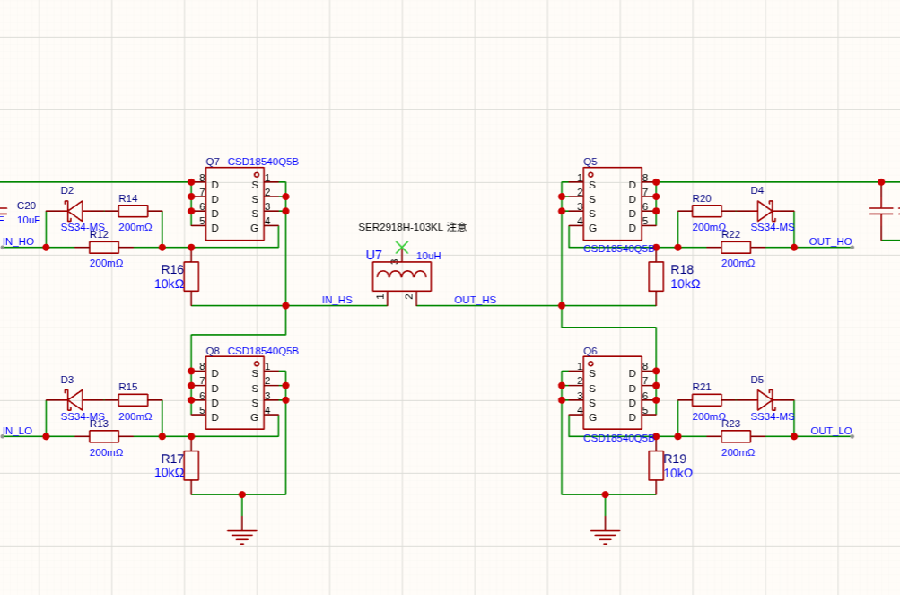
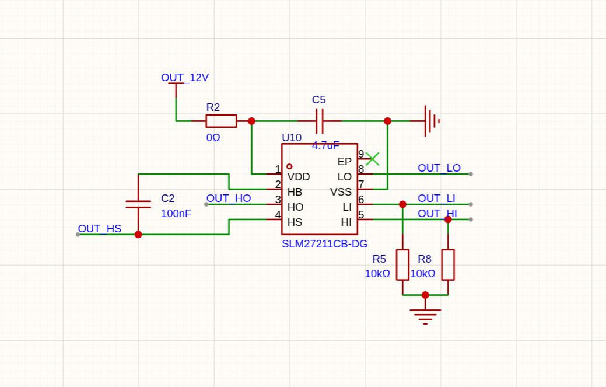
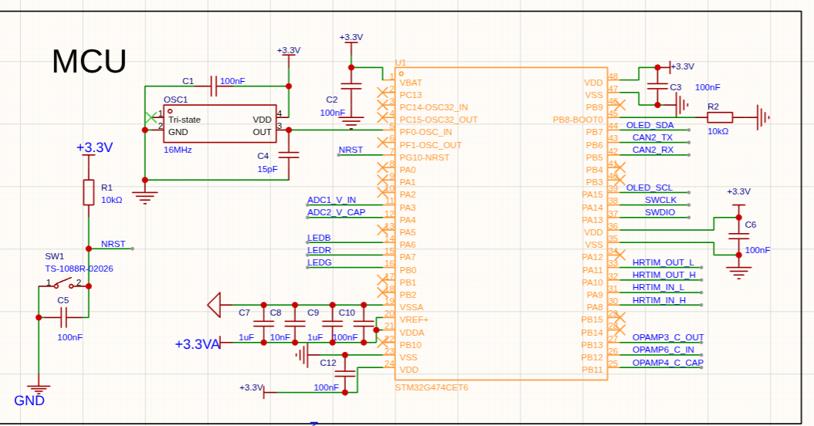
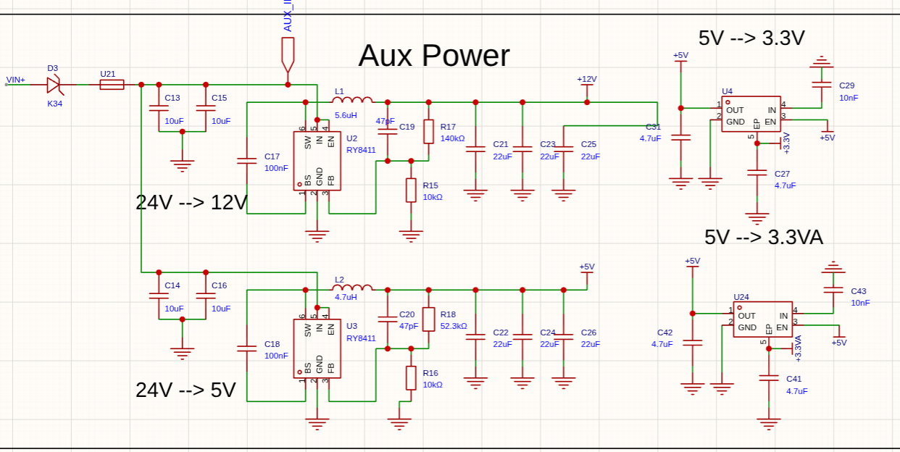
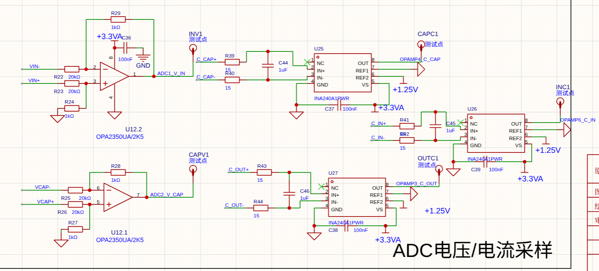

# 超级电容控制结构速览

## 要做的事

把**输入功率**（电池出力）稳在裁判系统给的上限附近：底盘用得少就给电容充电，用得多就让电容放电。手段只有一个——**控制电容电流**。

## 功率电路



这是主要的驱动电路拓扑：电感两侧各一个半桥，四个管子轮流开关，就能完成升压或降压。

```text
电容电压 / 输入电压 = 输入侧上管占空比 / 电容侧上管占空比
```

这个比值就是代码里的**变比**：小于 1 是降压，大于 1 是升压，等于 1 时两侧电压相同。控制器算出变比，再按这个公式反推两个半桥各自的占空比。



每个半桥配一颗半桥驱动器，把 MCU 的小信号 PWM 变成能灌进管子栅极的大电流；上管靠自举电容供电，所以占空比不能拉满，必须留一点时间让下管导通给自举电容充电。

## 板上其他电路



主控是 STM32G474，外置 16 MHz 晶振，HRTIM 出四路 PWM 驱动信号，另外接 CAN、OLED 和调试口。



24 V 母线先降成 12 V（给栅极驱动）和 5 V，再分别转成数字 3.3 V 和模拟 3.3 V。



两路电压用差分运放采，三路电流用电流放大器采，都经过 MCU 内部运放进 ADC，每路都留了测试点。

## 串级结构

```text
功率上限 ──► 外环（功率）──► 电容目标电流 ──► 内环（电流）──► 变比 ──► PWM
              反馈：输入功率                    反馈：电容电流
              前馈：上限 − 底盘功率              前馈：电容电压 ÷ 输入电压
```

- **外环（PI）**：输入功率高于上限就少充多放，低于上限就多充少放，输出"电容该充放多少电流"。
- **内环（PI）**：让实际电容电流跟上这个目标，输出变比（电容侧与输入侧的电压比），再换算成两个半桥的占空比。
- 外环慢、内环快，差一个数量级，两环才不会互相干扰。

## 两处前馈

前馈就是"先按算得出来的部分直接给，PID 只补差值"。

- **外环前馈**：由能量守恒，电容该吸收的功率 = 功率上限 − 底盘功率。底盘一动就立刻响应，不用等功率误差出现。
- **内环前馈**：变比等于"电容电压 ÷ 输入电压"时电感电流恰好为零。电容电压从空到满变化很大，这个工作点由前馈直接给出，PID 只输出很小的修正量。

没有前馈，PID 的积分就得独自扛住整个工作点，电压一变就是大误差；有了前馈，重新开输出时也能从零电流平稳起步。

## 第三个环：过压兜底

一个纯比例环盯着电容电压，超过阈值就把变比压下去。它和电流环**取较小值**：平时不起作用，只有电压异常冲高（比如没接外部电容）时才接管。纯 P 没有积分，不会在平时偷偷累积。

## 环与环之间的保护

- **限幅**：电容目标电流要按电容电压高低限制充放电大小；变比也有上下限。
- **限速**：目标电流和变比每个周期最多变一点，防止阶跃引起电流冲击。
- **积分保护**：命令被限幅卡住时，外环只冻结"往限幅方向推"的积分；内环则把实际输出反推回 PID 内部，解除限制时不会跳变。
- 无微分项：电流、功率信号噪声大，微分只会放大噪声。

## 源码位置

- 控制主流程、两处前馈、限幅限速：`USER/Src/power_calculation.c` 的 `control_calc()`
- 通用 PID 库：`USER/Src/PID.c`，注意调用是 `PID_calc(对象, 反馈, 目标)`，**先反馈后目标**
- 具体参数：`USER/Inc/power_calculation.h`
